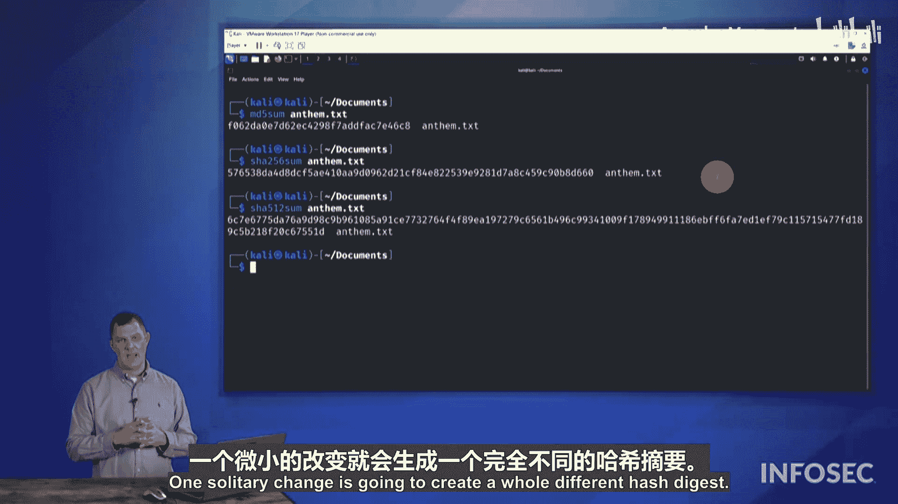

# 【Infosec】CompTIA安全 701认证 ｜ CompTIA Security+ 701 p08 02_01_03_hashing-demo -BV1LRr5BTEow_p8-

Hashing is a key component of cryptography。Hashing is a way that we can detect if there have been any changes to a file or it's a way to safeguard passwords。

Hashing is made up of hashing algorithms or it's centered around hashing algorithms。

And the algorithm is a one way street， we can take information in the form of some plain text。

 and then we run it through a hashing algorithm and we end up with an output known as a digest。

A digestig is a random or seemingly random collection of letters and numbers。

 it's a continuous string of seemingly random letters and numbers。

The output of the hashing algorithm is unique to the input that it was provided with。

So if I take some information， a digital file of some sort， and we run through a hashing algorithm。

 we'll end up with the hash digestigest， I can take any input and find a output that is unique to that hash input。

because this is a one way street， meaning I can take some kind of data。

 let's say like a copy of the movie Forest Gump， and we run it through the hashing algorithm。

 we're going to end up with a unique string of letters and numbers。Unique to that particular file。

If there' is any editing done on that movie， it will change the output。

If I take some kind of input like a PDF copy of Moby Dickick。

 and I run that through the hashing algorithm， I end up with a unique string of letters and numbers that is completely and wholly different than all other files that goes into it。

If I have two inputs。And they yield the same output， this is known as a collision。

The moment that we determined that a hashing algorithm can generate collisions or is capable of generating collisions。

Then that is said to be a broken hashing algorithm， it's then deprecated or somewhat retired。

 we no longer use that， and then that prevents others from creating those kind of collisions The reason we would want to avoid collisions is because if I have a piece of software。

And I want to detect， has there been any inclusions made since the vendor that made that software？

You know， finalize their design when we run through a hashing algorithm。

 I will get the same output every single time。If some malware authors slip some malware into that executable。

And I run it through a hashing algorithm， and I get the same output as if it was the original file。

Oh， that's going to be a problem because now I can't determine is this executable infected with malware or not。

 it has the same hashing output I would want to use a more cryptographically secure hashing algorithm that does not generate hashes。

Does that generate collisions？So these different types of hashing algorithms we can use。

 there is MD5， Sha 256， and Shaw 512。MD5 has been around for a long， long time。It has the drawback。

That it can generate collisions， and we've known this since sometime around the mid90s。

Yet we continue to use it on a somewhat pedestrian level because， well。

 it's good enough in most circumstances， if there's a question about security at all。

 you would then abandon MD5 and use the more cryptographically secure Shaw to HG6。The hash。Output。

 the digest of these different hash algorithms grows larger and larger and larger。

Let's go over and look at a live demo of what these hashing algorithms look like whenever they're in operation。

So on this virtual machine I'm running CallI Linux it is not important that you become a Linux master in order to succeed on the security plus exam I'm just using this because it is quite easy to generate different hash digests on CallI Linux so let's take a look if I go into this documents directory I have a collection of different files。

Available in this directory。These different text files。

 it's not really important to the content that we have， but if I go into look at one of these。

 I can view the national anthem， you know the star Spanglele banner by Sir Francis Scott Key。

 and so we've got the national anthem on here。Oh so， can you see by the darns early light？

If I run this through a hashing algorithm again， you don't have to know the exam on the exam。

 you don't have to know the command， but I'm just going to kind of show you what it looks like on here if I run this through the MD5 sum command that's what we do on the Linux command line。

MD5 sum and we hash this and we see the output is foxtrot 062 delta alpha yada yada yada and then kind of over here at the end I usually look at the tail end of this I usually look at the first four or five characters in the last four or five characters Echo4 six Charlie8 so we've got this。

MD5 digest， this is the output of this hashing algorithm。

Now what happens if we were to dive in and change one solitary character on the national anthem well。

 we could go in and we can say like， you know， if you wanted to be that person。

 you could say like the star Spangled banner， you'd be like。

 well you know technically it's a hyphen that's supposed to be there because the star Spangled banner and so you if you want to be that person you could do that but if you make that change on this file。

And I go in and I run that hashing algorithm again。Did we fundamentally change？

The message of the national anthem we certainly did not。

 but you can see here that we actually ended up with a completely and totally different hash digest for the national anthem。

 we changed one character， we added in a hyphen。And it completely changed the whole。Hash digest。

If I go back and I take that back， I'm like， okay， I made a mistake。

 I didn't mean to change it that way， I didn't know I was going to mess up all this other stuff。

We put it back the way we found it。If I run this hashing algorithm again。

 you can see that it put us back to the original state， we go back to having Fox 062 back over here。

Notice that we're not able to determine that there has been a change in the interim。

 we we were not able to detect that there had been a change made。

 but what it's doing is it's comparing the starting and ending point it's looking at。Did the input？

Then in the final output， did those two match up， if they are the same。

 then the hashing digest is the same。Another thing that we can do is I'm going to clear the screen。

Is if we go through and we that if we look at that hash digest。

You can see that we've got a number of different characters in here。

The letters and numbers that you see on here range from 0 to9 and a through F that gives us 16 characters per position。

The problem or the challenge of a hash digest or a hashing algorithm is that it has to account for all the data in the world。

We're just looking at the national anthem， if we change one character from uppercase to lowercase。

 or we make everything all caps and we make everything all lowercase or we put everything into one long line。

That's going to be problematic because。We're going to end up with a new hash digest each time。

If you think about how much data exists in the world。

 think about how much data you have just generated today just watching this video or checking your email this morning。

 every single email that you got， every single email that is out there that could be any combination of letters and numbers。

Any number of attachments that go on there？There's just a seemingly impotent amount of possibilities of what data exists today。

Plus， you have to account for all the data that ever has been in the past。That's a lot of data。

 how you capture that， how you represent that data from the past。

 there's a seemingly infinite number of ways you could do that。

We also have to account for all the data that is。Has been and ever will be。

All the data in the future。We have to be able to account for that and how it might be represented so you're basically taking the impotent all the possibilities of how your data could be created。

And you're trying to jam it into。The finite number of possibilities you've got in a hashing digest。

So at some fundamental level， you will eventually end up with a hash。

 but you have to be able to prove that and that's where the challenge lies for cryptographers。

 mathematicians and statisticians。So with MD5， the problem is we don't have enough。

Unique values to account for the seemingly infinite number of possibilities that we've got。

So these days， we don't use MD5 for a lot of secure。Hashing it。Applications， and so we use Shaw 256。

With shott 256， if we go through and we hash。Anthem。txt， you can see that we end up with。

A much longer。Hash digest no longer are we restricted to just this number of digits we've kind of doubled the length on here。

If that's not enough， if you want like， well， I want to future proof myself。

 I want to use the longest。Hashing algorithm we can， I can come in here and I can use Shaw 512。

And if I do this。With the national anthem and I use Shah 512， you can see it's much longer。

 it's twice as long still。And so we have more parking spots， if you will。

Of where our data can generate a unique string of letters and numbers。So again。

 each position here is a hexadeimal representation。

 it's0 through9 and a through FF 16 possibilities per。Spot on here。

 but this is a way that we can safeguard data and we can detect if there's a change one solidary change is going to create a whole different hash digest。

Next， let's look at how we can safeguard passwords using hashing。

