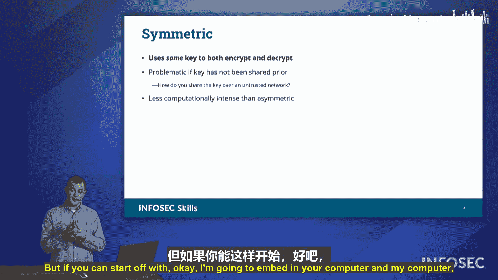

# 【Infosec】CompTIA安全 701认证 ｜ CompTIA Security+ 701 p09 02_01_04_encryption-symmetric -BV1LRr5BTEow_p9-

Let's talk about encryption encryption is a way that we can safeguard our information。

From unauthorized parties accessing it， we're going to protect the confidentiality of this information。

And so with encryption we have two different types of algorithms。

 we have asymmetric and symmetric in this section we're going to tackle symmetric encryption symmetric encryption is used a lot more than you might think。

So symmetric encryption， this is a really， really padty cake way of looking at how symmetric keys work。

So symmetric keys， what we have with this is it is the same key to both encryptrypt as it is to decrypt。

If you've ever seen a Ro 13。Ccipher， like we're looking at here。

 this is known as a Ro 13 because it is rotated。It has shifted。By 13 letters。

 we have 26 letters in the English alphabet， we shift it by 13。

 we're basically matching up everything between havealves so that A becomes in， B becomes O。

 C becomes P and so forth。So with each of these letters， it doesn't matter if I give you an in。

 you know that its counterpart is a。If I give you a， you know its counterpart is in。

So it almost does not matter if I tell you this is the encrypted form or this is the plain text form of dis informationation。

 you'll be able to use a Ro 13 and go and look at the corresponding letter to determine if this word is the encrypted or decrypted form of this。

Again， this is patty cake， we wouldn't actually get crypt。

National secrets or anything like that with this， but what it does is it does give you an opportunity to go through and look at how does this。

Work and then you can see that the same key to both encryptpt is used to decrypt so at the bottom of the screen here i've got a few i've got four different words here to try to decrypt so the very first one it's going to be you know it's short it's easy。

So take a moment and decrypt what you think this one is。With this one。Did you get it。It's easy。

 I told you said this is easy。R becomes E。N becomes a， F becomes S， and L becomes y。EA SY， easy。

So take a moment and try the second one， you areYYB。What do you think this one decodes into？

You are YYB。Hello， that's what this one decos into， U becomes H。R becomes E， y becomes L。

 y becomes L and B becomes O。So it's hello。Okay， we've got two more again。Humor me here。

 so the next one。Bs Bf。Can you decode what this one is？There we go。

 Inecec got to toe the company line， right？So with infoec。V becomes I， A becomes n， and so forth。

 info sec。All right， now that you've got some practice now you can tackle the hard one here。

 the very last one on here。It's pretty lengthy。Take a moment and work through this one。

You can pause the video if you need to。You think you got it？This was going to be。

 you've got it cryptography。It's a pretty long one。

 but you can see how this kind of goes back and forth。Again， this is really paddy cake。

 this is not what we use in technology these days， but we do use symmetric cryptography。

 the thing that we use with cryptography with some symmetric cryptography is that we use the same key to both encryptpt and decrypt。

So here here's the problem though， I have to come up with a way to share with you。That key。

If we're going to be geographically separated。If I'm over here and you're over that distant mountain range。

How how do I get the key to you any you know without knowing that the enemy has gotten a copy of it。

 or if we're separated by some distance， I can't just send it to you over the radio。

 the enemy might be listening in？So how do I get that to you over an untrusted mark。

 that's the challenge。But if you can start off with， okay。

 I'm going to embed in your computer and my computer we're going to have these。

Keys and once we have them， then we can separate one another。

 then we can still communicate with that， but we must first get a way to do that。

 So we're geographically in the same location， we can exchange keys if not。

 it's going to be a challenge The reason we would want to use symmetric over its credit is over its。

Over the other form of this is。That symmetric。Is less computationally intense than asymmetric asymmetric。

Deals with incredibly large numbers not to say that symmetric doesn't。

 but asymmetric has a lot of math involved and it is a real computational load on your system and so what we use asymmetric for is to establish these links。

And then what we do is we use with asymmetric， we establish a link between two remote systems。

So that we can set up a secure communication to send data from me to you。

And then what is that information we're going to send？The key for our symmetric。Exchange。

And so at that point now you have the key， I have the key， and both for our computers can go。

This is much easier to do so asymmetric we set up from one point to the next， roll over to symmetric。

 we can breathe a little easier and we can exchange data in large amounts。

 symmetric less computationally intense than asymmetric。Coming up。

 we're going to dive into asymmetric。