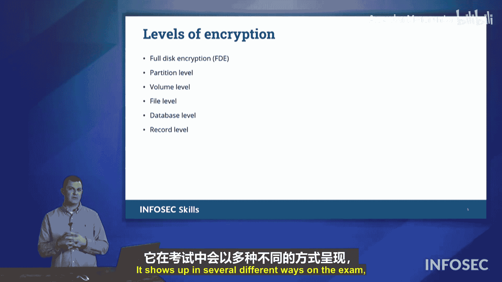

# 【Infosec】CompTIA安全 701认证 ｜ CompTIA Security+ 701 p10 02_01_05_encryption-asymmetric -BV1LRr5BTEow_p10-

In this section， we're going to dive into asymmetric encryption。

Symsymmetricmetric encryption uses the same key to both encrypt and decrypt。Asymmetric， though。

 you guessed it， uses a different key。And so we talk about these two different keys。

In the context of how they get utilized。There really is no。

Distinct difference between what makes a key public on one private other than how it gets used。

So this is all built on this idea called the diiffy Heman Exchange。

It's not really a tested topic there to understand Diffy He Exchange but。

We need to talk about the public and private keys and how they get used。

 so the two authors of this diiffy and Heman came up with the idea that I can use one key， one value。

 one number to encryptpt and the only way to decrypt that is to use a different mathematically related value。

These values that we're looking at。In practice are thousands of digits long。

 huge astronomical values， and they're dealing with extremely， extremely large crime numbers。

 when you multiply them together and do certain mathematical operations。

 you end up with these two values that are mathematically related。

But you cannot determine one just by giving the other。

And they're also related in that one will be able to encrypt the data。

And even if you know the value of that， you still can't decrypt it。

It's really weird to think about and it's hard to wrap our heads around because the numbers are so large。

 but you encrypt。With one way。And then use the other value to decrypt it。

There is no you know kind of functional difference between these one can be used in a public context。

 one is used in a private context， what makes them public or private is if you share it or not。

If I give you a value， that's going to be my public key。 The other one， I'm going to keep safe。

 and that's that's going to be my private value。 I'm not going to share that with anybody。 No how。

 no way。 That's private。 I'm only going to share with the public。My public key。

And the reason it's made public is because that's what I'm sharing。My private key。

 I hold close to the chest and I'm not going to share that with anyone。

And so with this graphic here on the screen， we've got the cinder has some plain texts that are going to encrypt。

They're going to send something to a recipient。In order to facilitate this exchange。

They request from the recipient。They're public key， they take that public key， they encrypt the data。

The whole world can see。That the sendnder is sending something to the recipient。 In fact。

 the whole world can also get a copy of that public key。It kind of doesn't matter， though。

 because it doesn't matter if you have the public key。

 just because you have the public key doesn't mean you can decrypt。

That information that has been encrypted with that public key。

 the only thing that will decrypt that information that has been encrypted with the public key is。

You guessed it。The private key and who has that？The only people in the entire world of the billions of computers in the whole world is the recipient。

 they're not sharing that with anybody， know how， no way。

And so only the recipient will be able to decrypt that message that the sender has sent。To them。

The problem with asymmetric encryption， this last bullet point here points this out。

It is computationally intense。Remember， we're using digits that are thousands of digits long。

 I mean just its it's near impossible wrap your head around how large these numbers are if you see them printed out you're just aghast。

The numbers are so， so， so massive。And so your computer。

Hast the burden of having to work with that large number， which is a burden in and of itself。

 but then it's having to then decrypt that use that whole values to then go through and decrypt every single byte。

Of that message that just got sent through， it's going to take a toll on your system's performance and so。

We try to get off of asymmetric as quick as we can。And so we will use asymmetric to facilitate。

Communication and it's order to send a symmetric key so we can roll over to that and then again both of our systems go。

Okay， now we can breathe easy and send this across。 Asymmetric is how we establish the link。

symmetric is oftentimes how we。Maintain that link。It's also worth pointing out here too recall that both the public and the private。

 there is nothing inherently defining about if it's public or if it's private these two values are are know somewhat indistinguishable from one another。

 it's all in how they get used。And so anything that's encrypted with public key can only be decrypted with the private key。

Anything that's encrypted with a private key can only be decrypted with the public key thats that sounds weird though。

 why would I ever want to encrypt something with a private key because again。

 the whole world has access to the public keys。That's。

That seems nonsensical we're going to explore why later on when we get into digital signatures and code signing about how we can encrypt something with the private key so that the whole world can then beryed。

It sounds weird， we'll dive into it later on。Next though， let's dive into how we exchange keys。

If I send you a key。Over the same。Channel that we're communicating with this is referred to as an in band exchange I'm using the same communication channel to send information from me to you about our encryption scheme。

This is called an in band exchange。There's also out of band and that's where this is our main line of communication。

 but over here I've got something else going on and I'm going to send information to I'm going to send you the key so that then you can then use that to facilitate our main line of communication。

This is going to be in the form of。You know， a chat message， email， snail mail。Some smoke messages。

 smoke signals， it really doesn't matter how I get the information to you if I'm using a different channel。

Then the primary means of communication， it is said to be an out of band exchange。

 and so that's how we're going to exchange keys between sender and receiver。Also。

 when we're talking about key length， I've said that these keys are astronomically huge。

Length is strength when it comes to key strength， the longer the stronger。

And so any sort of key length whenever you're looking at how long is this is this key。

 if we're looking at something like AES 256， that number of bits on there is much。

 much stronger than something like AES 128， which is only 128 bit。

 so length is strength longer is stronger。Where we see encryption used。

We see it used in a bunch of different contexts， but we can have this concept we're going to dive in more later on called full disk encryption。

 the where we encrypt all of the data on the drive。

That goes into a disk or we can just partition have just one partition that is encrypted。

 we have the drive volume that gets encrypted depending on our structure。

 we can use different levels of communication on there。

 we can also encrypt individual files depending on you know what it is that we're trying to accomplish。

If we're storing data in a database， we can encrypt all of the entire database or we can do individual records within that database。

 so the levels of encryption get mentioned on the objectives it shows up in a several different ways on the exam。

 but the main thing to get across here is that we have asymmetric encryption as a way of having a public and private key exchange。

So in the next following sections， we're going to be diving more into how we utilize encryption。

