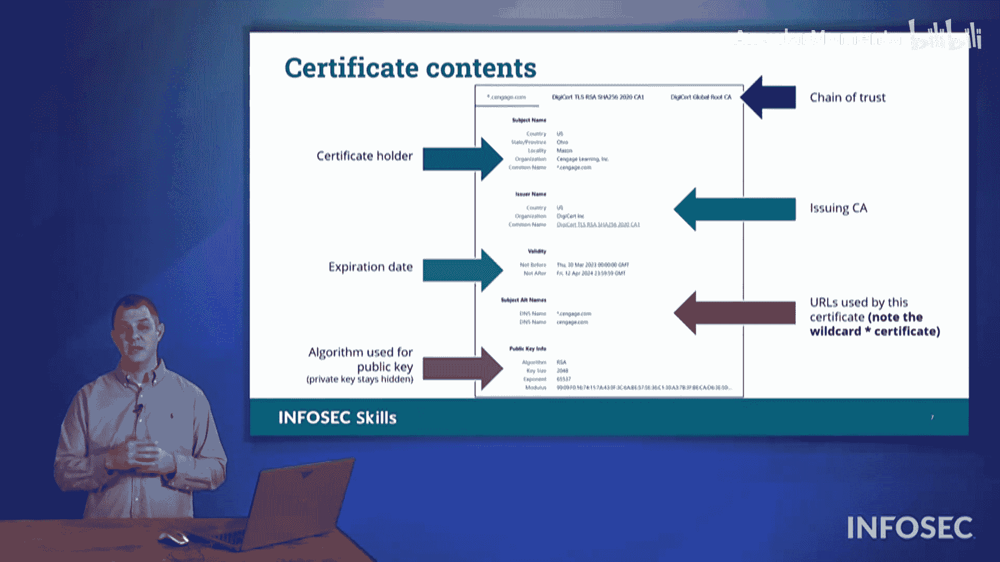

# 【Infosec】CompTIA安全 701认证 ｜ CompTIA Security+ 701 p11 02_01_06_pki-certificates -BV1LRr5BTEow_p11-

Let's talk about public key infrastructure and certificates。Recall that public key infrastructure。

Utilizes public keys and private keys。We've talked about how there's public and private keys and how you can encrypt something with public key。

 and then only the private key can decrypt that。Public key infrastructure supports this by ensuring that a public key belongs to one organization and only one organization。

Why， because？With that public key， only the private key can decrypt that and we don't want two organizations sharing a public key that would apply they're going to share the private key and they're able to read each other's confidential information。

So we utilize certificates from certificate authorities to ensure that we only have one certificate or one public key for each organization。

These certificates are issued by a certificate authority。And they are unique to each individual。

For every organization around the world that has certificates。

 they have a unique certificate so long as it is issued by a third party public certificate authority。

There are also situations in which you might self sign your certificates。

 this means that you are the acting certificate authority for your organization。

But only for your organization， you will only。Be able to issue those certificates for your organizations these are generally used for non internet connected networks if someone from the outside world was to connect to your network and you're using self science certificate you're going to get that pop up warning warning this is an invalid certificate。

Certificate authorities get their trust from other organizations。

 they issue these certificates to other organizations so a certificate authority receives this authority from another certificate authority and then they provide to you a certificate this whole process is kickstarted by the certificate signing request。

 the CSR be able to identify this term on the exam you might see it as one of the answer options the certificate signing request kickstarts the certificate signing process when you want to receive a certificate from a certificate authority you issue to them a certificate signing request and then their systems will spring into action。

Certificate authorities then will look at what other certificate authorities have issued they're going to check other certificates out there and see if there're a match for the public key being issued to you with the implication that there's also a private key associated with that same public key certificate authorities maintain records of certificates that they have issued。

And then they will also provide this lookup service so that other certificate authorities can check and see has that certificate already been registered？

Further， it will also allow you to do a lookup and find out is that certificate already in use。

 is that information coming from a legitimate source or not。

 the certificate authority provides that lookup service。They also can provide the lineage。

 the heritage or pedigree of your certificate。Showing this chain of trust。

 it came from the issuing certificate authority that you received it from。

 but where did they get their trust， they got it from some intermediate certificate authority and then they were in turn able to get their certificate issued by eventually a root certificate authority there is this chain of trust that we have a family tree of sorts as you see on the image here。

Whenever you're doing that lookup on here， we have two mechanisms that we can look at the status of a certificate。

We can use OCSP， the online certificate status protocol。

 or we can also use the certificate Revocation list。The online certificate status protocol allows。

A host， you or me to query a certificate authority and say， hey， I got the certificate。

 what's the status of it？Or you can also consult the certificate revocation list issued by that certificate authority the CRL in this case is almost like a no fly list。

 it says these are the certificates that we have revoked that we are no longer backing。

 these have lost their trust in a sense。And then as we go through and look at how the different fields that exist on the certificate are structured。

 we can see that on this demo here， we've got an example certificate in this case。

 infofosex parentent company Sengage has the following fields on this older certificate that we've got here。

At the very top， you can see the chain of Trust， it says Sengage got their certificate from digitert。

 digiterts， issuing certificate authority， got their trust from digisserts Route certificateer Authority。

 which is part of the root certificate authorities around the globe。The field below that。

Pvides information about the certificate holder in this case Sengage learninging Inc。

 it shows that our corporate mailing address is in Masson。

 Ohio and then it says the name of the site or the servers that utilize the certificate is anythingstar。

sengage。com。Any sub domainomain that Sengage maintains so if we have like a mail server or info sex website。

 anything that is subdomain of Sengage。 co is going to be covered by this same certificate if it is parked on a synengage do co facing。

Server。The field below this tells us information about the issuing certificate authority。

 and so this is where the that chain of trust there at the top that's where it shows。

The information about this certificaterift， the issuer of this certificate in this case is didert and it provides information about the certificateriKt authority that issued that。

Below this， perhaps what draws most attention for folks that are inspecting certificates is the expiration date how long is this certificate good for this is a managerial control there's no reason there's no technical reason why a certificate cannot last for three months。

 six months a year。1en years。That will be defined by the expiration date。

A certificate can last for decades， in fact there are some certificates that actually do last for decades。

 but most issuing certificate authorities only give you a year。Or maybe just three months。

 but that will be listed out in the expiration date on the actual certificate itself。Below this。

 the next thing to look at on a certificatecate is the subject alternative names。ThisIn this case。

 it says star。sengage。com or Sage。com specifically。

This is a place that we can put in other domain names， so if Sengage。

com had this certificate and they wanted to have any other parts of the Sengage group listed on here。

 then we would list this out so infosecinstitute。com for example could potentially be covered by the same certificate。

 but as we'll see with an upcoming demo that we'll see that that has its own certificate on there。

And then the last and final field。On our example certificate is the very bottom down here and it shows the cons of the algorithm used on here that is used to provide the certificate's public key。

This can can be in a lot of different formats， so here we're seeing that this is an RSA encrypted certificate there's also alytic curve cryptography that gets used lots of different types of algorithms get used and the certificate and that will be defined down here at the bottom of this one so these are some of the fields to be on the lookout for with the certificaterifcate and now let's take a moment and go and look at what a live real certificate looks like。

