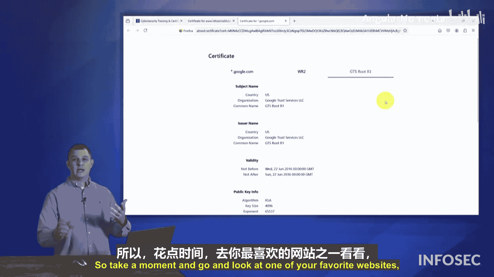

# 【Infosec】CompTIA安全 701认证 ｜ CompTIA Security+ 701 p12 02_01_07_pki-demo -BV1LRr5BTEow_p12-

So let's take a moment and look at some live demos of actual certificates that we see on the internet。

So here I've got pulled up the infoec website and you can see at the very top that we have this little。

Padlock icon a lot of us know to look for that if we've got a secure connection to a server。

If you click on that you can go to explore the certificate you can view the actual certificate and here we see those same fields that we just saw in the video we've got infosestute。

com covered by this certificate and tells us information about who issued this certificate in this case it came from Google trust services and it says that it came from W1 one of their certificate authorities under Google。

Down below that， we can see that we have the validity date these are the dates by which this certificate is valid this one says it's good from June 22 2024 until September 20th2024 at which point one of the system administrators will need to update this certificate this particular certificate that we're looking at will go bad it'll turn into a pumpkin on September 20 and it will no longer be valid it will be added to the。

Certificate Revocation list and a new one will replace it。

Down below we have these subject alternative names in this case， it's only going to cover。www。

infosecinstitute。com this is the only site covered by this certificate just as before you can scroll down you can see that this one is covered by the elliptic curve cryptography and other information below。

This and again shows that it came from the Google trust services it says how long Google trust services their certificate is valid for this one's really cool look how long this certificate is valid for this one comes from December of 2023 and it's good until February 2029。

At which point the root certificate authority for Google will then issue a new one to their subordinate certificate authority that does the issuing on their behalf。

Same information is kind of provided on this one and then the last one you look at over here is well。

 this certificate authority in this case WE1 where did it gets get its authority from it got it from Google trust services primary。

Root certificate。And look at the date on this one。From June 2016 until June 2036 this is a 20 year certificate these root certificate authorities don't really do a lot of issuing of these and so they have very long lived certificates。

So this is the one for infoec， I've got another one in a special case for you。

 I pulled up the certificate from a website you may have heard of it's called YouTube。com。

And this one actually pulls up and it's got some really funky weird things and so I've got it pulled up here on this other tab。

 so if I click over this tab here， I pulled this up from YouTube。com。Look at the name。

That's issued on here。It says it's for Google。com it doesn't even mention YouTube on here what why is this one this one's curious as we scroll down and look and we see that it has a relatively short life on its certificate。

 but the curious thing and what I wanted to draw your attention to is look at the subject alternative names in this example as we scroll down。

There are a bunch of services this company， Google Iue， certificate for。

 there are all of these services are covered under this same certificate。

So as you go down and look at all of the different results you can see that we've got the Canadian Google is covered on this。

 we've got Japan， India， the UK， Vietnam， Germany， Spain， France。

 Italy there are all covered under this same certificate there's one Google there's one certificate for all of their different services keep on scrolling and you can see it doesn't cover just Google specifically there's also other side projects that Google operates amp Google Add services also covered on here。

 double click one of their advertising tracking services， Google travel services。

 I think flights is in here， different Google content services are covered and then as we keep on scrolling down you can see the URL shorteners and then here we go this is why I was able to pull this particular certificate up when I pulled up the certificate for YouTube because YouTube being a Google subsidiary is covered under this。

as well so Google issues one certificate for all of their services it's a way to safeguard what information that they have available to you and they have it all secured under the same certificate。

This certificate you can look at its pedigree where it got its authority from in this case WR2。

 which tracks back to Google Trust Services Ro R1 that we looked at earlier on the infofoSec certificate as well came from Google Trust services as well so take a moment and go and look at one of your favorite websites。

 pull up a certificate and look at those individual fields and look for those subject alternative names。

 those are interesting ways to provide one certificate for multiple different services that you've got。

Thanks for taking a look at public key infrastructure。

