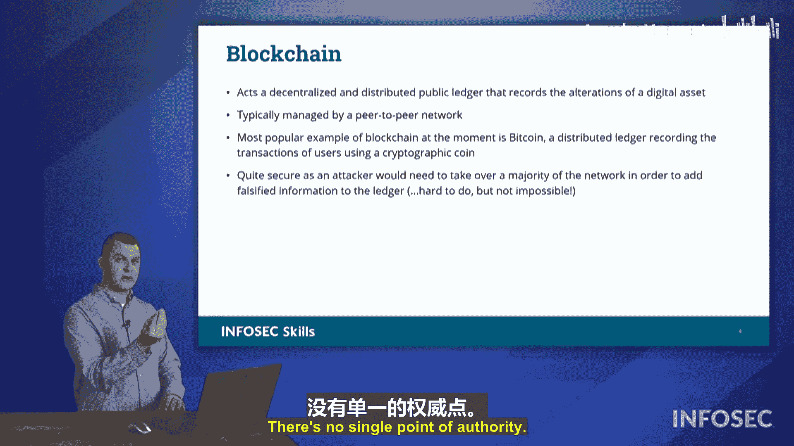

# 【Infosec】CompTIA安全 701认证 ｜ CompTIA Security+ 701 p13 02_01_08_uses-of-cryptography -BV1LRr5BTEow_p13-

As we've described， cryptography is important in cybersecurity。

 we have a few different ways that we can utilize some cryptographic concepts in providing security for our data。

So the first one to talk about here is code signing。

Suppose we have an update we need to send out to our clients or if Microsoft， for example。

 was going to send out an update for all of their clients to install on their operating systems。

 how do the recipients know that information that update the executable came from Microsoft。

 is there a way that we can？Be sure that it came from them。

 we can do that through code signing and so the process works like this。

The organization starts the bottom left on this graphic， and they start with their deliverable。

 their code， the update， the patch， whatever it is that they're issuing。

And what they're going to do is they're going to run that and they're going to have a hash file。

 And so they're going to then come in and they're going to。Hash the data that's on here。

 they're going to end up with that cryptographic。Hash， digest。

The digest will track if there have been any changes to the executable that they are delivering。Then。

Perhaps somewhat confusingly。They encrypt that with their private key。

 they're going to use their private key， Microsoft who is going to take their their personal private key that they don't share with anybody。

 no how no way， and they're going to encrypt information using that private key。

Well think about it when we talk about public private key cryptography。

If you encrypt something with the private key。The only thing that can decrypt that is the public key。

But everybody in the world has access to the public key， so what good is it to encrypt？Well。

 if we look back at the graphic here， you can see that the private key encrypts that hash。

The hash digestest and that then gets included with the code。

 along with certificate saying this came from， in our example， Microsoft。

You receive the sign code over here your system will then see that it was signed by Microsoft and it's going to go out and grab the public key from Microsoft。

 then the whole process gets unwound or works in reverse the signature that secured the private key encrypted hash digestig。

 then gets decrypted with Microsoft's public key。Again。

 what's the whole point of doing it with a public key？Well， what it does is。It proves to the world。

This information was originating from within Microsoft because who has access to the information that。

Microsoft's public key can decrypt。Of the entire world。

s only one private key there's only one key that will encrypt that Microsoft's public key could decrypt and that's Microsoft's private key and they're not sharing that with nobody。

 no how， no way。And so they keep this private key under wraps and by you grabbing their public key。

 you know that I know that this data originated from Microsoft。

And so what this does is this provides this concept of non repudiation。

 I know this information came from Microsoft because nobody else in the whole world has Microsoft's private key。

And then。What's left is the decrypted form of that hash digest。

The recipient can then take their code that they've decrypted they can then。Run a hash on that。

 compare the digests and see if they are the same， if those two values line up。

Then we know that there have not been any changes we can be assured of the integrity of that data。

 so code signing provides for both integrity and nonreudiation。

 I know this came from Microsoft because they're the only ones with Microsoft's private key that would be able to encrypt it in such a way that I can decrypt it。

And those hash digests provide integrity and I know that that。

Update has not changed in any way we see the same process at work whenever we go to look at how we protect other documents we've got access to digital signatures on here。

Digital signatures work the exact same way it hashes and encrypts data and so we're able to then track back and it provides that whole nonreuation you would use something like digital signatures with a digital contract something you sign digitally。

Online。Another cryptographic concept that we see mentioned in our objectives。

 I haven't seen it show up so much on the actual security+ exam。

 but it could come up in another offering and this is the concept of blockchain we hear a lot of information about blockchain in the industry and so how does blockchain work the best example I can provide for how blockchain works is similar to how real estate transactions take place in various states and counties across the country。

With blockchain。You have iss referred to as this public decentralized， distributed public ledger。

So it's decentralized， meaning that there's no single authority that is in charge of。

This ledger or if you could think of it as almost like a database。

It's decentralized there's no single point of authority like if I wanted to attack it。

 I can't go to a single point attack it and then disrupt the network I have to。

Take out the whole network， it's decentralized， and so that provides some strength。

 there's not a single point of failure here。The other thing is this distributed public leds distributed across all nodes。

And this public ledger， it is a record of public transactions。Like I said。

 it's similar to how real estate transactions operate。

You can go to your local county or parish courthouse and look up records for each plot of land in your state。

And yet that plot of land， you can go back and see how it has transferred from one owner to the next going back historically all through the years。

When you go to buy a property。You will have a title search done to say。

 does anyone historically lay claim to this land and if not that it's said to have a clear title。

 but in order to do that it has to be a public record。

 it has to be filed with the county or parish court system。

 and so you will then go through those that public record and search for those transactions。

Blockchain is kind of like that。Blockchain we often see it used most often with cryptocurrency。

 it's not the only solution using blockchain technology。

 but it is a way to describe the operation of it。Blockchain， when using with cryptocurrency。

 what it does is cryptocurrency has a particular value for， let's say Bitcoin， for example。

 and that coin contains a certain value associated with that cryptocurrency。

That cryptocurrency can then be divided， the much is the way land can。

 and it can be divided and then those portions can then be divided， sold off， traded to others。

In the same way that land can be subdivided and then those individual transactions will be publicly recorded。

 the same thing happens。With your cryp with cryptocurrency。

 you subdivide cryptocurrency and you trade it for in exchange for goods or services and those are publicly recorded Each transaction is distributed among all other players on the network on the chain。

 we say。And so if it's part of the blockchain network， all other nodes are made aware。

I'm Tommy and I'm giving this information over to Tiffany or I'm giving this information over to Chad And then that information will then transfer from others。

 Every other node will then create a hash digest of that。 They will compare those hash values。

 If everyone's in agreement， everyone says yes that。

That resource has transferred from this user to this user。And so in doing so。

 everyone has record of that。Later， someone else can't come in and say no， no， no。

 you didn't transfer that to Tiffany， you didn't transfer that to Chad that came from this individual and they gave that to me all the other nodes would be like。

That's not true。 We don't have record of that。 We have record of this one transaction。

 So nobody's able to game the system when it comes to blockchain therein lies some of the trust associated with or some of the security associated with。

The different hash values that we're computing in the blockchain transactions。And then like I said。

 it's not that there's a central point， it's consensus among all nodes， for this reason。

 it's hard for someone to crack。Into a blockchain and take over all of those transactions to say no。

 you didn't transfer that from from to Tiffany or to Chad。

 you transferred that to me and then Kwan was able to step in and be like。

 no that all came to me taking it over and grabbing all of that information coming back and so all of that information coming to that one record holder it's not impossible to do it has been done on some of the smaller cryptocurrencies whereas an adversary takes over the majority of the nodes on that network they're able to then steer the narrative and say。

 oh these transactions all came back to me the rest of those were fraudulent。It's not。

Easy to do that， but it's not impossible。 so it's difficult to do。

But not completely impossible blockchain， like I said。

 it's a technology that we see as a way to secure transactions， it's decentralized。

 and it may be coming up on a future security plus。

 but it hasn't been present on our most recent versions。

So these are some uses that we have for different types of cryptography。

