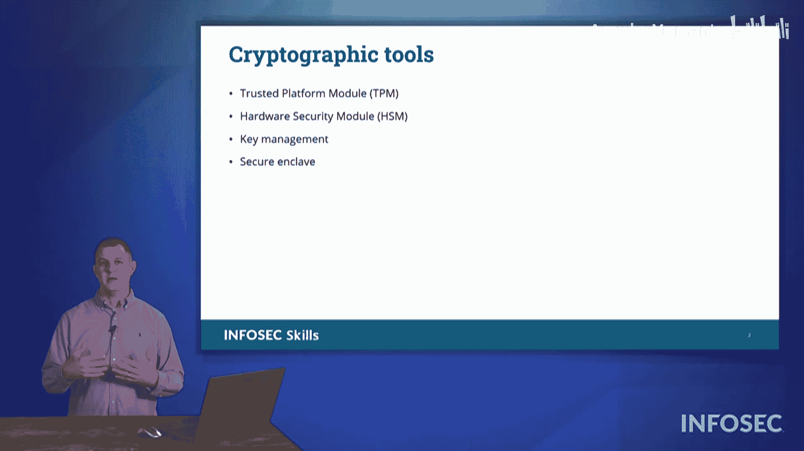

# 【Infosec】CompTIA安全 701认证 ｜ CompTIA Security+ 701 p14 02_01_09_cryptographic-tools -BV1LRr5BTEow_p14-

Cryptography is so central to so much of what we do in cybersecurity。

 we have a number of different tools to assist us in utilizing。Cryptographic protocols。

We have a few tools to discuss listed out in the objectives there is the trusted platform module。

The hardware security module。Key management and a secure enclave。First of all， I want to tackle。

Key management， this is just the rotation of keys as we've talked about with certificates being able to rotate your keys。

 making sure that if an adversary gets a copy of your key that they're not able to utilize that because you're going to be rotating them every so often。

The next term to talk about here is。The secure enclave most modern mobile devices have built into them a secure enclave in the phone there is going to be a stored amount of cryptographic memory and that data is secured within that device This is known as a secure enclave a lot of phones will use biometrics to decrypt or provide access to the data stored in that secure enclave the data is stored in an encrypted state so that it cannot be leached from that device directly without first authenticating into that information。

The next topic we're going to talk about here is the trusted platform module。The trusted Pla module。

Is this tiny little chip that we've got it is a either a peripheral on the motherboard or it is soldered into the motherboard itself you can see on the graphic here that central to this little device is this tiny purpose built chip。

And with this chip comes a way to generate hash values， it stores certain cryptographic keys。

 both in shortterm memory， but there's also read only memory that stores those cryptographic security keys and what this does this provides a way to identify a computer if I'm talking from this system to some remote system somewhere。

 I'm going to access that device and I'm going to say。

Send me back some information from your trusted platform module that way I know I'm talking to that remote system。

 the system that I know and trust。Something else I want you to think about when you look at this graphic on the screen on this screen we're going to see the small chip that's on there。

 I want you to think about TPM， the trusted platform module and I want you to think about this tiny tiny little chip it the you could even think about it as the tiny platform module because it's going to be different than the next piece of hardware're going to look at and that is the hardware security module the hardware security module。

If you know your computer hardware， you might look at this and think， gee。

 that really looks like a video card， you'd be right。

Underneath the hood of this is a graphics processor unit a GPU lies at the heart of this device it is a mathematical processor and it's going to have this substantial heat sync on there to dissipate the heat coming off this graphics processor unit but if you look at this the image of this hardware security module you'll see that it does not have a video output on here this is just it looks like a video card with no video connections on it this is the hardware security module what's the point of having the GPU on there。

Your main computer's processor。Is very， very， very fast。 It is a capable processor。

 but your main CPU is a general purpose processor。 It's really good。

At managing a bunch of different processes and doing a little bit at a time。

 it's said to be a timeshare processor we think about our computers doing a lot of stuff all at once。

 but in reality they're doing a little bit of a bunch of different tasks very， very， very quickly。

The graphics processor unit on the other hand， which was created for generating graphics with video games is very。

 very math focusedcus， it handles all of the geometry of changing those angles whenever you go around the hallway and you see the alien at the end of the hall or you see the zombie when you open that door and your vantage points change。

All of that geometry is being handled by your graphics processor unit。

 GPUs are great at handling mathematical situations。

And so by adding a hardware security module you're allowed to offset or offload the computational effort of generating or handling those giant public and private key cryptographic algorithms。

 all that public and private key encryption decryption。

 your general purpose CPU not very efficient at doing that your GPUs handle that quite easily and so by having a hardware security module you're adding。

Another graphics processor you on here， I want you to think about that this is a piece of hardware。

 it's very big。You can even think of it as the HSM the H stands for huge and the TPM stands for tiny and so you've got this kind of scaled difference on here they both handle cryptographic processes for the main computer but the hardware security module is much larger than the small tiny trusted platform module so you got the tiny TPM and the huge。

HSM。Together， all of these tools work together to provide cryptographic processing for our main computers。

 and it allows us to utilize cryptography in a lot of different contexts。

