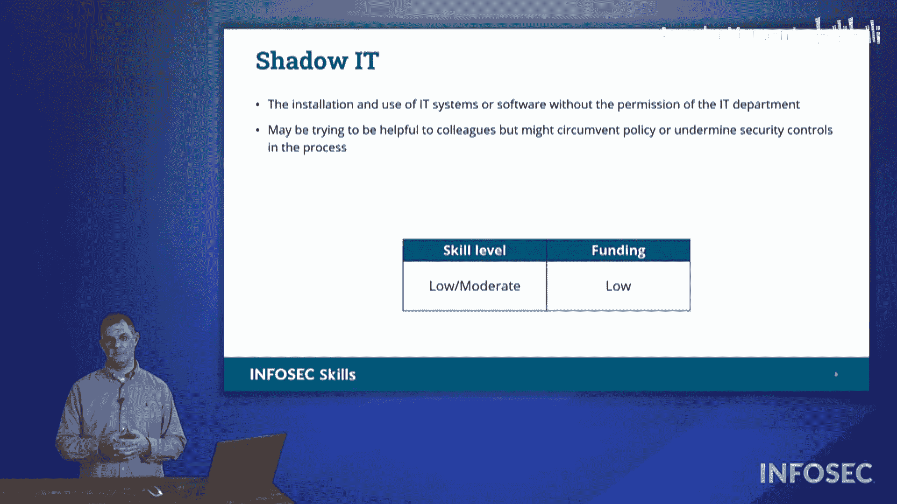

# 【Infosec】CompTIA安全 701认证 ｜ CompTIA Security+ 701 p15 03_01_01_threat-actors -BV1LRr5BTEow_p15-

With different vulnerabilities， there's always going to be threat actors who might be。Acting。

To carry out different attacks， they might be seeking to exploit those vulnerabilities In this section。

 we're going to go through and look at different threat actors that we might see show up on the exam。

The list they provided here is this the sequence we're going to go through， nation states。

 also known as an advanced persistent threat， you'll see it sometimes written out as an APT。

An unskilled attacker， formerly this was referred to as a script kitty， and this has been changed。

 we'll dive into that a little bit more later。We also have hackivists。Organized crime。

Insider threats， and then lastly， shadow IT。Perhaps the most important or the most noteworthy one of these。

 the ones that's going to show up in the news most often are these nation states or advanced persistent threats。

These are funded， operated by foreign governments， foreign countries。

And the the thing that is really one of the hallmarks to identify a nation state attacker is their high level of sophistication。

 they're going to come up with new and creative ways of exploiting different vulnerabilities。

 the level of funding is unmatched。If there is some special knowledge that they need。

 some special tool that they need， they need to get trained on something。

 they'll go out and hire the world's expert on something and they will fund it。

The what drives the nation state here is they don't care about prestige necessarily。

 they don't care about wealth generating wealth for their parent country， though sometimes they do。

What really drives them is their national interests。

 whatever is in the national interest of their parent or host country。

 that's what's going to be aligning their interests as well。

Someone at the polar opposite end of the spectrum is the unskilled attacker like I said。

 it used to be referred to as script kitty in some。

Circleles it will still be referred to as script kitty。Um。

 this is somewhat a pejorative term and it's like， oh， you don't know what you're talking about。

 you're just a script kitty。When it comes to a script kitty。

 this is going to be defined as having low skill level。

Maybe not a high level of understanding of what's going on。

And then also because they're largely self funded， they're going to have low levels of funding。

 so low skill level， low funding， this is kind of the stereotypical hacker。You know。

 living with parents， figuring things out as they go。Again。

 they they don't really know exactly what it is that they're doing other than they're connecting these different tools。

 others create the tools， they're merely using it， they're not crafting new vulnerabilities or they're not crafting new tools to exploit those vulnerabilities。

They're using something off the shelf they paid someone else for it。

 they got a free wear copy of this whatever but they just know if I pull this lever， pull this lever。

 pull this lever I get the peanut at the end they get some sort of payday at the end and what's driving them is going to be prestige so they can show off to their others look i'm a real hacker you know like okay yeah sure you did this on the exam we refer to them as an unskilled attacker。

A lot of times organizations might be dismissive， like， we don't have to worry about that。

 it's just some script kitties。Don't be so quick to write them off though， script kitties。

 even though they may not understand what you're doing。

 the exploits they're using against your organization can still cause significant harm to your organization's security。

 so don't write off unskilled attackers。Coming back up on the skill level a little bit is the hackivist。

A hacker with a cause， you know， it's someone that is driven by ethical， social， political。

 philosophical differences and they're seeking to spread their message。

 they're trying to break into some other organization。

 spread the message to that organization's supporters or advocates in order to get a change in views or a change in policies。

 whatever the case may be。This is a hack， it's an activist hacker。

When it comes to skill level and it's going to be a little bit moderate。

 they're going to be a little bit you know more advanced， more sophisticated than a scripty。

 these folks know what they're doing and when it comes to funding they may or may not be supported by some sympathetic group。

So a lot of times these can come up in the form of championing a foreign country。

 championing a political cause， or some sort of ethical cause that's out there。

So a hackiv is just going to be a hacker group that is trying to spread a particular message if I go so far as to name names on here。

 I would say that probably may not be surprising but the hacker group anonymous would probably fit under this profile if you look at what anonymous has done over the years。

 they have they have saw it to carry a message to whoever their victims are saying we're not going to tolerate what you stand for on this particular issue and then they will seek to disrupt the communications of that other group。

The other kind of more advanced group that we've got on here。

 similar to and perhaps in some regards on par with the advanced persistent threat， the nation state。

In this case， is organized crime。Now we're not talking about Lacosta notra or drug cartels or anything。

 though they do both have some cyber operations going on in this case we're looking more at ransomware gangs。

 cyber exploit gangs groups that seek to exploit or extort money from organizations when it comes to skill level these are very sophisticated actors indeed and when it comes to funding they've got the money and youve got to spend money to make money。

 organized crime what drives them is to make money that's all they care about they don't care about your political messaging they don't care about your ethical views on whatever they don't care about prestige。

Or even really national pride， they just want the money， so that's what they're after。

Organized crime is seeking funding from their victims they're going to extort money。

 they're going to blackmail them， they're going to carry out identity theft。

 whatever it takes to make a buck you'll also see this in the industry referred to as an advanced persistent threat as well。

But on the exam， APT is reserved for the nation state attackers。Again， organized crime。

 high skill level， high level of funding。Maybe a little bit closer to home closer to the office is the insider threat this is going to be an attacker that operates from within the building this could be a disgruntled employee could also be a bumbling employee but someone who gets passed over for a promotion or they think that they're not going to have their contract renewed or whatever they may seek revenge and they're going to you know I'm going to show them and so they carry out some sort of an attack against the organization that employs them。

The insider threat can be moderate skill level。It could be part of an IT team。

 or it could be a server administrator， could be one of the programmers， they know where to hide。

 they know how to cover their tracks。When it comes to funding level。

 it's largely self-funded and so they're not going to spend a lot of money doing this。

 they're not really supported by an outside organization necessarily。

 though there are groups that can work with insiders and cause issues that way the insider threat what really makes them dangerous is they have authorized access to the network they should be in the network because they're doing their job but they're also performing malicious acts on the side。

We also have the uneducated employee that's listed on here too。

 they can also be a problem just because they didn't mean to cause harm doesn't mean they didn't still cause harm oops。

 I accidentally。Deletated all of our customer data， oops， accidentally。You know。

 tore down the power lines that go to our facility。

What do you mean oops like it's still a problem and so even though they work here。

 you still need to protect your organization from your users。

 though they might just be bumbling along。Shadow IT， this is an employee in the office。You know。

 I know I know everything about computers and they're going to like really try to help out。

 you know like， oh， I know how this works， we don't need to call IT。We can do it ourselves。

Why doesn't any other？All of our colleagues in other companies。They all have wfi。

 why can't we have wfi we should have wfi you know what on lunch I'm going to go buy a wireless router we're going to set up our own Wifi network here。

That's against policy we have we don't have wi-fi because we have to adhere to these different policies there's different regulations that are in place we can't do this thanks for trying to help your colleagues but you're actually causing issues for us and so shadow IT might try to sidestep official policy they're trying to be helpful but they actually are causing issues again you need to protect your organization from the actions of these insiders as well they belong on your network they're hired to do a job but they're trying to do other things as well the skill level they may know what they're doing they may not know what they're doing when it comes to funding level apart from buying a you know a router on the lunch break they're going have low funding levels as well。

Here in this tabular format， you've got all of the different threat actors listed out。

 take a moment to review them， what you need to know for the exam is the skill level that is on here。

The amount of funding that they've got。And and really think about what's driving the interests of these different threat actors。

 you're not going to have to rattle off a list of any of these topics you're not going to have to fill in all the blanks on a table like this necessarily。

 but you do need to know given a situation given a description of a situation which threat actor is at play these are the threat actors to be aware of on the security plus 701 exam。

