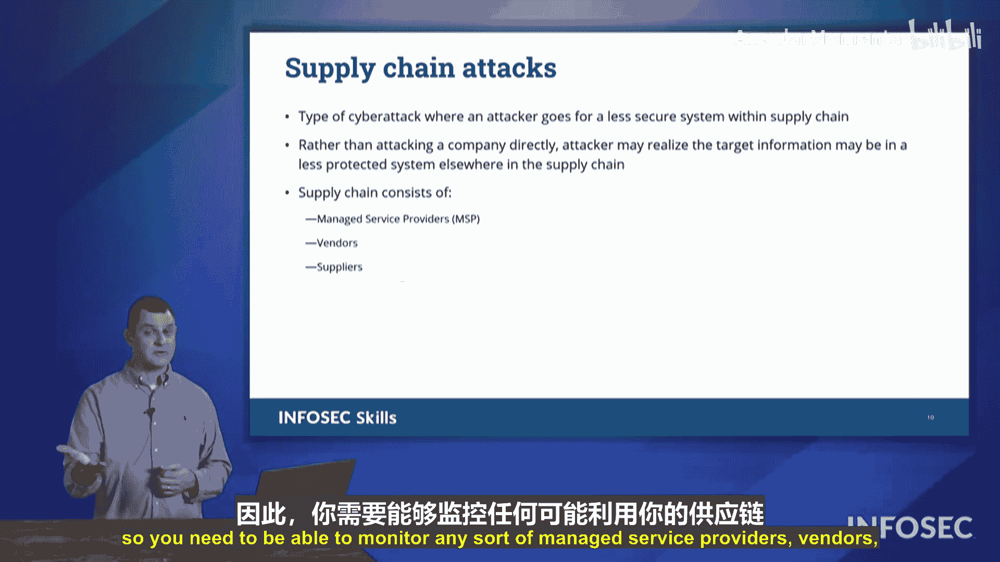

# 【Infosec】CompTIA安全 701认证 ｜ CompTIA Security+ 701 p16 03_01_02_threat-vectors -BV1LRr5BTEow_p16-

Attacks can come at our organization in a lot of different ways。

 let's take a moment to go through some of the threat vectors and attack services mentioned on the security+ exam。

The first one we're going to talk about here are message based attacks this is going to be those types of attacks that come in form of email messages known as phishing or SMS and text messages sishing。

😊，Or you can also have those chat messages that come in and those are going to be like those DMs that you get or instant messages come on different social media platforms。

 entticice me to click on a link or engage with some account。

We also might see voice based attacks such as Vishing or voice phishing。

 this is where someone calls in and says their Microsoft support or the internal revenueevenue service。

 also known as Vishing attacks。We might also see file based attacks and so this is going to be those files that have malware included with them or you might also have fileless malware。

 and I' have to say here's the uped moment for a second。

Fileless malware means that there's no file residue left behind。

 meaning that after the malware has taken off and it's done its dirty work。

 it's not leaving behind any trace， it's covering its tracks。But at some point in the whole process。

 there was a file that came onto your system that actually ran and carried out the malware attack。

 so even though they call it in fileless malware I'm still of the mindset that I'm like。

 well yep but it just covered its track， there's still a file involved with this。

Other types of file based attacks that we can see， listed out here。

 we can have file based attacks that comes in the form of using stganography files hidden within other files。

 or there can be malware hidden inside an image that gets launched by something else on the system。

tchography can also be a way of hiding information so it can be exfiltrated from our network these are collections of some of the different file based attacks that we might see。

Further， we can see different types of removable media。

And this is where we can see the use of mass storage devices。

 not just large hard drives hooked into our system， but it could also be removable USB thumb drives。

 digital cameras hooked up any sort of memory sticks lots of different things can be hooked to a computer that has mass storage devices on it。

 and so data can be exfiltrated from our organization onto this device。

 and then that data can walk away from our organization。

 or those devices might bring into our organization some malware and we don't want to allow that either。

And so we want to safeguard our systems from potentially the use of removal media for either data exfililtration or from malware infililtration。

Another term that you see on the slide deck is air gapap systems。

 air gapap systems generally will make use of removable media to move data from one point to the next。

 and so we saw this as we talked about with the Iranian Stuxnet virus。

 Iranian Stuxnet attack was aimed at the Nant nuclear facility to a system that was air gappped。

The malware was introduced to that airgap system through the use of removable media。

Vulnerable software can also be an attack vector if we have software that has known vulnerabilities those can be exploited by our adversaries so it is important that we stay on top of patches and updates that come out for different types of software we might also have unsupported systems and applications that are available on our network that are not of our own choice it's not something that is formally part of our network but our users introduce them to our networks and because these systems are not officially part of our system。

 we're not aware of them， we're not monitoring them， we're not patching them。

 software might be on our system it's not receiving regular updates。

 those can be vulnerable systems and applications on our network。

Our networks themselves can be problematic as well。

 we can have a wired network that has different ports all over the facility。

 you can have a network drop in the back of the office that is not being used。

It could still be active。Maybe one of the night crew comes in。

 plugs into that and now they're on your network， you don't know what it is that they're doing。

 so if you have a device that is on your wired network。

 you need to make sure that it's only those devices that are allowed access to your network。

Wireless networks are also a common attack vector for networks if you are not on the wired network。

 wireless networks can just kind of go off into space and so anyone is able to receive wireless signals。

It's not illegal to receive any radio signals。The the radio ether is public space and so anyone can receive that so you can listen in on someone else's wireless traffic that is not illegal you cannot send data to that but you can certainly receive all of that。

And so if an organization is using wireless networks。

It's kind of fair game if they're just sending data out。

The third type that we've got on here of different types of networks is Bluetooth with a lot of mobile devices now。

 a lot of mobile devices have built into them Bluetooth and we have on a lot of modern computers we've got Bluetooth in use The problem with Bluetooth is that it's oftentimes beening。

Calling out to friends calling out to any sort of device that may be potentially paired with it if you have a speaker a portable speaker or some earbuds that automatically pick up on Bluetooth it's because your phone is beening out as ID and those earbuds are joining with that device and so that can transmit your。

A unique signal via Bluetooth for anyone to receive。We see this come up in a bunch of retail stores。

 I know that certain big box stores are actually tracking that ID that gets beaened by your mobile device。

When my wife and I walk into a store they know that we come in together， they don't know who we are。

 but they see these two unique Bluetooth IDs come in together one kind of peels off to the women's clothes。

 one is a cheap skate and he goes back to the NC at electronics to see what's on clearance and then one of them gets sucked over into toys for a while where the other one meanders over they join up and then move along when we finally go to check out then they see what card was going with that purchase and they say oh that credit card belongs to this customer these Bluetooth IDs that must be Tommy and his wife and so they're able to see that we have come in together and they can track our movements throughout the store based on the Bluetooth ID。

So if you're not using Bluetooth， disable it because it's giving your position away and you may not be aware of it。

Open network ports are another potential attack vector that adversaries can get into。

These open ports might be on your network and so you want to make sure you're closing off any sort of open ports on your firewall。

 closing all service ports unless you need those ports open， recall that a port。

On a network is attached to the packet and it tells the recipient。

What service that packet is destined for this packet comes in and it's going to come in and says oh this is on say port 80 it says hey。

 wake up web server this is for you and so it hands that data off open ports need to be closed if you're not if you don't have a stated use for that one because it could be a potential attack vector。

Other attack vectors come in the form of weak or default credentials， well known credentials。Admin。

 admin。We used to see this a lot on a lot of mobile on a lot of wireless devices， admin admin。

 kind of that default credential that's out there， and so you want to make sure you're not leaving systems running。

 especially if they're internet facing using the default credentials。

So make sure you're changing that as you go through。And then also supply chain attacks。

 I want to make sure that our organization is not going to fall under attack from some of our vendors or suppliers。

Maybe our organization is secure enough， our security posture is so strong that attackers don't really see it worth the effort。

 not when they can go after one of our vendors or our part suppliers。

 we can go after them and then they will then give us an in road into the network these supply chain attacks can be very very problematic so you need to be able to monitor any sort of managed service providers vendors or suppliers that might leverage your supply chain as a way to attack you directly。

Be aware of some of these different attack vectors that we will see on the security plus exam。

