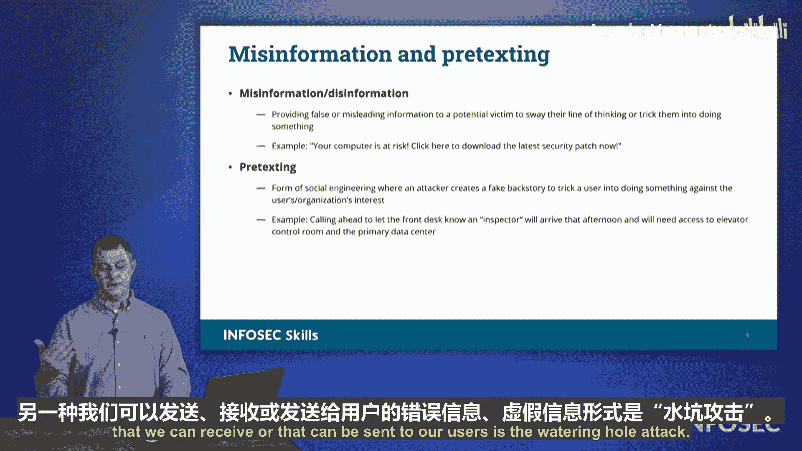

# 【Infosec】CompTIA安全 701认证 ｜ CompTIA Security+ 701 p17 03_01_03_social-engineering -BV1LRr5BTEow_p17-

Let's talk about social engineering， these are tactics that an attacker will use to try to elicit information from our organization or get people at our organization to do things they would not normally do。

So looking at social engineering attacks， the first one we have is phishing， this one's very。

 very common and one that a lot of organizations put a lot of time and effort into stopping because it is quite effective。

 it's very low effort on the part of the attacker and it is surprisingly effective for a lot of users at organizations。

With a phishing attack， this is casting a wide net。

 I don't know exactly which of the users at this organization are going to fall for my fake email。

 but I'm going to scoop them all up， I'm going to cast a wide net。

And so this is kind of a to whom it may concern form of attack。More specifically。

 we might target an individual user because of their permissions。

 because of their account credentials， what they can do if we were able to get into their account。

 we could do a whole lot more malicious activities because of their authorized access。

And so rather than casting this wide net of ph， we're going to do a specific type of fishing and this is where we're going to target an individual user in this case we're going to call this one spear fishing。

Think about how when you go spearfish。The diver is going after a particular fish with a spear gun saying that's the fish that's going to ni on my dinner plate tonight or they are standing on the shore picking out the fish in the shallows and they're going after that specific fish it's a very direct targeted attack going after a specific target you might be spearfish rather than just being cast out because you're working on the technology or you're on the security team at your organization。

Another type of directed attack and perhaps a more。Nitch part of spearfishing is whalling。

Whalaling is going after the big fish。And the reason that we call it the big fish is this is going after a CEO。

 chief executive officer， chief financial officer， chief operating officer， you name it。

 anyone in the C suite might。Might fall victim or be targeted in a whalling attack where the attacker is going after the big fish。

 why because they're in an authoritative position and that authority can be exploited to get other employees to perhaps act in ways they wouldn't normally do。

And so chief executive officers and others need to be on the lookout for whaling attacks。

The reason we mentioned this here is because you need to be on the lookout for a question on the exam whenever they use the word or whenever they use CEO when they you see a question mentioning CEO。

Not always， but there's a really， really good chance that if the question mentioned CEO。

 the question is actually asking you about whaling。So be on the lookout for that。

 if you see CEO think whaling， that is a tailtale sign that it is a question about whaling whenever you see the word CEO on there。

Fishing comes in other forms to us not just email based we also have Vishing or voice phishing have you received one of these calls before this is where someone calls up and they tried to explain to you that they're Microsoft technical support or they're calling from the internal revenue service there's a number of YouTubetubrs that have kind of reverse voice phishing scams and they try to scam the scammers they're pretty entertaining if you've seen them before but Ving is a form of voice phishing it's a joining together of the words voice and phishing。

Another one that we've got on here is smishing or SMS phishing。

 text message phish I actually just got a text message today。

claimlaiming to be the US post office saying that they had a package on a hold and I needed to click on this very not USPS link in order to give some information about getting this package delivered。

Let me tell you， I don't have any many packages I'm expecting and it's certainly not coming from a site that is not coming from USPS。

 even though it's claiming to be from USPS， so that would be a smishing attack that's on here and further taking this a step further is they are impersonating。

The US post office with that text message that I just received and it's saying we are the post office。

 no you're not， but they're leveraging the good name of the post office in order to win me over go oh well。

 you know I do receive mail from the post office so it stands the reason they would have a package that would have problem delivering it but I'm not expecting a package and I'm not going to be out any kind of surprises or whatever it's not my birthday there's nothing coming up so I don't believe that I actually have a package coming。

Iersonation is one thing that attackers will often try to do against your organization。

 your organization has a good uping name and that good uping name can be used as a leverage against someone else in the form of brand impersonation brand impersonation again。

 they're leveraging your organization's good name。impersonation can also be more on a personal level。

 someone calling up and saying， hey， this is Tommy and I'm calling from infoec like。No。

 I watch those videos with Tommy， I know what he sounds like and you don't sound like him and that's where it's like。

 no， no， believe me I'm this person because and they're going to give some reason for that that's going to be just kind of general impersonation brand impersonation is where someone's trying to represent an organization。

We also have this come up in social engineering where we've got misinformation and disinformation。

Misinformation and disinformation is。Spreading lies it's not true and what you're trying to do is you're trying to persuade or create the belief that something is wrong when it may not be warning your computer is at risk。

 download click here to download the latest security patch and it's like oh I guess so。

my sweet mom called me up a while of actually just， Tommy me。

 how do I get the pop ups to go away and I was like， oh dear"，What pop ups mom and she said。

 well I know that you told me not to click on these things and so I didn't click on it but every time I try to close this window it keeps popping back up and I was like which？

How are you closing it， how are you doing it she was closing on the X and so she was it was actually turned out to be I think an image and she kept clicking on that X and she wasn't actually clicking on the pop up the popup kept kind of relaunching or whatever。

 telling her a certain keystroke she was able to close that and it was able to go away we ended up close the whole browser and it started back up no problem mom' safe but it was giving her misinformation disinformation that she was not believing she was on guard。

Against that。Another form of attack that we might see used against our organization would be pretexting and pretexting is whenever someone creates the pretext in which an attack might be carried out。

But they're not going to call it an attack right it' not going to be like， hey。

 be on the lookout for this to occur or whatever， this would be。We're going to call ahead。

And we're going to call you a week ahead and say， hi。

 be just letting you know the inspector will be in your area next week and we're just want to have a courtesy call。

 be expecting them next Tuesday。Friday comes around yeah。

 just a reminder the next Tuesday will be in your area our inspector will be on site and you'll be able to recognize them with their ID card and they'll be wearing an orange safety vest。

Monday comes around， hi， we've had some cancellations the inspector is actually in your area。Well。

But you know they're going to be in your area in the next few hours and then you get a call， hi。

 I'm the inspector， I'm here， just want to know which door do I need to go into to meet somebody that can to escort me and they're going to go into the building。

And they're going to look the part， they're going to be wearing an orange safety vest。

 they have the all important clipboard， maybe they have a hard hat。And people will believe them。

 they even see they've got an ID badge hanging from some badge pulled that's on their shirt。

Are we expecting an inspector what are they inspecting who asked for them to come on what authority are they inspecting anything like who is this person Oh。

 well， we we allowed them to come in because well they called ahead。

 no attacker is going to call ahead。They will if they're carrying out a pretexting attack。

 and so that's the term pretexting that we see here on the terminology。

 pretexting is creating a false belief that something is happening when in fact it's not。

 but it gives a context for why you would want to allow someone in the facility so pretexting is a form of misinformation disinformation it's getting people to get be prepared for that attack。

And then another form of misinformation， disinformation that we can send that we can receive or they can be sent to our users is the watering whole attack for a long time folks that have been in my classes have have had issues with。

Watering a hole， they think about it like a water cooler has something to do with it no， no， no。

 it's a watering hole attack and so I've included here a picture of the American alligator。

And in this case。Think about how an alligator gets its meals。

An alligator does not come out of the water and run down and chase down its meal， its prey。No。

 it lies in wait。 It lets the prey come to it， come to the water's edge。Get a drink of water。

 I know you're going to come to that get a drink of water every day。

 and so it's going to jump up and snatch the prey it's going to。

Spring the trap because it knows that the prey is coming to it。The same thing。

 if you've watched any kind of nature documentaries。

 you've seen crocodiles and some shrinking watering hole in the African Savannah。

Water is scarce and animals keep going to the watering hole， even though there's crocodiles， hungry。

 hungry crocodiles that are in there。Yet the animals still need to get some water in there。

 and so that's where the attack comes。 I know you're coming to the site every single day。

 I know you're coming into this connection every single day and that's where I'm going to lie and wait。

Perhaps I'm going to carry out a typo squatting attack and with tyypo squatting。

 this is where you're sitting on a domain name that is a misspelling of a legitimate name。

 so instead of going to Google，You can see up here， it says Google。At first glance you're like， oh。

 yeah， that is misspelled， but if you're not paying close attention。

 you might be tricked into doing that， or if you're going to workday seeing W0 RK DY。

 it looks like workday， but if you're not paying attention， you're going to click on that。

 it looks like workday， but it's not actually it and you just gave over your credentials to an attacker。

Things you would not normally do， but you've been talked into it。

 you've been led to believe this is what's going on。

 these are social engineering attacks to be on the lookout for on your security plus exam。

