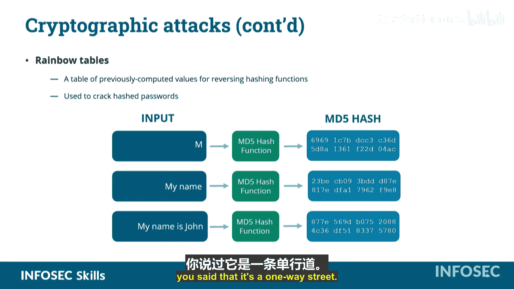

# 【Infosec】CompTIA安全 701认证 ｜ CompTIA Security+ 701 p18 04_01_01_cryptographic-attacks -BV1LRr5BTEow_p18-

Let's talk about cryptographic attacks。A lot of times adversaries want to get access to our data that we've protected with cryptographic measures。

Some of the ways that we can。Face these attacks come in a few different ways。

Perhaps the most popular form of cryptographic attack is the password attack where our adversaries are trying to get access to our passwords。

 we've encrypted our passwords， but they're trying to get access to them。

And so the first one we're going to talk about here is the brute force attack。

 this is perhaps the easiest and most simplistic form of password attack。

This is where the adversary is going to stumble through every possible combination and permutation of inputs in order to finally guess。

That pin or password or whatever it is they're trying to break。

The problem with brute force is that it takes forever， it takes forever in a day for it to work。

 it will eventually work。The problem is， will the computer still be on。

 will the connection still be live？Will the earth be here？Will mankind still be around。

 will the sun still be shining， it will take eons， but it will eventually work mathematically it will eventually stumble across whatever that password is。

 but time itself may have come to an end so it takes forever for brute force to work and so we have more efficient ways of doing this。

The next type that we have is the dictionary attack。The dictionary attack。

 it's not someone cracking open a dictionary and looking up。Vocabulary words or something like that。

 instead， think about what a dictionary tech or think about what a dictionary itself actually is。

It is a list of words。wordords that are spelled appropriately correctly and so we know that's how we're going to use a dictionary。

 but in this case what we're doing with a dictionary attack is it is a list of possible inputs。

 it's a list of words。And so the dictionary is actually constructed of previously used passwords。

This should underscore why you should not reuse your passwords。

You want to use unique passwords in each system and you never want to reuse a password because if a system becomes compromised。

 passwords that are stolen from that system， those credentials are going to be thrown under the heap of dictionary attack word lists dictionary word lists become enormous。

They can easily grow over the size of a single terabyte。

The most recent one that I've downloaded was one and a half terabytes in size。

Just simply astronomical size when you're thinking about that every single password in there is a collection of bytes。

Each letter in a text file is a single byte。And recall that there's 1024 bytes to a kilobyte。

1024 kilobytes to a meg。1024 megs to a gig and 1024 gigs to a terabyte。These are a lot， a lot。

 a lot of passwords that are in there chances are some of the passwords you've used are in there too Additionally attack is going to cycle through all of those known previously used passwords and if you're reusing a password it's going to be on that list。

Another one that we've got on here is password spraying。

Password spraying is where instead of me taking a single password I'm sorry。

 instead of me taking a list of passwords and a single user and cycling through all the potential passwords。

That that user could have instead I'm going to take a single password。

 all of the users and I'm going to go against all of the users until I find the one that it sticks with I'm taking this one password and I'm spraying it across all of the users on a system this is password spraying。

Another form of attack that we have is the cryptographic attacks。

The next form of attack that we're going to talk about is the birthday attack and this has nothing to do with your birthday specifically instead what we're looking at is this weird quirk that we have in statistics。

Statistics tells us that we have a number of individuals in a group。

How many people would how many people in that group or how large would that group be？

If we wanted to say have a 5050 chance。Of any two individuals in that whole group。

Sharing the same birthday。So if you were to come out and say， well， this is， you know。

 this is my birthday and then you're going to check with everybody else in the group。

 how many people would it take for any two people， not just you。

 but any two people in the whole group？So your kind of knee jerk reaction is going to think， well。

 okay， there's 365 days in a year。And so if we divide that in two to get that 50，50 chance， 180。

 what 186 days， something like that， 182 and a half。Well。It actually isn't that large。

It's actually substantially smaller， in fact， it's only 23 people， 23， that's it。

And the reason this works is because。Person number 23 checks with person number 22， hey。

 do you have this birthday， nope， person number 21， person number 20， 19 1817。Not down the line。

 then person number 22 checks with person number 21 and 20 in 1918 1716 not down the line。

Person number 21。And on down the line， each time they're checking with everyone else in the group。

And the chances of that group having a shared birthday is a 50，50 chance。

 it's actually slightly above 50% and this is because with 23 people we're getting more than 182。

 183。Comparisons just off that small group that's because the first person checks with there's 23 comparisons and then we have 22。

 21， 2090 and as you add all of those up， it actually works out to a much larger number。

So the birthday attack， the reason it has this name is this is whenever you take what is seemingly a large。

Number， but in practice， it actually works out to be a very small number。

of possibilities and so with the birthday attack we're taking a large number。

 say 365 days and we're actually reducing it down to a smaller actual group of matches。

With a collision attack。Recall that a collision is whenever we have a hash digest matching up with another hash digest of some other input if we're hashing two inputs and wind end up with the same。

Digest on the output， then that's going to be a collision。

A collision attack is whenever we are attacking a cryptographic hash function。

 and what we're doing is we're finding that we have these two inputs yielding the same output。

This only affects those hashing algorithms which are known to have collisions。

 this is why we should not use cryptographically insecure hashing algorithms because they could fall victim a collision attack。

Having some kind of important patch for a vendor and taking that patch。

 embedding some malware and ending up at the same hash value。

 you could provide to a victim some sort of patch with that malicious software embedded in it。

 and even though it has the same hash is the other one。

 the recipient would take that installed on their systems and unleash that malware on their network。

So this would be referred to as a collision attack。

Another form of cryptographic attack that we have to talk about is the known plain text attack。

The known plain text attack is whenever we have what the final state of this should be。

 whatever the plain text is， the non encrypted text。

What we do with this is we're able to roll it back and start to see what is the input that yielded this cryptographic output。

I like to talk about the movie if you've seen it imitation game。Benedict Cumberbatch。

 he's playing Alan Turing and in that movie， there's a particular scene where the one of the code breakers that works with Alan Tring says。

They're sitting around a pub， they're sharing a pint and they're saying。

I do like the enigma operator they're listening to German code intercepts， she's like。

 I like Cellia's boyfriend。And Bent Cumbbatch is taking a step and he puts it down， he says。

How do you know？The guy's girlfriend is Clia， she's like， oh， well。

 he's always setting his rotor settings to silly。Her nickname。He's like what she's like yeah。

 it's always doing that and so he quickly like dramatic music plays he sets down his pipe。

 he goes running down the road and he runs back to the hut where they're at he starts rifling through all of the code intercepts that they've received looking for those same rotor settings。

And as he's looking at that， he's like， if only there was a message in all of these。

That was the same on each one of them。And if you've seen the movie this。

 it's actually kind of a pivotal scene when they do this， they're coming along and they're saying oh。

 what is the final thing that they have at do this and if you remember what it is， do you remember？

They're sayingH bloody Hitler， and so he goes through and they're looking for。

They know that every one of these communiques that they've received at the end of it saysHil。

And then Hitler on there， and that's what the match is that's in all of these。

They're all using the same rotor setting and they all have the same ending message they know that's at the end of every message。

 it's a known plain text attack， they know what the plain text does and now they can start to unravel the German enig machine so the enigma started to get broken because they knew they had the same message being shared throughout here。

There's also the known cipher textex if you know what it should be。

 if you don't have access to the plain text， it can make it hard to find this one。

 but the known cipher text is whenever you see what it is like okay I know what this how this is encrypted on here the known plain text attack though can definitely show the weakness in an encryption mechanism。

And then the final form of cryptographic attack we might see on the security plus is the raininbow table。

And rainbow tables are one way that we can attack hashed passwords。

Rainbow tables make use of pre computed values， and what we're going to do with this is we're going to figure out what is the input that yields an output。

And you might be thinking， Tommy， when we talked about hashing， you said this to one way street。

 we can't figure out。

What an input is given just the hash digest。And while that is true。

 we can cycle through all potential inputs and what rainbow tables do and do so incredibly well is it looks for patterns in these and it considers the whole range。

Of inputs and so it'll go through and it will hash all letters in the alphabet and then once it finds a match there then it's going to hash all of the next letters and numbers and it's going to figure out what is the next character and the next character and the next character and eventually it's doing a reverse lookup seeing that I've got a pattern that matches the hash on the input。

What was the input that gave me that， it does this reverse lookup and it says， oh， that was letter M。

 that was letter M Y M space， M space in， and it starts to figure out what was the input that yielded that output。

Rinbow tables are effectively used against breaking hash passwords。

 but you must know the system that that password was hashed with。

 I need to know what hashing algorithm was used， I need to know how that hash scheme was being employed。

 what sort of salt was being applied to it and that's how the rainbow table is able to break this。

 it gets this name from the all the range of inputs that it has。The full spectrum。If you will。

And so it has nothing to do with the colors of a rainbow instead it has to do with all of the potential inputs that we have with this cryptographic attack。

 the full spectrum is in play just like you have the full spectrum of colors in a rainbow。

This is the last form of cryptographic attack that we might see on the security plus。

