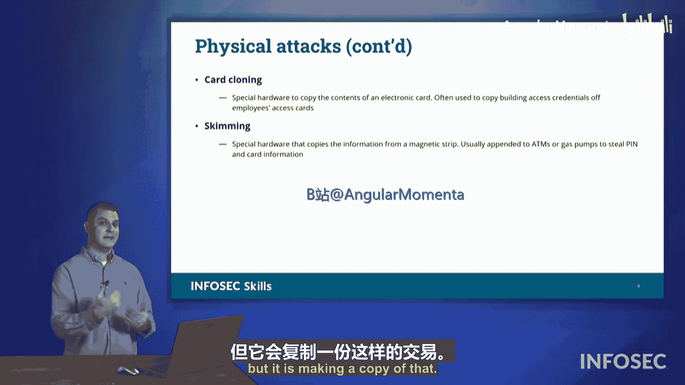

# 【Infosec】CompTIA安全 701认证 ｜ CompTIA Security+ 701 p19 04_01_02_hardware-attacks -BV1LRr5BTEow_p19-

On the security Plus there are a few hardware attacks to be aware of in this section we're going to dive into what those hardware attacks are。

 what they look like， and how they can affect us。The first one to talk about is the malicious USB cable。

This is a USB cable that has circuitry inside of it that allows data to traverse the cable normally。

 giving you the type of use that you would expect， but it is also making copies of your data or it is injecting some kind of code into the computer itself as if it was a removable thumb driverive。

Another type of hardware tech to look at is a malicious USB drive。What these do， when you plug it in。

 it injects code onto the computer directly， it may act like a normal thumb drive or it may look like a normal thumb drive。

 but in fact is carrying malware to launch different attacks。

One of the retailers that makes these available is a group called HaCC5。

 they make penetration testing tools， and they have both a malicious USB cable and a malicious flash drive when loaded with Scris。

 when you plug these devices into a computer it automatically runs those scripts on the system carrying out all sorts of malicious payloads that would allow access to the computer there are plenty of other types of these devices that are out there on the market。

 but HaCC5 is one of the more well-known providers of those。

We also have to worry about how different cards get used， and so we have card cloning and skimming。

Card cloning is where someone sees that you're using an RFID card， for example。

 and they make a copy of that。They make a they get a reader and they go up and make a copy of your RFID card how it's either in your laptop bag or maybe you have it in your wallet in a purse on the side and whenever you are standing at a train station or you're standing out on a public sidewalk that will bump up against you with their laptop bag which may be containing。

An RFID reader， it reads the unique identifier on your RFID badge and it makes a copy of that。

They can then use that information， that unique ID。

 replay that onto the facility that you're trying to enter on a normal basis and they can actually masquerade and impersonate you by using the same RFI ID number off of your badge。

Another type of device is known as a skimmer skimming is whenever you go to make a credit card or debit card payment some sort of payment card is inserted into a reader as you slide it through the magnetic stripe reader or you dip it into say a gas pump the reader is actually performing a man in the middle or it is skimming the information off of that again this allows normal operation to flow through the reader so that you get normal activity on that you still pay for the gas that you're paying at the pump or whatever device you're paying on but it is making a copy of that a couple of visual examples you see here these are pulled from crrebson security Brian Krebs actually has a exhaustive list of different card skimmers that he's come across in international circles these pictures are taken by law enforcement after these devices have been found on different payment card schemes。

The one on the left we're looking at is an ATM reader， whenever you go to put in your bank card。

 it is going to make a copy of all of the magnetic data on the magnetic striptrie on your debit card that way the data gets stored on this。

 they can take that information and play it back later to masquerade or impersonate you accessing your bank account。

The one on the right is a man in the middle credit card skimmer when the payment card is insert in the machine。

 the normal reader sees it， it passes data through this device。

 which passes it along for normal operation， allowing you to pay for your gas。

 but it is storing that information internally。Later。

 the attacker can roll up to the gas pump at night when nobody's looking。

 connect to it via Bluetooth from their phone， download all of the credit card numbers for the day。

In a way they go to be never to be seen found or wherever they're at。

 so these are some of the different forms of physical attacks we might see on the security plus exam。

