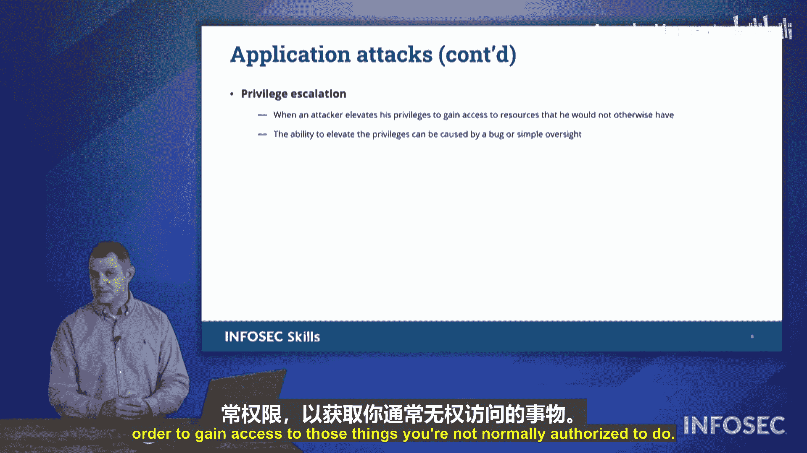

# 【Infosec】CompTIA安全 701认证 ｜ CompTIA Security+ 701 p20 04_01_03_network-and-application-attacks -BV1LRr5BTEow_p20-

In cybersecurity we have a number of attacks to be aware of in this section we're going to talk about some basic network and some application attacks to be on the lookout for these might show up on your security plus exam so keep a lookout for them。

So the first one to talk about is what's referred to in Comptia's security plus materials as an on path attack。

 this is formerly known as a man in the middle attack what occurs with a man in the middle attack is you've got some adversary。

 some connector that connection is that is made between the user and the service they're connecting to。

They're going to disrupt that original communication there along the top。

 and then they're going to have that information flow through them， the attacker。

What they're doing is they're going to be able to view and analyze all of the traffic transiting their devices or devices that they are in control of。

They might see things like Social Security numbers， phone numbers， credit card numbers。

 usernames and passwords， any number of information that is not encrypted。

 they're going to be able to see， make a copy of that and hold it for later use。

This is what's referred to as a man in the middle attack and in other circles。

 but on the exam expect to see it referred to as an on path attack。

What I like about the name onpath attack is that the attack may not necessarily be in the middle。

It may not be in the middle of the connection and it may not be a person at all。

 it could just be a system that is running some sort of software that's on there。

 so just think of this as an on path attack where the adversary steps in between the two endpoints of a communication。

DNS poisoning is another type of attack that we might see mentioned on the exam with DNS poisoning。

 this is going after the DNS server。Recall that DNS is that system that returns an IP address from a given domain name。

You might type in Google。com， APnews。com weatherer。com。EPN。com， you name it。

 and whenever you type that in， then IP address gets returned to you by a DNS server。

If an adversary can slip into that transaction， you request the IP address for a domain name。

 they quickly return to you a fake IP address as if they were the legitimate。DNS server。

Your computer is going to connect to the IP they provide rather than the one coming from the DNS server。

Your computer sends out the request for the domain name and then it's the request for the IPS with a given domain。

 and then whatever reply comes back presumably from the server is what it's going to connect to。

An adversary might give you a fake I address to steer you elsewhere， you think you're going to goo。

com but you're actually going to an IP address that they control your computer believes that's a legitimate I address because the DNS server said so and in this way。

The attacker can actually poison the communications between you and the DNS server。

Another form of poisoning attack that gets mentioned here is ap poisoning。

ARP poisoning is where the address resolution protocol is exploited to allow another host on the network。

To masquerade as a different one。 So an adversary on the network might give out the。Mac address of。

The router and say，" oh， that's me also， or I am that same host。

The router gets it and the adversary gets it in this way。

 both of them get a copy of this information， so any frames of data they are going to the router are also going to go to the adversary。

 they're going to be able to read all that data they're in performing a an onpath attack or a man in the middle attack。

 this is what's referred to as ap poisoning。Another form of network attack， a quite popular one。

 anytime you talk about cybersecurity with folks， it usually revolves around or some mention of denial of service attacks。

A denial of service attack is where you overwhelm。A recipient with too much information。

Having more than one person talking to you at a time might overwhelm your。

Your two ears connected to your one brain， you've got two mouths talking and I only have one brain to process it and it can overwhelm me add on a third or a fourth voice。

 and you can quickly become overwhelmed and not make sense of what's going on this would。

Can't have the effect of getting you you know all locked up and like I can't understand anything that anyone's saying I'm too overwhelmed the denial of service attack is also referred to as a resource exhaustion attack。

 it's going to exhaust all resources that that server or that host on the network has at its disposal。

You can actually overwhelm a host。Without sending in too much information， you can actually send in。

Just enough。Information slowly。And then make several different connections from the same host。

This is one particular attack called a slow laris。Attack。

And you can actually have one system attacking a remote Apache web server that's the web server that falls victim to this sort of an attack。

And it eats up every single connection that that web host has available to it。

And it just strings that web server along by just sending。A single character， ever so slowly。

And of course， the web server is just sitting there waiting and waiting and waiting。

 but it's doing this a thousand0 or 20 times and the web server just can't handle any more exterior connections。

This is a denial service attack that is not just overwhelming the bandwidth。

 it's just eating up all of the resources that Web server has at its disposal。

Another extended form of denial service attack， this is the one that we see the most in news these days。

 this is distributed。Deial of service attack， the distributed denial of service attack is where you have a number of different hosts at your disposal。

 and they are all bombarding one particular target with too much information。

 The graphic shown here on the screen shows us how we've got three different hosts at our under our control。

 And we're sitting that all to a single host。 It's going to lock up that host。 Den the server。

From the legitimate user， it's going to deny the service。It's a denial of service。

 hence the name denial of service attack this ones distributed across a bunch of different hosts in this graphic we only have three hosts on here in practice this will be hundreds or thousands or even tens and hundreds of thousands of hosts connecting to any one particular target and it's going to send wave after wave after wave of unwanted unrequested traffic to the target。

The way we can overwhelm a host is using application attacks。And so。

This amplification that we've got， this is actually a way of。

Interacting with those remote hosts that we just saw。

The amplification attack sends out small amounts of traffic。

 and then we get large amounts of response back。Case in point。

 you send out a small single request for information about a domain。Google。com。In response。

 if you ask for all DNS records， you're going to get more than just a single IP address。

 if you ask for all records， you're going to get a whole stack of different responses coming back from that host。

A small outbound request and an outsized large response coming back is going to be an amplification attack I can amplify。

The amount of bandwidth I have going out from my network and have an overwhelming amount of traffic come back to you。

That's just from one of my hosts， if I have tens， hundreds or thousands of hosts under my control。

 I can quickly overwhelm you by sending out queries from all of my devices to DNS servers out on the internet。

And have them overwhelm you as a target This is the DNS amplification attack we can also leverage other protocols。

 there's the network time protocol inTP This also is useful for carrying out amplification attacks We need to safeguard any sort of responses that are coming back to us that we did not request this is how you can shut down a distributed denial of service attack。

Another form of amplification attack that we have to discuss is the buffer overflow。In computing。

 a buffer is a block of memory。That contains information coming in from our users。

 any sort of input that comes in， we're going to hold for processing inside of a buffer。

The buffer is a set amount of information we have to know and we have to program how much。

Information we're wanting to store。In that。And what happens is with the bufferflows。

 if you send too much information， it actually spills out into the rest of the memory and computing。

So we've got a finite amount of memory in our buffer and then if we send too much information。

 it's going to flow out and could overwrite values elsewhere in the computer's memory。

With proper research and work done， you can actually cause a buffer overflow in a number of different applications。

 so this is largely going to be application specific。In this next graphic that I have coming up。

 we've actually got a buffer overflow that I saw when I was on a family vacation。

So we were in far west Texas and I have a gas pump that we pulled into and the gas pump that we saw was an old analog gas pump and I was like。

 when I first got out of the car I was like，Oh man， I got to remember。

How do I do this thing it took me a minute and I was like， oh yeah all right。

 you left the handle turn the dial or the lever and then the dials reset there on the image there whenever you do that it kind of kind of turns on the gas pump。

But if you get looking closer at the gas pump itself， as I was filling up gas。

 I took this picture here。And this one shows the dials on here。

 so it it's an analog display right you got these numbers on dials that goes around here。

 you might remember some old car。Odometerters that are similar what it does is if you go through and you look at the numbers tumbling through there。

Imagine the situation where if I put in 999。9 gallons that would be a lot of gas or if I put $99990。

 that's probably even easier to do than 999 gallons。

 but if if I fill up these numbers and it has no space left to go，9，9，9。And 90 cents。

If I put in 10 cents more。What is the display show， it's going to show0，0，0。

What happens is that one does that mean hey I have free gas， yeah。

 I wish actually if you look here at the if you look at the sticker on there it says you have to prepay before you pump gas。

 people may have tried to do that。But what happens is that something happens to that one。

 we don't have space for that one on our analog display here。

 and so it's going to overflow coming back from that。

In this way that one could push off some other mechanism in the machine if you can imagine that that's what a buffer overflow is we have a fixed amount of memory dedicated to a certain task in this case we have three hole digits and then we've got some sort of fractional number that's there on the side to show how many tens of sense that we have purchased in this case this is the buffer overflow why might we want to cause a buffer overflow what might we want to overwrite well we could overwrite some of the information that is in the system that could be in the form of changing our user credentials it could be giving us access to things that our user account is not set up to do。

And so if we have a system that inside memory， it says， okay。

 the user ID for the administrative user is， and then it has some number on there。

We could actually cause a buffer overflow， write values to memory， and then change the user ID。

And it just so happens that we change it to be our user ID。

 This will allow us to perform a privilege escalation attack。

We're able to escalate our privileges beyond what we originally assigned to do so what we're looking at here is privilege escalation。

Overstepping your normal privileges in order to gain access to those things you're not normally authorized to do。

These are some of the examples of network and application attacks that we might see coming up on the security plus 701 exam。

