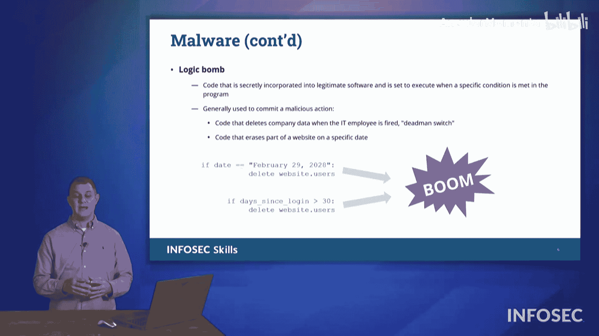

# 【Infosec】CompTIA安全 701认证 ｜ CompTIA Security+ 701 p21 04_01_04_malware -BV1LRr5BTEow_p21-

In cybersecurity， we oftentimes have to deal with malware。

 that's largely what we're trying to defend against is different types of malware infecting our networks。

In this section， we're talking about different types of malware and we're going to list out a few that we might see reflected on the exam。

The first division that I want to talk about within malware， which， by the way。

 malware is a portmanteau between malicious and software。 We join those two words together。

 and we end up with malware malicious software。 The first division to talk about is viruses and worms。

 a virus just as with a biological virus needs a host。 It needs a human。To do something。

 the virus relies on user interaction。 It needs you to click on the link。

 It needs you to download the file， or it might need some scheduled system process to kickstart that malware。

 This is a virus。 It relies on a host。A worm， by contrast。

 does not need any sort of human interaction， a worm just as in you know， just as in nature。

 a worm does not necessarily need a human for it to。Travel around， it can move on its own。

In cybersecurity， a worm is able to move and travel on its own。

 it will crawl through a network on its own， it is self replicating and self executing。

The worm is different than the virus because of the amount of user interaction required with it。

Some other terms that we'll see in when discover describing different types of malware is a Trojan and a back door。

 a Trojan， its name coming from the Trojan horse is a。

P of malware that is hidden inside of a legitimate piece of software。

 or it's a piece of software that isn't really what it pretends to be。

If you go out and you download a very expensive piece of software and application and it comes in and you're like。

 great， I found this bootleg copy of this software， it might be a functional copy of that。

 but what else are you getting with it？It might be a Trojan horse， it might be a Trojan。

Be on the lookout for those。Another term that we'll see used on the exam is a back door。

Now a back door is not always。Miicious intent， but it can always be exploited if found by malicious actors。

And so what a back door does is it allows you to authenticate into a system without going through normal authentication measures。

So you go to test out an application you're developing when I go to create that application I may not want to have to go through the normal authentication measure each time we're going to build this secure so you type in username password and then you've got some series of multifactor authentication。

Devices to log you in。With a back door， it allows us to circumvent all that login system so that we can test it。

 this is a back door。A developer might include that so they can test the application。

But let's say that developer gets sick or they're out of work for some amount of time whenever the organization goes to launch that software。

If maybe that developer has not told anyone else about them creating that test platform。

 that test ability。And they go to market with that software。That back door now exists。

Maybe the developer thinks well， surely one of my colleagues caught it and the organization is like surely nobody could put a backdo in our software。

 it wasn't created maliciously， but an adversary is certainly going to be looking for one。

 a back door allows unauthorized access into a system。Another term to talk about here is a remote。

Access Trojan， a rat。remotemote access Trojan is something that gets installed on your system and on this system whenever it's running。

 it's actually talking out to the wider internet and it's going to get some command that the malware author has instructed its different devices to do the rat will go out。

 get that command and run it here locally， even though the attacker is not directly logged into our system。

They're interacting with some website somewhere else。 The rat pulls down that command。

 runs it here locally， as if。The adversary was actually logged into the system， but they're not。

 it's just this software running locally on it。Rats can also be in the use of a bot we hear this used quite a bit in the news。

 a bot is a system that is running remote controlled， and so a rat is kind of a form of a bot。

You can actually have a number of these different bots running together forming a bot net。

And then the malware author that is controlling that bonet running those commands from Afar。

They're going to be called the bot master， they manage all of these bots and these botnets can number in the thousands。

 so you have tens of systems， hundreds of systems， thousands of systems。

 hundreds of thousands of systems as part of some of the world's biggest botnets。

What sort of activity does a bonet do？The bot master might say。I feel like attacking this system。

And they will point all of their bots to they'll instruct them to send unrequested data to that target system and it knocks them offline with a distributed denial of service attack there's a lot of different things that botnets are capable of and they can be very very problematic for others these build off of the concept of a rat again it's the software on your local system pulling commands from a remote system and running it as if the attacker was here locally on the system。

Other types of malware to be on the lookout for on the exam， we have key loggers。

Keyloggers are these pieces of hardware， or it could be software that is installed on the system。

And what it's going to do is it's going to read every keystroke that you make on the computer。

Why would it want to do that Think of all the sensitive information you type on your computer。

 you've got usernames， passwords。Credit card numbers。Social Security numbers。

All sorts of financial information they can be sent out。Especially those passwords though。

 all of that is going to be read by an attacker key loggers can either be hardware or software。

 they can store the data locally or they can send all of your data out over the open internet so key loggers are watching and waiting for you to enter some sensitive information。

Somewhat associated with that is this concept of spyware spyware spies on your system。

 it is a key logger plus some， so it might be able to do key logging， yes。

 it will also grab whatever's on your screen and it can also snoop on your webcam seeing and watching what you're doing。

 when you're at the computer， what websites you you going to。

 what sort of network traffic are you generating， what are your keystrokes。

 spyware can watch everything you're doing， be on the lookout for spyware as a type of kind of hyper key logger。

The final one to look at on the exam to be aware of is a logic bomb。

Logic bombs are usually the work of an insider threat。

And what it's going to do is it's going to look for a specific condition to be met when the logic。

Is right。When the terms of the logic are correct， then it triggers whatever malicious act is being intended。

So in this case， it's going to look at and it says if is if the date is February 29th， 2028。

 delete all of the users on the website。And so on this particular day， this logic would be triggered。

Down below。If the days since I was last logged in is greater than 30。Cause the harm on the system。

 delete all the website users。In this case， we're going to refer to this as a dead man switch。

If I don't really like it here， I don't like my colleagues and theyre and I just。

 I feel like I'm going to get canned soon， you know what I'm going to show them and so I'm going to create a logic bomb。

If they fire me or I'm terminated or they don't renew my contract， well， 30 days after I'm gone。

 they'll see I'll get even with them and so a logic bomb will watch and wait for that period to pass and then it will spring into action。

There was actually a case of a logic bomb that was found at the federal level by the government sponsored corporation that underwrites a lot of mortgage backed securities。

And or a lot of the homeowner mortgages this insider threat felt like his days were numbered at this organization and so he created a logic bomb and if it had gone off if it was not discovered ahead of time。

 it was going to go through and delete a number of different mortgage loans that were backed by the federal government and caused irreparable harm to cross the US economy they did find this before it actually went off and he was prosecuted for that but this was him trying to cause disruption at his organization because he felt slighted logic bombs can be the work of an insider threats so be on the lookout for those all of these different types of malware could show up on the security plus exam。

