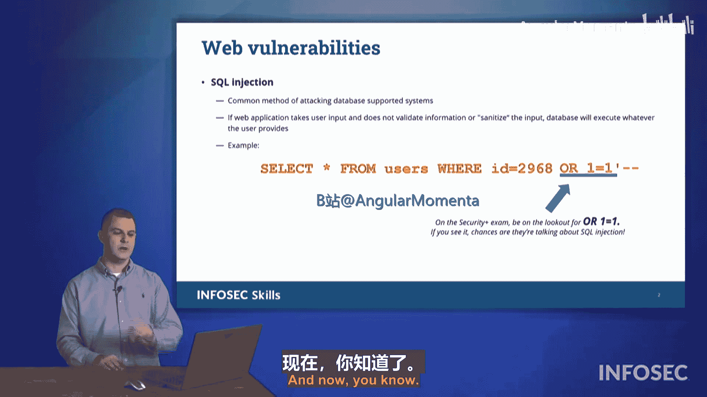

# 【Infosec】CompTIA安全 701认证 ｜ CompTIA Security+ 701 p22 04_01_05_sql-injection -BV1LRr5BTEow_p22-

SQL injection is a very common and popular form of attack SQL is the structured query language in this section we're going to look at the SQL injection attack and how it operates from a high level。

So the first thing to talk about is how SQL injection works overall。Or how SQL itself works。

 And so what SQL injection is or what a sQL injection attack does is it injects a little piece of logic into a standard。

SQL query， such as the one seen in red now。Where this query says select star from the table called users where ID equals 2968。

So this is a standard。SQL query， but with SQL， what it's going to do is it's going to go to the table users。

 it's going to grab all of the records。Where the condition ID equals 2968 is going to choose that row。

 that record and return that result or any results where that clause is true in this case there's probably only going be one row that has a ID 2968 and so that's what's going to be returned oftentimes with web applications whenever you go to view a product ID or a particular restaurant if you're looking at like Yelp reviews let's say。

There's going to be an ID associated with that individual restaurant。

 that location of the restaurant， and then it will then provide all the information from that table according to whatever that logic is。

So what a SQL injection does， though， is it actually tacks on a little bit of logic on the end of that。

And so in this case， you're saying the or1 equals1 gets tacked on here。

The way that SQL does this is that it's going to process， it's going to go through and look at。

If ID equals 2968， if that's true。Then that's the data we're going to pull otherwise。

If one equals one， if that's true， then return the result that you're considering at the moment。

 we're going to take a moment and we're going to look at this in just a moment to see how this actually operates what I want to draw your attention to though is look for this or one equals one。

Compampia every time on the exam， if you see a SQL statement and it's going to be written out like this。

 even if you're not a SQL master。If you see something along the lines of select。And especially。

 I really want to draw your attention to this if it says or one equals one。If you see that。

 or one equals1。That is a tailtale sign that they're asking about a SQL injection attack every time bank on it if you see or one equals one。

 you will know for a fact that that's going to be talking about a SQL injection attack。

 it never comes up in any other context it's a way that Comptia is asking you and if you know you know and now you know or one equals one Let's look at how a small simple database in this case we're gonna to have a table called products。

And then on this table。We're going to see how that or1 equals1 completely changes all of the results returned by a SQL query。

So the first what we're going to look at is we're going to have this SQL query， it says select star。

 select everything from the product table。Where some ID is provided。

Now this could be coming in the form of a URL or from some input on a web form。

 it's going to ask you to put in some value on there okay。

 so let's just start off and let's say the number three。So if we take the number three。

 what we're going to do is we're going to go through each row of this table and we're going to consider what is the row that we're looking at。

 does the criteria in our query， does that match with the row that we're looking at。

So the first step that it's going to do is we're going to create a results。Entry。

 we're going to have a bank of memory。That stores all of the data taken from our database。

It's going to store all of those， and so at the end。

 once we're finished considering every row and record on the database， it returns those results。

So the first thing that we're going to do is we're going to go through each row of the database in this table we're looking at。

The first row and it says。Id is equal to one。The product name is thingh， it cost is 50。Price is one。

 and we have 24 on hand。So we look through here and it says， is ID？Equal to three in this case。

 does one equal 3。 No， one does not equal 3。 that's a false statement。

And so because that clause in our SQL statement is false。

 we're not going to include this in our results， so the query moves on and it looks at the next row。

And it says row number two， this is a do Hickey and their cost is 25 cents。They sell475 cents。

 and we have 52 on hand。In this case， does ID is that equal to two。

 well I'm sorry is two equal to three？😊，No， two is not equal to three， that's a false statement。

 and so this is not going to be returned in our results。We go on to row number three。

The third entry on this one， it looks at this row， and it says。

Is ID equal to three is three equal to three you bet it is it always is three is equal to 3。

 so in this case the row containing widget a cost of $125 sells for 250 and we have 1915 on hand what we're going to be doing is we're going to take that record we're going to put that into our results and we're going to return that at the end of the queries。

Next we move on to the next row because we're not finished yet。

 we don't you and I can see all the information we say yeah。

 that's the only one that has three but the system doesn't know that it has to step through each of these。

 so it goes onto the next row and it says，Row four。Roow fort， this is a dingle hover and they cost5。

 we sell them for six bucks， we have 10 on hand。Is the ID equal to three is four equal to three， no。

 that's a false statement， it's not true。And because it's false。

 we don't include that results in our results， and so we've reached the end of our database。

 we return those results to the user or to the web application and what are our results contain。

 it contains just row number three。And so we get just that one record that we wanted。

 that's how a normal SQL statement works。Now， what happens if we throw that wrench in the plan。

 what if we unleash on the query？Or one equals one select star from products， grab everything。

From each row， from the table products where idd equals 3。Or where one equals  one。

Let's step back through that logic， that process and see how does this or one equals one？

Flow through this。 And it's that or one equals one that we're really focusing on。

 Now we go through and we look at each row of this。The first row does ID equal 3， does one equal3。

 no it does not， that's a false statement。Or。Does one equal one， it always does。

 so that's a true clause， that compound statement， does Id equal 3 or one equal  one。

 that's a compound statement that is true。And so now we take row number one and we put that into our results。

How about row number two if we grab row number two， does two equal 3？No， does one equal one， yes。

That's a true statement， so we grab that room and we put it into our results。How about third row？

Does three equal  three， yes， and so we're going to take that and we're going to put that into our results。

And then how about this last row， row four？Does four equal 3， no， it does not。

 how about that one equals 1？Does that is that a true statement it is and so we take that row and we put that down into our results and now we've reached end of our database。

 we return the results and what do we get？Now that web application has all of the results。

 that web server might gush all of our contents of our database。

 and now we might be spilling the beans when it comes to how much we pay for some of these products。

 somebody might call us up and say， hey， can I get some of those do Hicies from you？Well， yeah， yeah。

 yeah， we've got 52 on hand。 Okay， I'd like to buy 50 of them。

 but I really don't want to pay the retail price。 Okay， well， the lowest I can go is 50 cents。 Oh。

 you can do a better price than that。How about， let's say 30 cents？

And you can talk down because you know what their cost is。And they're not going to say， well。

 I have to stop to make a profit on that， we don't buy them for that much， you know better than that。

 and so an adversary can actually use this as leveraging in a normal business transaction。

 this is some proprietary intelligence that we don't want slipping out。And so in this way。

 we need to provide protections watching for these SQL injection attacks on here。

 watching for something like or one equals one。This is how a SQL injection attack works。

 be on the lookout on the exam for a SQL injection attack and you'll know it's a SQL injection attack because it will always have or one equals one。

 something else to look for on your security plus exam。

