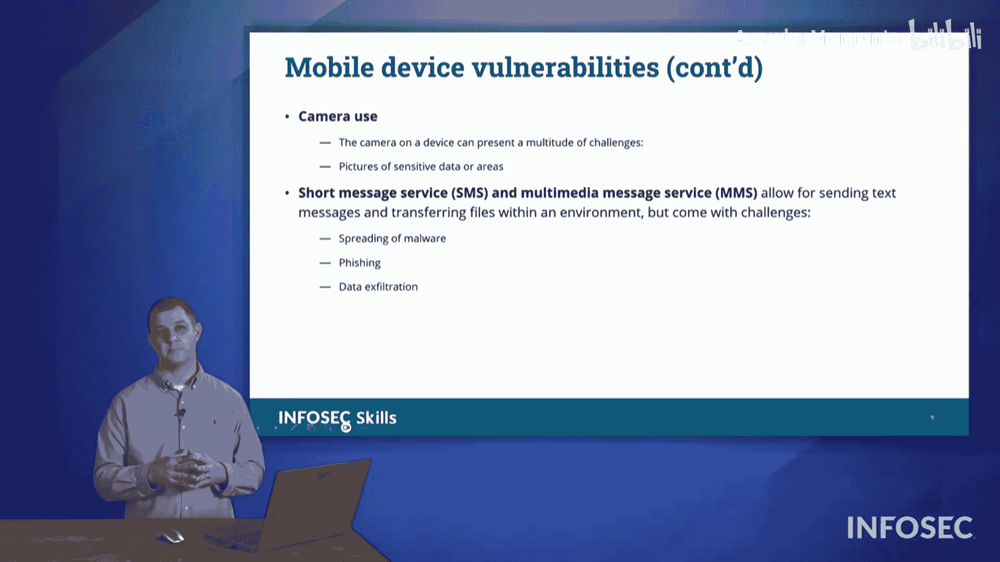

# 【Infosec】CompTIA安全 701认证 ｜ CompTIA Security+ 701 p23 04_01_06_vulnerabilities -BV1LRr5BTEow_p23-

In this section， we're going to talk about different vulnerabilities that could affect our networks。

Different organizations handle these vulnerabilities differently， but on the exam。

 we're going to be looking at some of these terms and we need to be familiar with them in order to identify them on the exam。

In this section on vulnerabilities we're going to first of all start with a term that you'll see time and again throughout cybersecurity。

 and this is what is known as the dreaded Ze day。When a vulnerability is discovered or as we say。

 disclosed。It starts a clock， it starts a type of timer。And we begin to conversationally say。

 how long have we known about this one， did you see that new vulnerability about that thing。

 have you heard about the new vulnerability about that this or that？

How many days have we known about it we've known about that one for， you know， 30 days。

 we've known about that one for 90 days， 180 days， 365 days。That vulnerability is five years old。

 doesn't mean it's any less harmful， but we talk about how many days old a vulnerability is。

 how many days since it was disclosed。The problem that comes up is those brand new vulnerabilities。

 the ones that nobody's seen before， how many days have we known about it zero today's the first day it's caught everybody off guard that's why we call it a zero day the zero day is what keeps folks awake at night you worry about those times when you have a zero day because there's no existing solutions that we know of that stops it。

And so in doing so to stop these， we try to layer our defenses to stack up as many mitigations as we can to stop and catch zero days。

Let's dive into some of the different types of configurations or vulnerabilities that we've got and actually the first one we're going to look at is misconfigurations。

 that is to say when a system or some part of a system is misconfigured if it's not configured correctly or it leaves us open to some sort of insecurity。

 this isn't going to be considered a misconfiguration。

Typical common misconfigurationations include having a default account。

Admin admin right your username is admin and the password is admin right out of the box。

 some new technology might have the default login included on there。

 and so this would be a misconfiguration if you never went back and changed that default account be on the lookout for those。

Another one could be error handling if you're not handling errors that get reported to users。

 you can actually。Overshare other types of information that an adversary would be attacker might glean from that and then they would be able to use that information against your organization because they would know what type of server you're running or what operating system you're running。

And then there's also the problem of unnecessary software components。If you don't need some software。

 uninstall it， you don't want to leave software on systems installed if you're not using them。

 if they're not serving any purpose， get rid of it because keeping software on a system。

 every piece of software is a potential vulnerability and if it's not needed。

 there's no reason to keep it around， it's just a vulnerability and you have no reason for it。

Other types of vulnerabilities that we have。Can be operating system vulnerabilities with operating system vulnerabilities。

 we have these two types we have malicious libraries and malicious drivers let's first of all talk about what a library is。

When you write code， if I was to create a program that was going to be for Windows and I need to create a window to handle my application。

 I don't have to go in and write all of the code that makes that window possible because there are other developers that are making the same types of programs that need window controls。

And so。In the case of Microsoft Windows， Microsoft puts out a block of code that anyone can use that generates the code。

For that window， I can then utilize that code in my program to create those kind of behaviors that I want so that when you click on the X。

 it closes the application， there's no need to go in and reinvent the wheel。

's there doesn't need to be a duplication of efforts。

 one person can create a library and then others can use it。To consider it another way。

 if I wanted to learn anything there is to know about elephants， let's say。

 I don't need to travel to the African Savanna or to the jungles of Southeast Asia to learn about elephants。

No， instead， I can。G grab a book that has been written by a wildlife biologist who has already studied elephants。

That book might be available at， you can see where the analogy is going at the library。

I can go to the library， grab that book， turn to the chapter on elephants。

And read what I needs and read， I can use the knowledge that has been collected by someone else。

 I don't need to recreate that knowledge， I don't need to recreate the effort I can use what they've already put out there for us。

In programming， it's kind of the same way， I don't have to recreate that code。

 I can use what they've already got， I can go grab it off the proverbial shelf and then use that in my program。

The problem is if an attacker knows that I'm using a library。

If they know I'm going to go grab that book off the shelf。They can alter that book。

 they can change what the contents of that book might be， and then I would be， in my analogy。

 misinformed about something， or in the case of a vulnerability。

 they can change and alter that code so that my program now ingests this library and along with it comes some sort of malware。

 some sort of potential attack。And so this is a malicious library and how attackers might use them against us。

Something similar is with malicious drivers what a driver does is it is the software。

That talks with our hardware to make sense of the signals coming or going from that hardware。

The software that our operating system utilizes to talk to that hardware is known as a driver。

A malicious driver can actually include some unwanted behaviors with that hardware as signals are coming in off of that hardware。

 perhaps a malicious driver is making a copy of that we see this in the case of a key logger key loggerers read every keystroke that we do。

A malicious keyboard driver would interpret the signals coming from the keyboard。

 make a copy of those keystrokes， store them in a file。

 or send them off to the internet for collection elsewhere。

These malicious drivers are problematic because operating systems must trust the drivers that they've got because there's no way for the operating system to know what the hardware is actually doing unless it's coming through the driver。

We protect drivers through code signing and other security controls。

 but malicious drivers can be a form of an operating system vulnerability。

Our actual hardware can also be a potential vulnerability we can have hardware vulnerabilities where attackers can install hardware that's going to spy on what we're doing this can be a problem because if an attacker can have physical access to a system that's a problem in and of itself we want to protect the physical access to our systems we want to make sure that people are not plugging in removable media such as USB drives or cameras any sort of media converter all of that sort of stuff we want to be careful that they're not plugging into our physical systems and then leaching our data taking it elsewhere that would be problematic。

And so generally what we're going to do to safeguard our systems from any of these peripherals。

 which often come in the form of USB devices is we just block all USB ports on our systems。

Here at InfoSec， we actually block。Physical access to our USB ports to remove all removable media on thumb drives and mass storage devices is just a way to safeguard and remind ourselves that we don't want malware being injected into our system or data being exfiltrated out。

 everything has to come into our systems over the wire so that we can monitor that and keep each other safe。

Other types of vulnerabilities that we've got， we also have software supply chain vulnerabilities。

With supply chain vulnerabilities， this is where we're starting to look at who are the vendors that supply us。

Perhaps your security at your organization is too secure an attacker doesn't want any part of that that just sounds like a lot of work This organization has a lot of security in place and so an adversary is just going to be like I'm not going to go directly at them。

 I'm going to do an end around。And I'm going to attack their suppliers and so if we are buying services from some third party。

That third party can actually be leveraged as a way into our network and so we need to make sure that our suppliers and vendors and any business partners that we're working with。

 we have security agreements in place to help secure our supply chains。

 we're constantly on guard and we're staying vigilant for supply chain attacks being on the lookout for how supply chain attacks work can help protect our organization's security。

Other types of vulnerabilities that we might see on the exam。Cryptographic vulnerabilities。

 this is those types of vulnerabilities that exist because a potential cryptographic algorithm is broken。

Or it might， if we're using hashing algorithms， if a hash algorithm can generate collisions。

 that's going to be a cryptographic vulnerability。Think about it if we have an executable and we have an executable with malware in it that some attacker creates。

If they can create the executable with malware in such a way that it generates the same MD5 hash value as the legitimate executable。

 when we receive the executable with malware， we run it through the MD5 hash。

It gives us the same hash value as what we were told the legitimate。Software would be。

 so we know that we've now got a legitimate software。

 we're going to install it or we think we have legitimate software。We install it。

 we unleash the malware on our system， this would be a cryptographic vulnerability。

Another type that you see mentioned here。Is。Past the hash。With the past the hash。

 this is where we are sending information that might be hashed or it might be stored as a hash。

 but because we're not encrypting it， it can actually be used and that can be sent along。

So we want to make sure we're protecting our data when it's in transit， when it's in storage。

And when it's in use through the use of cryptography。

 these cryptographic vulnerabilities might show up on the exam in some other contexts。

And then lastly， we're going to look at mobile device vulnerabilities with mobile device vulnerabilities。

 there are a number of different concerns that we have with our mobile devices。

 the first one to tackle。Is third party app stores do we want to require our users to use a third party app store or do we want to deny them from using a third party app store it could be either one depending on your situation。

It could be that we want our users to only use the official app store。

 so we're going to deny them from using the thirdparty app store。

 or we might say there's just too many apps in the official app store to use on your company mobile device so we don't want you using the official app store。

 we want you to use our in-house thirdparty app store， we create our own app store。

 collection of apps that we have vetted and are assured that they are cyber secureure。

And so this third party app store that we run， that's the only one you want to use on your company mobile device。

 it depends on which one you're doing。Side loading is another way that users can access apps on their mobile device with side loading。

 we can actually load an app direct from a computer onto your mobile device this is often used by developers of various mobile device apps so that they can test the software whenever they go to launch it。

Sure， they can create the code on the computer， see it run in a simulator。

 but there's still a chance that something's wrong and so they want to load it onto a physical mobile device and see what is the user interface。

 how does it work， what does it look like， etc。How you access that。

 the way that you grab that app and load it on your mobile device is known as side loading。

 I'm just going to load it directly onto it。The problem with this is there are a number of apps that do not pass muster and will not get listed on an official app store。

And so some of these apps are available on the internet that are only available if you side load them。

 if you hook your computer directly to your phone and then download the app that way。

 this is known as side loading。The last point on this particular slide says rooting and jailbreaking Rooting is where a phone gets rooted。

 it gets root level access to a user so that they can disable any sort of security controls that you have on that mobile device。

 such as MDM or mobile device management software。By rooting it。

 they're undermining the security that locks that software in place。

The other term jail breaking is where。A user gets into their mobile device and they're able to unlock features on that mobile device。

That are normally off limits。And so it gives the ability to do things that you wouldn't normally be able to do。

For example， if you had your mobile device had a camera on it and was disabled by policy。

 jailbreak would allow it to re enableable that。So jailbreaking enables us to access。

Those features which are normally off limits。Finally， we have two。

Other mobile device phone release to discuss at different organizations we might restrict the use of cameras。

 I don't want you installing or making use of I should say。

 a camera on your phone here at our office we have sensitive things that are here in the office we don't want any of our users taking pictures and using those so by policy we might disable those cameras。

You might also have vulnerabilities that come up with text messaging。

 so SMS or MM these types of text messages can actually be problems for organization security we can have data that gets exfiltrated that way malware it might come in it you might be subject to some sort of a social engineering attack it can all come in the form of a text message to a mobile device and so we want to be able to block that from occurring beyond the lookout for these and other types of vulnerabilities on the security plus exam。

