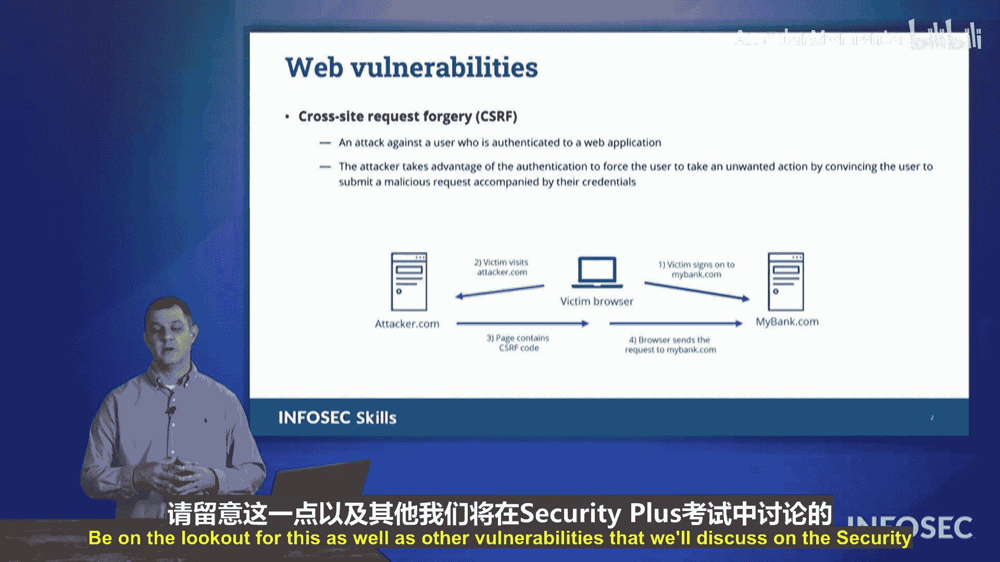

# 【Infosec】CompTIA安全 701认证 ｜ CompTIA Security+ 701 p24 04_01_07_csrf -BV1LRr5BTEow_p24-

In this section， we're going to look at one of the vulnerabilities that we will see on the security plus exam。

This section is about the cross site request forgery let's take a look at how it operates the cross site request forgery is exploring the interaction between the victim。

 some service provider in this case Mybank。com and an attacker shown on the left as attacker。com。

What we're going to do in this scenario is the victim is going to log into their service provider。

 in this case， MyBa。com。They're going to log in， maybe the bank sends them some multifactor authentication login credentials。

The user will then authenticate and the service provider will send back a cookie to the victim。

The user， the victim in this case， has this cookie that provides an authenticated login to the service provider。

At some point， the attacker sends an email or some other measure。Ss a connection to the victim。

Which lures them to click on that link。Bringing them to the attacker's site。

So the victim goes to visittheattacker。com。Because they've been lured into clicking on an email。

 congratulations， you're one of our six daily winners for a free laptop。

 Thanks for being a loyal Mybank do co customer。😊，That's believable。

They do give out prize from time to time and I am a Mybank。

com customer sure I'll click on that link and so it takes them to the attacker's site The attacker then provides a link for them to click on which goes to the victim。

That page contains the cross site request forgery， and what it does is it has the user system actually send forward that request on。

The attacker has forged。The request and the victim's machine then takes that forwards it to the bank。

 which actually conducts whatever business it is。In this way。

The victim's computer sends their request on behalf of the attacker。And then the request might say。

 I want to transfer all of my money from my bank account to some offshore account。

 and the victim is not aware that this is what they've clicked on。

 but the attacker is leveraging that authenticated session that the victim's computer has had with their bank in doing so the attacker has again forged the request。

Across。To a different site， hence the name is a cross site request forgery， the CSRf。

Be on the lookout for this， as well as other vulnerabilities that we'll discuss on the security+ exam。

