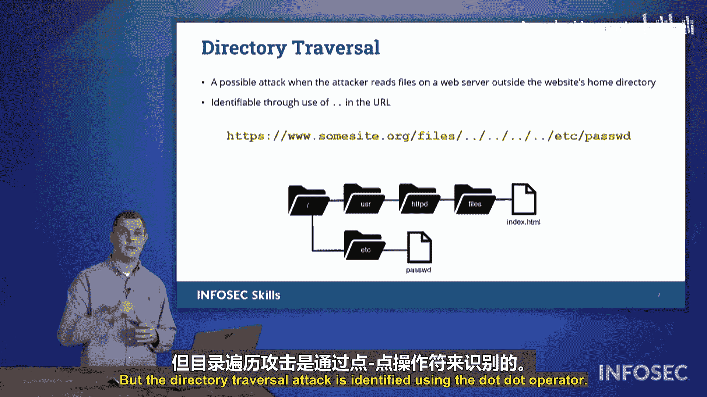

# 【Infosec】CompTIA安全 701认证 ｜ CompTIA Security+ 701 p25 04_01_08_directory-traversal -BV1LRr5BTEow_p25-

In this section， we're going to look at one of the vulnerabilities that might show up on our security plus exam this vulnerability is called the directory traversal。

The way that the director traversal attack works is it provides access to files on the file system of the web server that are not normally part of the web server's file system。

So showing here is the graphic， we can see how we've got on the top layer。

 we've got a listing of files that are accessible to the application， the web server software。

The Web server software has this directory called HTTPD。Inside of it is a directory called files。

And then inside of there we might have a file， in this case we're looking at index。htm。However。

 with a directory traversal attack， an adversary might be able to navigate the host operating system of the web server in order to access files that are not normally part of the web server's offerings in this case。

 Etsy。Password file。The way that the adversary would carry out a directory tover attack is to use the dot dot operator。

On the command line， in Linux and even in DoOSOS。You've got the dot dot operator。

The dot dot means to go back a directory。So dot means you're here， dot not means to go back。

And so if you look at the URL on our slide， we've got www。ss。org/ files。Slash。

And then the dot dot takes us back out of files， it goes back a directory。

Which in this case takes us back to the root of the main website， somesite。org。

And then dot dot takes us out of that into the in this case， the user directory。

 the dot dot then takes us back out of the user directory to the main route directory from that point we can now navigate into the Esy directory and then ultimately the password。

If the web server is not configured to defend against this sort of attack。

 the web server might be tricked into offering up the password file。

 which is going to contain a list of all of our users on a Linux or Uni based system。

This would be problematic because now the adversary has a list of authorized users on the system。

 and then it can go into launching against some sort of a password attack or some other authorization attack。

But the directory Traversal attack is identified using the dot dot operator。

 be on the lookout for that on the security plus exam， it's one that might show up on it。

