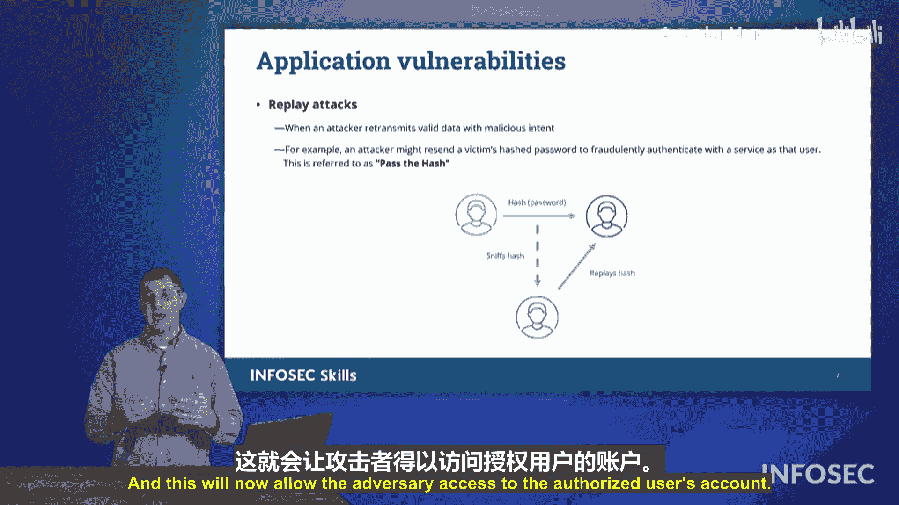

# 【Infosec】CompTIA安全 701认证 ｜ CompTIA Security+ 701 p26 04_01_09_pass-the-hash -BV1LRr5BTEow_p26-

In this section， we're going to look at one of the vulnerabilities that might show up on our security Plus exam。

This sort of vulnerability is known as pass the hash。

This is a form of a replay attack let's talk about what a replay attack is first this is where an adversary is able to listen in and eavesdrop on your communications when you go to authenticate with a system。

 it might say what's the secret password and then you will then transmit back whatever the transmit the secret password is。

The adversary is able to listen in on that password and all they have to do is listen for what that is。

And then they can then later go and authenticate with the system and say， hey， system。

 I want to authenticate， it says， send me your password and they just say。

Here's what it was last time。Now as humans we think about well。

 the computer would hear the change in voice because you're not going to sound like another user。

 but remember computers， they all talk the same language， it's all ones and zeros。

 there are no tone differences or accents or voice changes it's all just ones and zeros and so by a replaying whatever the authentication measures。

 the server is going to give access to the adversary just as it would with an authorized user this is known as a replay attack with past the hash what we do is we have a user transmitting their login credentials。

 say a password to a server。Now the server is going to go send me your password。

 but let's not just send it plain text， I mean， we're going to be more cyber secure than that。

Go ahead and hash that password， and so the user hashees their password。

 sends it across to the server， the server has a hash digest on file， and the hashed password。

 those digests get checked and if they're the same the service says， yeah。

 that's the user come on in。But the whole time， an adversary has been listening down here at the bottom。

 and the adversary hears that conversation going on between the user and the server。

The adversary makes a copy of those credentials that were used and so when the user disconnects the adversary can then connect to the server the server saysS me your password Sure here's my password all they have to do is send in the hash digest of that password。

Now， does the adversary know what the plain text of that password is？No， do they care， no？

They just need the hashed form of that so they take that data。

 send it to the server the server says yeah this is the same hash as what you logged in last time。

 come on in and this will now allow the adversary access to the authorized users account this is what's known as past the hash and it's one of the types of vulnerabilities we might see on our security plus exam。

