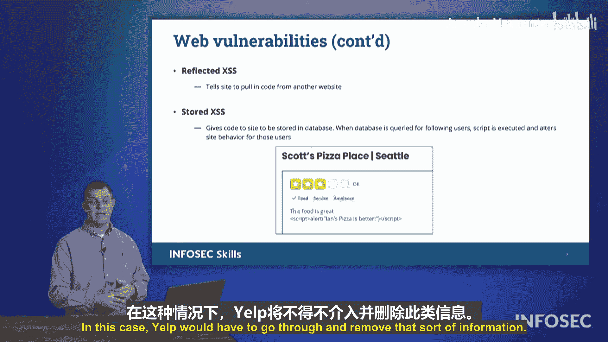

# 【Infosec】CompTIA安全 701认证 ｜ CompTIA Security+ 701 p27 04_01_10_xss -BV1LRr5BTEow_p27-

In this section we're going to look at one of the vulnerabilities that could show up on the security plus exam。

 this vulnerability is known as a cross site scripting attack or XSS for short。

A cross site scripting attack is where an attacker sends in malicious code to a web server or web application with the intent of causing some sort of misrepresentation of data or causing a malfunction of the web application itself。

This is a form of injection attack， it provides oftentimes JavaScript as the payload to actually carry out this cross site scripting attack。

What it does is the user is requested for information， how many widgets do you want to buy。

 what is the number of items you're wanting to look at， what is the search term you're looking for。

 what restaurant reviews do you want to view and on that input。Instead of answering the question。

 how many widges do you want to buy instead of putting in the number two， you put in the number two。

Follow along with some other code。That code could also just be a stand for the answer。

 so when the web server goes to process that code， it then falls victim to the trap。

This occurs because the web application or web server is not sanitizing its inputs。

It's not ensuring that look， if I'm looking for a number， the user needs to send in a number。

 I better be sure that a number is what the user is submitting。

I also want to make sure that whenever the user submits their response that I'm。

Striking out any of the would be code operators such as semicolons， slashes。

 maybe open and closing curly braces， et cetera， anything that might give way to a potential cross site scripting attack。

We have two primary types of crossite scripting attacks to be aware of on the security plus exam the first is a reflected crossite scripting attack again。

 a web server might say how many widges do you want to buy and instead of providing an answer you go actually I want you to go over to that site over there and that code over there will tell you how many items I want to buy。

The web server just goes。Okay， and it runs along and it grabs that code from elsewhere。

It ingests that code， it runs it。And boom， there goes the trap。 It causes some sort of。

Disruption in the web application， it causes it to crash whatever the case may be。

 it happened because the answer， how many widges do you want to buy actually go over to that web server that web server from beyond will actually grab。

That code and ingest it and run it， that's when the trap is sprung。

 it's reflecting the answer to another site elsewhere。

The other type that we might see is known as a stored crossite scripting attack with a stored crossite scripting attack。

This is where a database that might house user comments or post on a message board or some sort of form of text input。

 usually it's in the form of some sort of social networking community based discussions。

And where those messages pop up， whenever it goes through and it reads all of the latest comments from users or messages on a message board。

With a stored cross site scripting， what happens is we actually inject some code into our comment。

 our post on the website， or our review of some restaurant。

And every time somebody goes to pull up those reviews or those comments。

Our JavaScript gets brought along with it and then rendered on every one of that site's visitors。

This is known as a stored crossite scripting attack because the JavaScript that gets submitted to the system is actually being stored in the database and then offered up every time a visitor goes to read all of those product reviews。

 the restaurant reviews， product information， whatever the case may be。So with this setup here。

 we've got the stored crossite scripting， you might actually have it show up where you have some sort of a comment like this。

 let's say we go to visit Scott's pizzaa place and it's a fine pizza establishment in Seattle we're just going to go check it out but。

We actually run。Ian's pizza。And we want people to come to Ian's pizza。

 and we want Ian's pizza to get more votes， and we want people to come to Ian's pizza。

 not go to Scott's pizza。And so what do we do， we go to Scott's pizza and we leave a yelp review and we say。

 yeah， the food was okay， the service was fine， whatever。

 and so in our comment down here at the bottom， if we look at our comment down here at the bottom we'll say。

 yeah the food was pretty good， the food was great， yeah， that's fine。But then down below。

 you'll see that we've got a block of JavaScript。This is actually an alert statement what an alert statement does is it。

Flas to the web browser。Whenever it sees that block of JavaScript， it runs the alert。

And you end up with a pop up。And what does that pop up say。

 We'll look over here at the code and it says Ian's pizza is better。

In practice what's going to happen is the user is going to get a poppa says Ian's pizza is better。

 I wanted to go information about Scott's pizza place。

 but now I'm getting this pop about Ean's pizza。 It's going to plant in my mind。

Maybe I should go check out Ian's pizza it's probably better anyways so I'm going to maybe steer and sway some people to go to my pizza joint Ian's pizza place rather than going to Scott's pizza place This is a small snippet of JavaScript that has been put into the comment field and it's being stored in the database that warehouses all of our restaurant views In this case Yelp would have to go through and remove that sort of information they would have to sanitize their code so that it strikes away any of those open closing little brackets that we've got the parentheses that they are in place we don't want to allow certain things to be written into a comment so that we can block any sort of JavaScript This is what's known as a stored crossite scripting because again we're storing whatever our malicious activity is that code as part of an entry into a database This is known as the cross-s scripting attack with reflected and stored beyond the lookout for these on your security plus exam。

