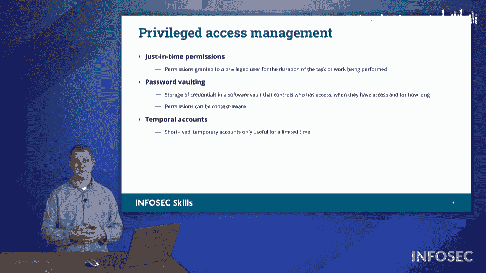

# 【Infosec】CompTIA安全 701认证 ｜ CompTIA Security+ 701 p28 05_01_01_privileged-access -BV1LRr5BTEow_p28-

Protecting data at our organization starts with the users we need to control the access that our users have to the data。

In this section， we're going to be talking about privileged access。With privileged access。

 we can control what access our users have to what data。

In this first slide we're going to talk about least privileged access。

 we want to ensure that users have only the amount of access and privileges to access data。

Sufficient to do the job they've been hired to do。We don't want to give them too much access because that could be a liability both for the organization and the user。

Lease privilege access says give only the amount of information that you need to do the job and nothing more。

If a user has too much access， they could be extorted for access to that information。

By protecting that user through least privilege access。

 they just simply don't have access to the data， they're less likely to be extorted and blackmailed for that access to the information。

Lease privilege access also protects the individual。From that sort of extortion。

 and it also protects the organization from users stealing the data and exfiltrating it out onto other networks。

Lease privilege access is a vital important part of access management。We also have。

Privileged access management。We've got ways to manage who has access to privileged accounts。

 we have privileged access， which is that level of access beyond what normal users have and those users who can utilize that are called privileged users。

Privileged users are generally our system administrators， network administrators。

 and security administrators。They have access beyond what typical users have in order to grant permissions to others and to control different servers and systems。

We control the level of access that privileged users have through different privileged access management techniques。

Three solutions that we have here。Just in time and permissions。

We've got password vaulting and temporal accounts。With just in time permissions。

Users are given access to the information right when they need it。

They will go in request access for permissions for privileged access。

 and they'll say this is the work order I'm working on， this is the trouble ticket I'm working on。

And then it will request how long do you need to do this and you say it's only going to take about 10 minutes。

 the system will grant them 15 The moment they log in to that system。

 the clock starts and they by the time they log out， they will then have those permissions revoked。

This protects that individual from accidentally causing harm on a system or accidentally falling into some trap because they always have that privileged access going。

If a user that has privilege access is spearfished， for example。

That access can be exploited by an adversary。Utilizing one of these techniques helps safeguard against that from occurring the next to one to talk about is password vaulting with password vaulting the password for the administrative account is kept in a so called vault。

They request access for this。And then they give they state the reason what they're going to do with it。

 and then they're going to say how long they need it for and then permission is granted or denied based on the context of the ask。

Pasword vaulting is another。Method of protecting privileged access。Thirdly。

 we have temporal accounts。Temporal accounts， these are temporary accounts that we will set up。

Suppose we have a service provider or a vendor that's coming on site to perform activities for us。

 they're going to log into some system to configure it or repair the system。

 whatever the case may be。And so what we will do is we will say we're going to have you sit in this cubicle。

 you're going to be on this computer and we have you connecting to this remote machine and is only you talking to that one device those are all the permissions you have now you have total。

Free you know freedom to do whatever you need to on that system。

 but that account is temporary this account is only live from 8 am until 4 pm at which point you better be done and it can only log in from this one system or if they're logging in remotely they will connect remotely into our network and we will request okay what IP address or IP block are you going to be connecting from you only have access to this one virtual machine that is staring right at the device you're going to be working on we're going to be watching and logging and monitoring what you're doing and it's only available from this hour until this hour if you need to extend that we will grant you know that if we need to but this is a temporary account and is referred to as privilege us access management。

As temporal accounts。

Be aware of these three types of privileged access management and the whole idea around privileged access。

 these are terms that might come up on our security+ exam。

