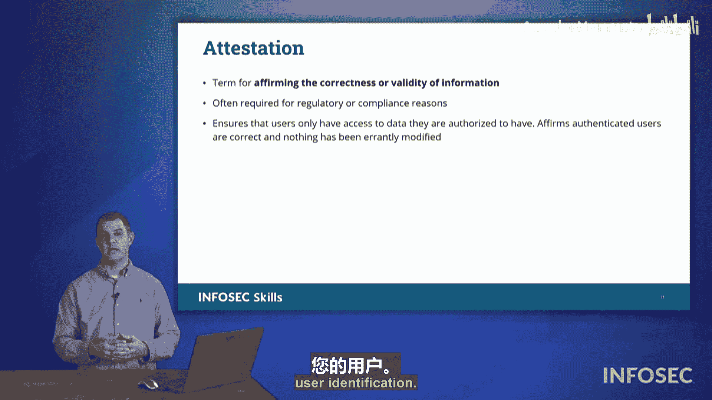

# 【Infosec】CompTIA安全 701认证 ｜ CompTIA Security+ 701 p29 05_01_02_identity-and-access-management-iam -BV1LRr5BTEow_p29-

In this section， we're going to talk about users and access management。

This section of identity and access management is where we look at users and the ways that we safeguard their accounts。

First of all， when we have user accounts， we want to make sure that we are safeguarding the process in which we create those user accounts。

 we want to make sure that there's no single user at our organization responsible for creating user accounts the reason for this is because we don't want it being a single person's job where that person might be targeted through potential spearfishishing attacks or extortion blackmail where that person could be compromised and have to create accounts against their will or they might also become an insider threat where they create accounts for themselves behind the scenes so that should they be separated from the organization they still have accounts they can log in and cause problems。

Further， we also want to make sure that we are documenting the creation of these accounts。

At one of the jobs that I used to work at， we had a process by which the only accounts that could be created were those accounts that were requested by either human resources or our technology director。

 nobody else could put in a work order to create a new user account without a work order no user account could be created and so in doing this we were able to safeguard the account creation process one person would set up the account。

 another person would activate it and assign the permissions for that。With assigning permissions。

 we're wanting to make sure that the permissions that we have for those users are aligned to their tasks。

 the job that they've got， and their role so that whenever they have role based access controls。

 they are aligned with the position that they have。

Next another topic we might see mentioned on the security plus exam is identity proofing this is where you prove your identity we have an account waiting for you when you begin when you show up on day one of your new job。

 bring us a birth certificate a couple of forms of ID we want to prove your identity before we give you this access card because at that point everything you do and our organization is going to track back to you we need to make sure you are you this is the concept of identity proofing。

Another form of access control that we are likely to see on the exam is that of federation。

Federation is where you have two entities and they are sharing credentials across each organization。

So in this example on the graphic， you have University A and University B。And on the exam。

 what we've seen in the past is questions about students at a higher education institution logging in from one institution into another students at university A are taking classes at college B。

 students at college B are taking classes at university A。

Each student body wants to use their home schools credential to log into the school or the campus where they are at。

In this scenario， each are referring to the other one and this is known as a federated login。

 using a resource from another organization to authenticate users at your organization。

 this is a federated login。Perhaps an extension of federation could be considered。Single signon。

Single signon is where you sign on one time through some secure means。

 maybe we have real stringent login requirements where username。

 password and multiple layers of multifactor authentication once you've signed on to our single sign on system。

Then every application you use is then dependent on those login credentials from the single signon or SSO server。

 you sign on one time and then that's going to give you access to everything you need。

 you don't have to create 14 or 15 different passwords each one being unique and separate and not at all similar so you're not going have password one。

 password two password3 as the literal password instead you have one solid strong password with your single signon and that gets you into the rest of the network。

We oftentimes will rely on LDAP。The lightweight directory access protocol。

LDap is formed around this concept of X500 standard the X500 standard is what lays out the different criteria for these different accounts you're not going to be asked on the exam to identify these but you do need to know that LDAP the lightweight directory access protocol is that system in which we submit our login credentials to get access we submit our username password and other forms of authentication and then get rights and privileges from that system LDAP was a precursor to active directory but they serve a similar role they both warehouse permissions and provide scope of access and authorized access across our organization。

Another form of identity and access management is a cloud access security broker。Earlier。

 I mentioned if you have users that separate from your organization， you might have a system that is。

Logged on to your local network， or you have a system here on your local network that maintains your accounts。

 your AAA server。And then you might also have some cloud resources for your organization because a lot of organizations are relying on cloud and virtualization。

There might be a disconnect between the two different accounts as you have accounts on your local system and then you have accounts out there on your cloud account。

If you have users separate from your local。Network。

 you'll go through and you'll remove those user from your local actor directory。

 but you might forget to change their login permissions out there on the cloud and so what we do in order to keep these two in sync is we rely on this software solution called a cloud access security broker。

The actual technology name of the product that we're looking at is going to vary based on who your cloud provider is。

 They each provide tie ends with your local。Active directory server or local LDAP server。

 whatever AAA solution you're using， there is a solution for that from your cloud provider again it goes by different names。

 but the overall technology in general is referred to as a cloud access security broker。

Another way that we can have accounts logged in over the open internet is through the use of OOuth。

OOuth was created by Twitter， I refuse to call them X。But with OOF。

 Twitter came up with this original login scheme where you can log in with a public and private key。

 you can authenticate over the open internet I can log in to my Twitter account and then Twitter will then share to some web application my credentials telling that web application yeah。

 Tommy he's good to go he's one of our users， he's authenticated， you should let him in。

This is known as OOth， it's an open form of user authentication， Twitter created it。

 but they've thrown it open for the world to use and many organizations do use OOth If you were to make a Twitter bot。

 OOth would be how your bot authenticates as you on their network。Next is we have open ID Connect。

Open ID Connect is made by Meta or Facebook with open ID Connect。

 they took the great idea of OAuth and they said this is really great， really slick。

 we like this a lot。But。We can kind of optimize this a little bit。

 you know you're doing this step in this step， we can combine those two as one step we can completely sidestep this。

And they came up with open ID Connect， it's faster。

 but it's another open standard that is out there on the open internet。

You authenticate through different services， if you log in through Facebook or Instagram。

 then it's going to be open ID Connect that you're logging into。

How the information travels from one of these service providers to the next is done through a format called SAML。

The security assertions markup language， this is an Xml based formatted。

File that transmits information about users and their credentials。

 so if there was some shady web application that I was wanting to check out， that looks really cool。

But their're little sketch I don't know that I'm going to trust them with my personal information yet Oh。

 but I see I can log in using my Google credentials or Facebook credentials I can click on that service provider and then what they're going to do is they're going to send me a token。

In SamML to send back to Google or Facebook or Twitter or whoever。

 and then that service identity provider will then identify me and then say if I'm good to go or not。

 if I am， they're going to send back a SamML token and they'll provide that to the service provider。

 the Shay web application and then that formatted data is going to be in the format of SamML。

 what you need to know for the exam is that SamML is the XML format for authenticating users over the open internet。

These technologies all work and work hand in hand together because of this concept of interoperability。

 we have one system that we have in place and because it is open documented and free for others to use。

 we can interoperate because we're using open standards like XML or JSON to exchange information we're documenting the way that these AIs work all of this interoperability is what allows various systems and service providers and identity providers to work hand in hand。

Lastly， in the realm of identity and access management， we have attestation。

Affirming the correctness of information， we're confirming the validity of the data that is on here we are giving it a stamp of approval we're signing off on this and saying I hereby at testest with these credentials that this information is correct and valid Attestation is a way of confirming this and it can track back to your user through some form of user identification。

All of these terms taken together is what makes up the body of information on the security Plus exam dealing with identity or identity and access management。

 or IAM be on the lookout for these topics and others on the security+ exam。

