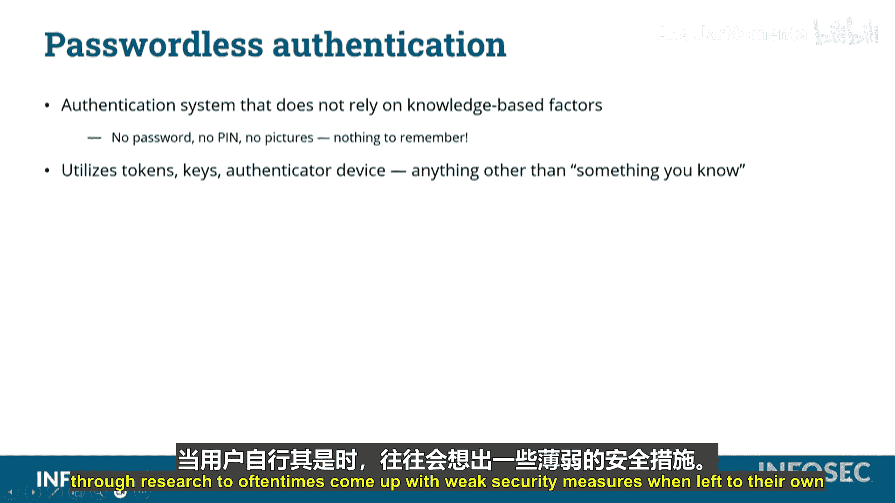

# 【Infosec】CompTIA安全 701认证 ｜ CompTIA Security+ 701 p30 05_01_03_password-concepts -BV1LRr5BTEow_p30-

When talking about passwords， there are a few concepts to keep in mind for the security+ exam。

In this section， password concepts， we're going to look at some best practices for passwords。

First of all we have password length when it comes to passwords。

 length is strength longer is stronger， these concepts come into play when you start considering how many characters long a password is。

Consider the pin number 000。And it ranges up to 9，9，9。If we have a three digit pin number like that。

 how many potential guesses would it take to guess that？Pen number。Well。

 if you start at 000 and you go to 999， that's1 thousand。That's only1 thousand00 guesses in there。

 but if you add one more digit， that's 10，000 guesses， add another digit， that's 100，000。

So the longer you got for a password， the more guesses it's going to take to find out what that password or pinIN number is。

When it gets to complexity， complexity is again， a way that we can increase the number of potential values that we have for our passwords。

For complexity， this is where we're adding in letters。Uppercase， lowercase numbers。

 special characters， we don't want to have just numbers， we don't want to have just letters。

 we want a mixture of letters， numbers， mixture of cases， and a mixture of special characters。Again。

 when taken into consideration with three positions for a pin number。0，0，0 to 999。

 there's  a thousand guesses in there。 that's 10 to the third。 you have 10 digits。Z to nine。

And you have three positions， so it's to the third power。

The longer your password is the exponent goes up。The more complex your password is that is made up of characters from A to Z。

 uppercase， A to Z lowercase， digits involved， that condition alone， capital a to Z。

 lower a to Z and digits， there's 52 characters in the alphabet plus 10。

 you're now looking at 62 potential values。So if you only had three character long password。

 that's 62 to the third power。Still much stronger than a three digit pin made up of digits alone。

And of course， as I mentioned earlier， longer is stronger， so those same 62 characters。Of uppercase。

 lowercase and digits。Now， whenever you add length to that， you're increasing that exponent value。

 it may have 62 to the fourth if you have four characters。To the fifth。

 if you have five characters and so on， so 62 to the eighth would be an8 character long password。

 the longer you can make it， the more complex and harder it is for an attacker to break that password。

You also want to make sure that you're avoiding password reuse。

You don't want to use the same password on different systems。

 nor do you want to use a password you've used prior。

We want to limit the number of passwords we've used prior because。

Any sort of exploitation that goes on with another network。

 they're going to steal our credentials and store them on a dictionary list。

 and that's going to make our passwords easy to fall。You also want to consider password age。

 you don't want to use a password for too long if that password has ever get compromised。

 the attacker would be able to log in and impersonate you on your account numerous times before you change that password so you want to balance out how often you change your password don't keep a password too long。

 but also there's a sweet spot because changing your password too often can often result in users choosing weak passwords。

 there's a value a balance between using passwords that are too old and that you change them too often。

The next topic to discuss is password managers with password managers。

 these are software solutions that we have that keep track of extremely long。

 extremely complex passwords。They're going to randomly generate a good， long， strong password。

You will authenticate into the password manager and then it will then offer up whatever password it is used for whatever account you're logging into。

Password managers are very， very helpful at managing a lot of long。

 complex passwords and then changing those passwords as needed。

You must authenticate and you want to make sure that you've got a good strong login solution for your password manager。

 putting all of your passwords in a password manager can be like putting all your eggs in one basket。

You're at the mercy of that password manager if that password manager gets hacked。

 all your passwords can be compromised， so password managers are a good solution for keeping track of passwords。

 but they do come with some drawbacks。Passwordless authentication is another login mechanism that organizations are considering This form of authentication just simply does not rely on any knowledge based factor。

 there's nothing to remember so no passwords， no pins， no past pictures， past phrases。

 nothing that you have to keep up with that you might forget or。More rather。

 you might mash your newfo。Redo that take or not take。Starting over on this slide。Soorrry。

Log the time。All right。Another authentication mechanism that some organizations are experimenting with is passwordless authentication in this situation。

 organizations are relying on some。Combination of factors other than something you know。

 this means no passwords to remember， no pin to remember， no pass pictures or pass phrases。

 nothing for you to remember or to but another way。

 nothing for you to forget we're not going to rely on our users to come up with something because users have been found through research to oftentimes come up with weak security measures when left to their own devices。

So with passwordless authentication we're going to rely on something you have that is to say we're going to use hardware tokens。

 software tokens， we're going to use something you have。

 so a phone getting a number sent to it a one- time pin that gets sent out any combination of factors other than something you know this is what we mean whenever we talk about passwordless authentication。

 these are just a few of the password concept to keep in mind when taking the security plus exam。

