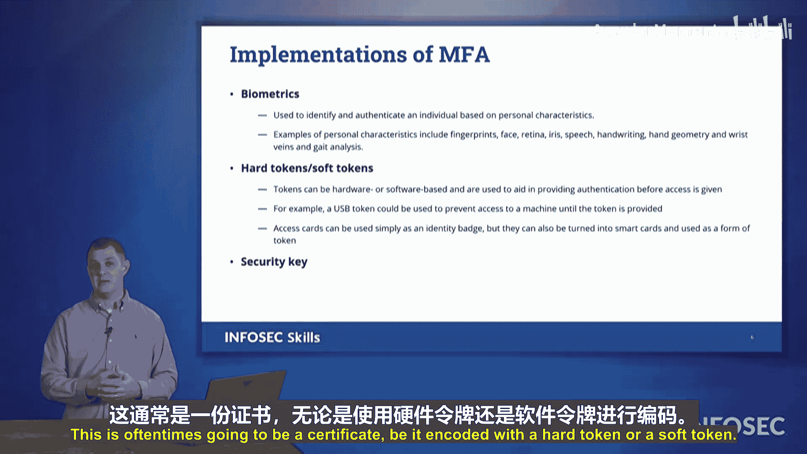

# 【Infosec】CompTIA安全 701认证 ｜ CompTIA Security+ 701 p31 05_01_04_multifactor-identification-mfa -BV1LRr5BTEow_p31-

Proving your identity on a system， authenticating can take on a bunch of different approaches。

One of the ways that we can safeguard against weaknesses found in our authentication measures is to use multifactor authentication。

 even if an adversary steals your password， they still would have to have some other factor to authenticate on a system。

In this section， we're going to look at multifactor authentication and we're looking at the different authentication factors for the exam。

 I need you to understand the different factors we have listed here， something you know。

 something you have， something you are， something you do。And somewhere。

You are these are some of the different factors that we have on multifactor authentication listing on the security+ exam。

So I need you to be able to recognize a given factor， one of these factors。Provided a scenario。

So looking in depth at what these are， we've got。Something， you know， this is the traditional。

Password。Pen， it's something that's in your head， it's a way to know and authenticate who you are because it's something that only you retain in your head。

For example， my brother lives in another state from me if he was to call me up and say， hey， Tommy。

 it's your brother， Greg。I'd be like， first of all， no it's not you're not Greg。

 Greg doesn't say that thing whenever he。Calls me it's like we have a way of greeting each other and it's not hey it's your brother that would be kind of weird and kind of too formal。

 but if I' would say how do I know it's you。Prove it to me there is something that he knows and something that I know we have。

 you know a lifetime of memories together that I can draw from and be like， hey。

 what was that video game we played when we went camping with mom and dad that time。

Now you might be thinking there's a bazillion video games that you guys could have played we don't know what that would be and that's precisely the point he and I know without hesitation exactly what game I would be referring to but you wouldn't know that you would have too many choices to choose from that's something that only he and I really know even my mom and dad aren't really aware of what we' would be talking about so this is something you know。

There's also something you have， something that you have that is uniquely you。

 and so if you look here on the listing， we've got this is referring to something that you some kind of physical object that you have。

Your phone， an ID card。We in a moment we'll look at some different physical tokens that you have it's something that you have with you that proves。

It is you， there's only one of these things they are unique in all the world and you have it。

 therefore you have access to this。Your house keys or a mailbox key or your office key these are these traditional physical keys that we have is something you have that house key provides you access to your house apartment whatever it's something unique to you you're the only one that has that and that's what gives you authorized access to your living space。

Further going on， we have something you are。Something you are is a factor that considers something about your person。

 it's encoded in your genetic information， it's information about you。

 this can be something that's encoded in your fingerprint。The shape of your face。

 the sound of your voice， all of these things are influenced by your genetic information。

 this is something that is uniquely you。Even though you might try to change。

The appearance of yourself， you can still find that information encoded in your genetic information。

Another factor that we have is something you do。This is information about how you do something。

 the way that you write your signature， the way that you type on a keyboard， the way that you walk。

 whenever you the length of stride that you take when you walk the length of stride you take the way your feet hit the ground。

 if you proate or not if you're pigeontoed or not these different terms can be used or these different factors can be used to identify you just based on your walk。

 we can have sensors in place that does gait analysis or it can have pressure plates on the ground that measures your footsteps。

Another factor that we have on here is some you are some network that you're connected from or GPS location。

 what is your IP address are you connecting from a remote network that you've never been on before in that case we can say well this looks like it's Tommy but it may be someone else because he's connecting from a network that is not normally where you connect from and so let's prompt with another factor and so it's the collection of all of these factors together that makes up multifactor anytime you're using two or more of these factors it's considered multifactor authentication。

Another term you will see on the exam or or these terms you'll see on the exam。

 you'll have biometrics， again it's something about your person。

And then there's also hard tokens and soft tokens， so hard tokens is going to be some sort of hardware soft tokens is going to be some sort of software based identity。

 some sort of unique information that you've got on here we also have the security key that stems from that this is oftentimes going to be a certificate be it encoded with a hard token or a soft token。

On the next screen here I've got examples of some of the hard tokens to be on the lookout for whenever you read about on the exam。

 a question that talks about hard tokens， I want you to think about these three options that we've got on the left we've got RSA tokens and so you've got six digits that are on here and these six digits are rolling。

With the you know with some kind of unique key that you've got on here whatever is on your token is what's going to be on the server and those are kept in sync if you have this key foob in your pocket then it is something you have that is uniquely yours and then those values are going to be in sync how do I know this is this user logging in they've provided the username the password and they're providing that same unique key。

We oftentimes will have our phones and our phones can be a form of a hard token it's something you have there's going to be an app on your phone that gets that number on here and then that's how you authenticate on the far right side we've got UB key and a UB key contains a secure certificate when you insert that USB device into a computer that authenticate you again this is something you have it's some sort of a key foob。

And of course right in the middle we have our controlled access card anyone in the federal space DOD networks will utilize controlled access cards these cards have a embedded chip in them which contains a unique certificate this certificate identifies you as well as having your picture and other information on it the CAC is how you authenticate into your system so you might have other forms of authentication but you'll have to provide the CAC in order to gain authorized access。

So whenever you see on the exam， questions about multifactor authentication。

 be able to identify if it's one of the factors listed or one of the devices I have shown。

This is look through multifactor authentication。