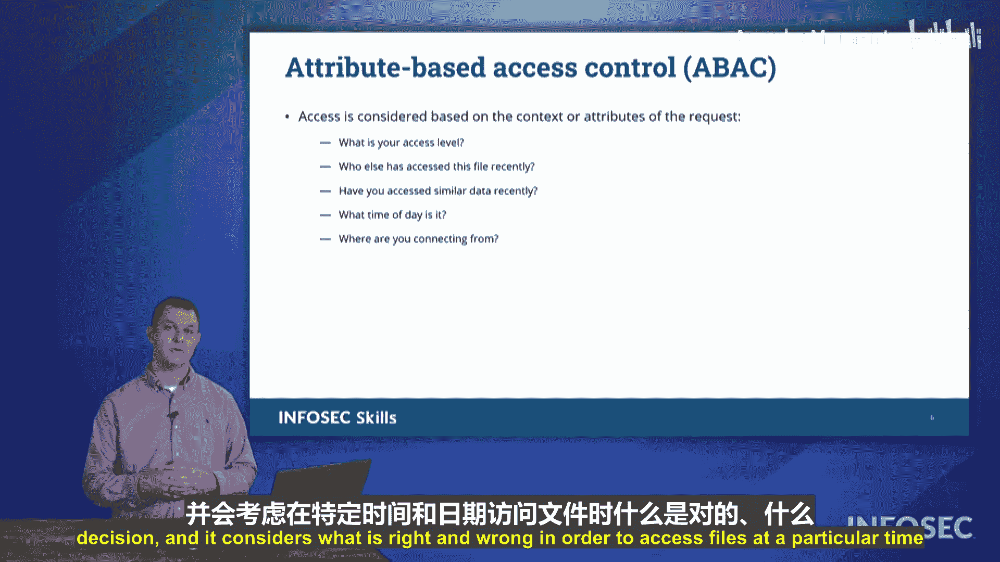

# 【Infosec】CompTIA安全 701认证 ｜ CompTIA Security+ 701 p32 05_01_05_access-control-models -BV1LRr5BTEow_p32-

When protecting data at our organization， we might subscribe to one of several different access control models。

Comptia highlights three or four different access control models depending on how you divide them。

In these models， we have a major distinction to make between discretionary and rule based。

I'm emphasizing rule based to distinguish it from role based。

Rule based access control is a type of rule based access control。Discretionary and rule based。

Under rule B， we have three options， we have mandatory access control， rule based access control。

 and attribute based access control。Between discretionary and rule based。

 discretionary is what you have on your home computer。

Think about it whenever you create a file on your home computer or personal computer。

You just create that and you can make that file read only。

 you can control who has access to that if you want to password and protect it or something。

 it's at your discretion， you can do it if you want。There are no rules。

This is in opposition to rule based access controls within rule based there are rules you must follow those rules and then they each will have their own rule structure。

Rounding out this slide is time of day restrictions we might have a form of access control that is based entirely on what time of day is it you may only be able to access files between certain hours of the day or a certain shift depending on your organization's structure will that will affect what our time of day restrictions are like。

So let's dive into the three different types of rule-based access controls the first of these rule- based access controls is mandatory access control with mandatory access control your implementation of it is mandatory at the organization this is best described as the type of access controls we see present at the federal level on federal computers DOD computers these all subscribe to mandatory access control this is where we have different levels of secrecy according to the information that we've got。

These systems subscribe to the Bell Lapaullo module。

 which describes what level of access you have is determined by what inputs are on that file with mandatory access control if you're receiving information that is of top secret nature and that is put into a report that report is then top secret even if 90% of that information is all public knowledge if there's even one IioA of information that is considered top secret that the whole document is therefore considered top secret you must abide by this access control model because it is mandatory。

 this is mandatory access control best seen on federal networks。

Next we have role based access control， it is indeed a type of rule based access control。

 but the rules involved here revolve around the different roles at your organization。

If you're a people leader， if you're a manager。Your subordinates。

May not be able to see what you have， but you can see what they have。

And your superiors can see what you have， but you can't necessarily what they have or another way to look at this is if you work in the sales department you're going to see access。

 you're going to have access to the sales Sha folder or shared files you may not be able to see what is over in engineering you may not be able to see what is in marketing or marketing may not be able to see what's in engineering it depends on your role。

At the organization as to what you have access to， this is role based access control。And then lastly。

 we have attribute based access control AAC。Attribute based access control really revolves around this decision engine that takes in various inputs。

 different attributes of the request for access。As you request access to different files。

 those attributes are considered by the rule engine what's your level of access。

 who else has access this file recently， have you access something access something similar lately。

 what time of day is it there's our time based and then。Where are you connecting from。

 are you on the local office network or are you connecting from a remote network and where is that remote network located all of these different attributes。

Of the request for access are considered and the rule engine will look at the rules put forth by the administrators and they will determine if you get access that file or not。

Everything might check out， but it just might be the wrong time of day。Or everything might work。

You're just not in the right country because we don't want you connecting to that when you're on vacation in a far away land。

So attribute based access control considers all of the different attributes and before making the decision and it considers what is right and wrong in order to access files at a particular time and date。

So keep these access control models in mind when taking your security plus exam。

 remember discretionary， it's at your discretion and then rule based。

 you've got different rules to follow depending on which model is being subscribed to you've got mandatory access control。

Roole based access control and attribute based access control Keep an eye out for these on your security+ exam。

