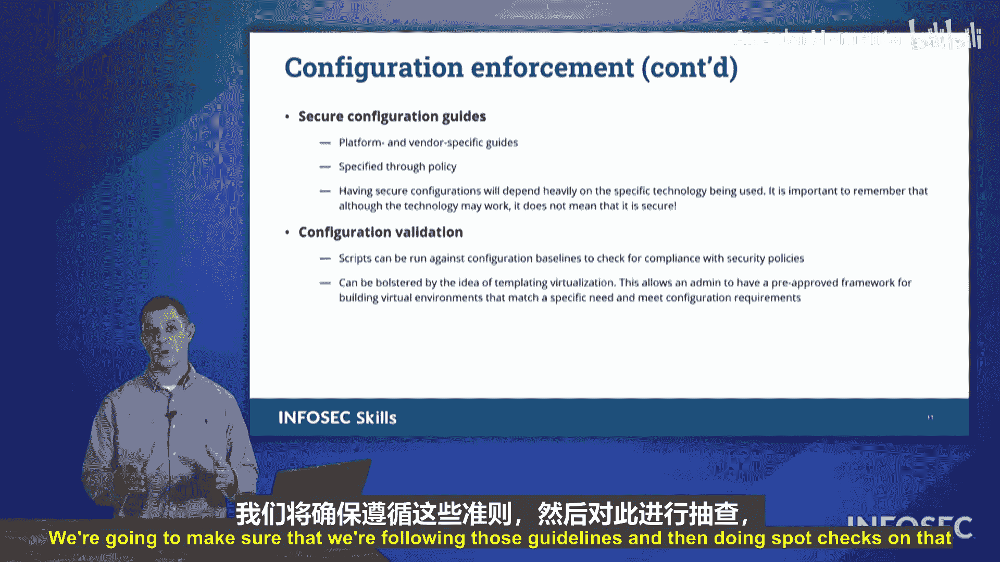

# 【Infosec】CompTIA安全 701认证 ｜ CompTIA Security+ 701 p33 06_01_01_enterprise-security -BV1LRr5BTEow_p33-

When protecting data at our organization， we have a number of different security controls to implement。

In this section on enterprise security， we're going to look at some of the different technologies available to us。

The first to consider here is segmentation。With network segmentation we are subdividing the whole corporate network into bitete size manageable pieces by doing this we're limiting the scope of impact of a malware infestation should malware take root on one system it's not going to spread throughout our whole corporate network instead it's only going to affect a small number of users。

Ways that we can subdivide our network fall into two categories。

 logical segmentation and physical segmentation， the first to look at is logical segmentation。

With logical segmentation， we're using subneting to subdivide our corporate network into smaller pieces as data transits from one segment to the next through a gateway is providing a point of inspection we're able to go through and see what sort of data is being sent from one of these networks to the next we can make decisions on that if we want to allow that data through or not at each of those gateways。

 we can install a firewall between network segments。

Another way that we can share a network but have separate segments on the network is to use a virtual local area network or VLAN。

With a virtual local area network， we're using one cable and we're sending that data across that same cable。

 those packets are transiting the cable together， one cable。To connect those different devices。

 but because of the VLAN technology in use， individual packets are never going to see one another indeed on the end we are using a layer3 switch on each end of that VLAN we are going to send data to that switch and that switch is aware of what is going on on layer 3 where we have IP addresses it is able to consider which VLN is this IP address a member of and then only members of that VLAN might get that broadcast message or network traffic sent through to it。

This is a。Logical segmentation method。With physical segmentation。

 this is where we have physically distinct networks。In a lot of government and DOD networks。

 we have the non secure network and the secure network known as Nppernet and Spernet respectively。

With these two networks， they are wholly and completely separate physical networks。

 there are two wiring closets or they are physically distinct networks within the same closet。

To help distinguish between them， even the last cable coming out of the wall is going to be color coded so that you know if you're connected to nipernet or Spernet。

 they require duplicates of hardware， they require duplicates of cabling。

 they are physically distinct， There is no traffic that can make the hop from one network to the next。

 at least not at the lower office level for these networks。

Another form of physical segmentation we can do is called an air gap with air gaps。

 what we're doing is we are physically disconnecting a host from the rest of the network。

This is where one device is completely and wholly removed from an internet connected network with no w-fi or wired internet connectivity at all。

 the only thing that spans that gap might be removable storage devices to transfer files to and from an airgap system Air gaps are for non-internet connected devices so that it is free from any sort of intrusion coming into it。

 these are different ways that we can have physical segmentation。

The next topic to look at is how we can isolate these different devices。With isolation。

 what we're doing is we are prohibiting a device from being able to spread its infected。

Communications to other device on the network we're stopping that malware from being able to connect to other devices isolation allows us to isolate that device。

 putting it into a VL jail， a party of one nobody else can communicate with that device We are containing the malware we're stopping the spread so that no other devices can be infected by that。

From that point， then we can go into investigation mode and start to see what's going on with that。

This is the use of isolation as a security control。

Another form of security control that we can have is access control。

 controlling who has access to what and as we go through and look at these different control lists about who do we provide access to。

 we can start to determine who's going to have access， when are they going to have access。

 what are they going to be allowed to do and so forth。

 access control lists determine what sort of activity is and is not allowed。

 who can do that and who might not do that。We can also utilize file system permissions。

 being able to control who has access to read， write and execute individual files。

 all of these topics are encased under the idea of access control。

 but it's all about containing who are describing who has access to what。

We can also make use of allow lists and block lists， these come in a few different forms。

You can have application allow lists and application block lists you can also see when we talk about firewalls that we have firewall allow lists and block lists。

 but here with application allow lists what we've got is a list of allowed，Applications。

 these are the programs I want to allow on the system， if it's not on the system。

 we're going to block it。There's also the application block list。

 this is a list of applications we do not want executed on our operation systems。

The block list is going to go through and it's going to say these are the executables that are not allowed to execute。

 they're prohibited from running everything else is good to go。

 but just not these it's like a no fly list。Vers is the allowow list。

 which is more like a guest list， if you're on the guest list you're allowed in。

But if you're not on the list， you're denied。So of these two technologies。

 it's just interesting to think about when you consider the name。The allow list。

Is actually more restrictive。Then the blocklist。The block list is actually more。Free and more。

More applications can run when you consider a block list。

Because you're only limiting it to a small number of applications。

 so the block list is less restrictive， the allow list is more restrictive on the number of applications you can run。

Be able to look at these two different lists and consider the trade offs of them when talking about。

 does it allow other applications to run or does it deny other applications for being run？

Another topic to look at on here is patching， patching is paramount to keeping our security up to date on our corporate networks。

With patching， if there is a vulnerability that is found。

 we're going to seek out a patch from the vendor or solution provider and make sure that that patch addresses whatever the vulnerability is。

 if not we want to document that and continue researching for other ways to mitigate that threat。

Another security technology we can make use of is encryption。Remember。

 encryption protects confidentiality， we want to make sure that nobody that does not have authorized access。

Can access any of the files on our systems。So in order to do this。

 we might utilize file system encryption such as a。Full drive encryption or self encrypting drive。

Listed here are a couple of examples with bit locker or file vault for Windows and Mac respectively。

These file system encryption technologies are in place to help protect the files that are stored on the drive if that drive is physically removed from that machine。

 the contents are encrypted and therefore useless to anyone who took it。

Another form of encryption is protecting data。On the move。

Data and transit and this is using encryption in the form of virtual private networks with VPNs。

 we utilize encryption to protect and safeguard the data that is transiting an open public network。

 but it gives us the concept of a virtual private network。And then lastly。

 as we're sending data out over the open internet via email。

 it's important to know that unless other security measures are taken， email itself is insecure。

 and so we utilize email encryption email encryption can encrypt the contents of a message sent via email we can utilize in this case。

 PGP。Or。GPG， the canoe privacy guard， or we might also be able to encrypt the attachments that we're sending in that email in the form of using SMM。

 the secure multipurpose internet mail extension。Email encryption is a way to keep unencrypted email safe by。

Enncrypting all the contents。Then another security technology that we can make use of is configuration enforcement。

This is making sure that。The configurations that we have put out are running secure we will create secure baselines and roll out that common secure system across all computers that we bring into our network。

 making sure that all of our systems are equally，Ready for any sort of defenses that we've got。

We can also make use of。Secure configuration guides that might come from vendors or from best practice bodies。

 bodies that will tell us。Through other organizations。

 this is how you should configure these different devices。

 we will cook these up and we will choose which ones we're going to follow based on what platform we're talking about or did it come from a specific vendor so if we're talking about a Cisco or Palo Alto or Fornet depends on who the company is that makes the hardware we're looking at we'll configure our solutions according to their best practices。

And then lastly， to check out and make sure that we are indeed configuring things to be as secure as possible。

 we're going to have someone else， a colleague come along behind us and validate those secure changes that we've implemented。

 we're going to make sure that we're following those guidelines and then doing spot checks on that to ensure that we're looking out for one another。

So keep these different security solutions in mind when going to take your security+ exam。

