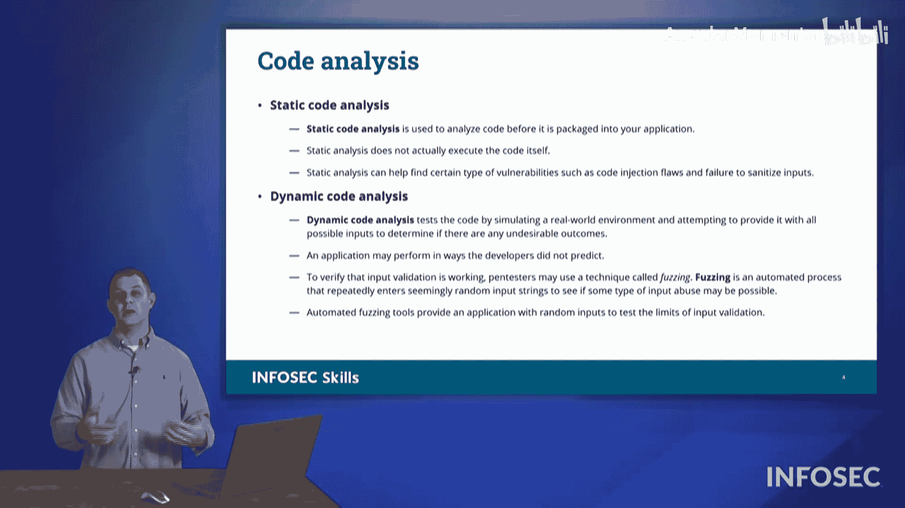

# 【Infosec】CompTIA安全 701认证 ｜ CompTIA Security+ 701 p34 06_01_02_application-security -BV1LRr5BTEow_p34-

When considering the security of our applications it important that we。

Consider the ways that our applications can be attacked in this section called application security。

 we're going to be looking at some ways that various software attacks can be leveraged against our applications。

And ways that we can protect against that。And so the first topic we're going to look at is input validation。

Input validation is。Where we go through and if we're expecting a certain number。

To be entered into a field， we're only allowing numbers and we're only allowing a certain range of numbers。

 a valid range of numbers。 so if we have a web application we like how many widgets do you want to buy？

If we're expecting the user to enter two， we're only going to allow the digit2 to be entered in there。

 we're not going to have TWO allowed in there， we're not going to allow someone to submit an image in there or type out some potentially malicious code for like a crossite scripting attack no we're only going to allow numbers on there。

Sanitization。Get rid of any sort of characters that we don't want to allow。

If someone enters something that is invalid we either toss it out completely or we will not accept their input on there this is known as input validation and sanitization。

 it's a way of protecting our application because any information we receive from the user is going to be stored in the buffer and then it could potentially cause harm to the rest of our system or if our code was to act upon whatever values they gave us。

 it might cause some unwanted actions on our application so input validation and sanitization very。

 very important。Some other forms of attacks like the cross site， request， forgery。

 and other sorts of malicious activity can be thwarted if we utilize secure cookies。

By utilizing a secure cookie with the keyword secure。

It restricts that cookie from only being able to be transmitted over a hypertext transfer protocol secure channel。

 it must use HtTPS and it can only go back to the host that set that cookie。

Cookies should never be trusted for providing input about a user。

 it's generally only going to be used for references to that user's personal settings。

 so color of a background， for example， etc。So secure cookies， very。

 very important we don't want to store anything sensitive on those cookies。

 it could be compromised on their system and we don't want to trust any data coming from those cookies it could have been compromised securecu cookies is another way to protect our application and code。

When we're looking at development processes， we've got a couple ways to analyze the code。

 we can perform code analysis。There are two primary ways that CompTia wants us to be aware of for protecting code through code analysis。

There's static code analysis and dynamic code analysis。

Statatic code analysis is where someone submits a body of code and you look through that source code and you kind of look through it and look through it。

 read all the code， make sense of it and say this looks good or。

I see you're expecting some input up here on this line。

 but I don't see on any subsequent page where you're sanitizing those inputs or validating that input Can you go back and correct this static code analysis does not require executing the code it's merely just reading through the source code。

Even though I'm gesturing like I'm flipping through individual pages on here。

 oftentimes you're just going to perform static code analysis on a computer screen。

With dynamic code analysis， however， if this does require us to execute the code。

 we are going to run the code， we're going to execute the program and see how it operates and if we see an input box。

 if we say how many widges do you want to buy， we're going to。

Generate all sorts of crazy inputs if if you're going to enter the value2。

 I'm going to check the value2 if I'm going to put in 2。0。

 I'm going to see how that operates if I put in。2。543。1415926。

 I can put in a lot of different numbers on there I can try negative numbers what if I put in thousands。

You know2000 items you don't have 2000 items on hand well if that's what we're going to try we're going to try all sorts of crazy wacky inputs not just numbers I'm going to try letters i'm going to try different code i'm going to submit images in there i'm trying every single。

Possible input that I can think of and this is what's known as fuzzing fuzzing is giving it some garbage input and hammering away on that application to see how does this application respond to garbage input I might see if I can get it to behave in some awkward new way that might disclose some information。

Lastly。We can protect our code through code signing We talked about this previously in another video。

 but with this example， this is a way that we can protect our code from some malicious third party interacting with our code slipping in some malware or they might say hey。

 this came from us or this did not come from us with code signing。

 we can assure our clients and our users that code came from us。

And they know that it came from us because of non repudiation found in code signing。

We can also protect the integrity of the code， making sure that nobody maliciously alters our code because we're using those the hashes inside of our code signing algorithm。

So code signing is another way we can protect the software that we develop for our clients。

 be aware of these types of methods to secure applications on the security+ exam。

