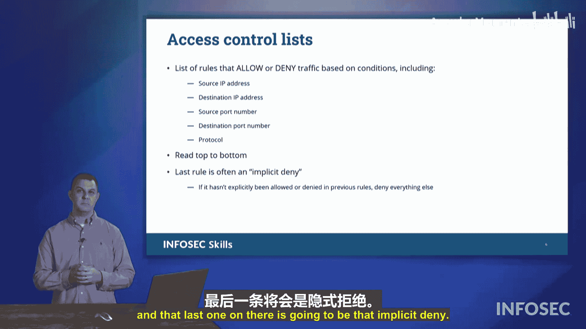

# 【Infosec】CompTIA安全 701认证 ｜ CompTIA Security+ 701 p35 07_01_01_firewalls -BV1LRr5BTEow_p35-

When protecting our organization and the network， we oftentimes will make use of firewalls。

In this section， we're going to explore some of the concepts dealing with firewalls that will show up on the security plus exam。

In effect， what a firewall is is a filter it filters internet traffic or local network traffic from other devices based on a set of rules that is a firewall at its most basic a firewall doesn't have to just exist on your corporate network you can also have firewalls that are located on your individual systems these are referred to as host based firewalls。

Why would we want to use a host base firewall when we have a network firewall in this case we're going to have individual firewalls on each of our systems to protect each system from its neighbors if there's a malware outbreak on one of these systems it will be protected from other devices。

This is a host based firewall。Some other types of firewall that we might see show up on the exam is a web application firewall。

 a web application firewall again is a type of filter and what it's going to do is it's going to filter network traffic from the internet going to our web application it's going to filter traffic for those types of network injection attacks。

 SQL injection attacks， crossite scripting attacks。

 it's filtering all of that it can also filter for denial service attacks。

The reason that this works is because your web application will be set up to only accept traffic from the web application filter。

 the web application filter looks for injection attacks， crossite scripting attacks。

 or any sort of embedded malicious request going to the web application。

And then the next type of firewall that we have on here is the next generation firewall。

 this is a firewall that has logic built into it and it's able to identify what is the type of traffic that we've got coming to the network and is able to make determinations if the traffic should be allowed or not。

If for example， you have a device on your network that is sending network data out on port。

 say 3000 and it is destined for port 80 the web server port if that traffic is outbound on port 80 but it sees that the response is going to come back on port 3000 the next generation firewall will open 3000 and be waiting for that response to come back at which point it will close and so it's able to make these independent determinations about what sort of activity should be allowed on the network based on current network activity this is the next generation firewall。

Baked into our firewall， what keeps them running are different firewall rules。

What makes the firewall work are these types of rules。Take， for example。

 these three rules we have on screen。This set of rules on here are set up and we read these rules from top to bottom。

 it matters the order that we put these rules in as denoted by the rule number found on the far left。

We read firewall rules from the top down。And at the very bottom， we kind of have this catch all。

 this implicit deny it's referred to as and this says the implicit deny says。

If I have not previously allowed it through some explicit rule， I want to deny it。

I'm going to deny that sort of traffic and so if we consider the rules that we have here on the screen。

 this says if we have traffic coming from 192168064 and it's going to anywhere as long as it's connecting over ports 22 or 3389 we're going to allow that that's where traffic is good to go。

The second rule says if you're coming from anywhere and you're going to192168032。

 as long as you're connecting over ports 80 and 443， the web service ports。

Those sort of traffic is also going to be allowed and so these two rules are explicitly saying this is the sort of traffic I want to allow otherwise rule3 is going to catch that sort of traffic and say it's not allowed。

 it's going to be blocked it is implying that if I haven't allowed it to now I'm going to un I'm going to block that traffic。

So the general structure of these rules says we're going to have a source IP， a destination IP。

 a source port number and a destination port number。

 and then we're also going to maybe specify a protocol either TCP or UDP。

Remember that we read these rules from the top， down， from top to bottom。

 and that last one on there is going to be that implicit deny， very。

 very important that we know that。

On the exam there's going to be a number of different example port numbers you might see I just referred to a couple port 22 and 3389 for remote access and port 80 and 443 for web traffic。

Let's dive in and look at some of the ports that we might see on the exam。

