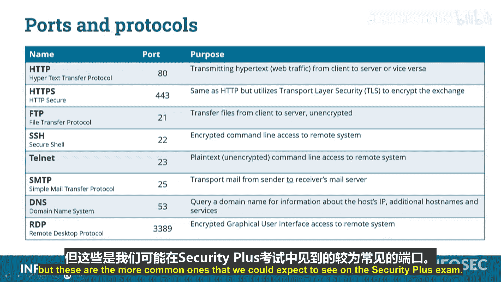

# 【Infosec】CompTIA安全 701认证 ｜ CompTIA Security+ 701 p36 07_01_02_network-ports -BV1LRr5BTEow_p36-

On the security plus there are a number of different network ports we need to be aware of。

 there's not a lot， but there are few that might show up in different questions in different contexts let's take a moment to explore what some of these ports might be。

On this list here， we have the name of the service on the left。

 the port number in the center column and then a description of what that service is on the right let's step through what each of these services are。

 what they do and remind ourselves of the port number along with that。So right at the very top。

 we have perhaps the more common example port number。

 and you may have even heard me referencing this。HTTP hyperpertext transfer protocol。

 this is the webserv port， it's on port 80。This is what。

Web servers are listening for traffic coming in on port 80， that's what they're going to respond to。

Around the mid 90s， someone said。Hey， this web traffic stuff is really， really cool。

 but it's sending everything in plain text， meaning anybody can read our back and forth。

 they can read our request， they can read what information we're sending to the web server。And so。

In technology， the technology community came together and they created hyperpertext transfer protocol over SSL is what they originally called it。

Nowadays， we refer to this as hyperpertext transfer protocol。Sre。

That original over SSL that I mentioned is secure Sockets layer。Nowadays we no longer use SSL。

 instead we encrypt our traffic with TLS， transport layer security， TLS。And so you'll see HTTPS used。

 but that could be originally hypertext transfer protocol over SSL。

 but nowadays we simply call it hyperpertext transfer protocol secure。Next。

 we have file transfer protocol FTP。This rides on port 21 this is a quite an old protocol。

 this is how we send files from one server to the next the problem with FTP is that it sends data unencrypted。

And so we have come up with other ways to secure our file transfers。

 but FTP is largely no longer used because it sends everything unencrypted。Next。

 I want to jump down to Tnet。Port 23。And the reason I'm doing this is we'll become clear in just a moment Tnet is another old protocol。

 it rides on port 23， it sends everything plain text， unencrypted。

 and what it does is allows you to remotely access a remote system。

So I'm going to connect to a system over when this originally came out， the telephone network。

 hence the name tellNe。The problem with Tnet again is that it sends everything unencrypted。And so。

A lot of folks said this is great， I want to be able to remotely access my systems。

 but I don't want to do it in an unseeccured manner， I want to make sure my data is encrypted。

A hobbyist。Cooked up a personal project that is essentially like Telnet。

 but he layered on RSA encryption。And so what he did is he created this secure shell。

And he called it SSH， it is secure shell， it allows command line access to a remote system。

 but it is doing so encrypted。This is parked on port 22 and the reason it's on 22 is because when he was originally cooking up his project。

 he saw the very popular port 21 and he saw the very popular port 23 he said。

 hey I see there's a gap here in the middle I want people to take my project seriously and so he said can you park my SSH project on port 22 he made the request the request was granted and so he's nested right there between port 21 with FTP and port 23 with Tnet。

These three are sequential， that makes it easy to remember。

 another way that people might remember tell net。Is on port 23。You might remember his airness。

 the great Michael Jordan， wearing Jersey number 23。

 which seemed like any time he threw up a shot he would hit nothing but net。

 so if you see tell net and you see port 23， those two kind of go together。

Another older protocol that we might see referenced on the exam is port 25。

 this is for simple mail transfer protocol or SMTP。

 this is how we send mail from one system to another system。SMTP port 25。Next to last。

 we have the domain name system。We've talked about this in a few different contexts。

This system is what resolves an IEP address from a given host name。

 or it might offer up other information as we'll see in other videos。The DNS system。

Querries are made on port 53， there are DNS servers listening to port 53。By default。

 DNS sends data out onenncrypted。But there are ways to secure it。

And then finally we have remote desktop protocol all all the way at the bottom RDP rides on port 3389 This allows us to have a graphical user interface so that we can access the desktop remotely as the name implies this is for a GuI interface such as Windows This is port 3389 This is on an exhaustive lift list at all of the various network ports。

 but these are the more common ones that we can expect to see on the security plus exam。

