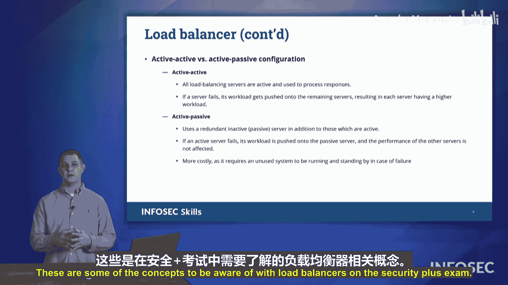

# 【Infosec】CompTIA安全 701认证 ｜ CompTIA Security+ 701 p37 07_01_03_load-balancer -BV1LRr5BTEow_p37-

Load balancing。We want to make sure that our devices。

 our computers and servers are available to our users， we want to maintain high availability。

In this section we're going to be looking at how we can maintain high availability we most often achieve this through the use of clustering clustering is where we use multiple different computers to serve in the same capacity and so if one of those was to fail then the others can fill in for that this is referred to as clustering。

With a cluster though， if we have a cluster of web servers。

 how do our users know which one to connect to this is where we use a load balancer a load balancer helps spread the load across all of our web resources in this graphic we only have three systems on here but there could be hundreds or even thousands of different web servers behind a load balancer the load balancer will be where the clients connect to and then it shunts the traffic off to one of the systems that it is connected to。

Different methods can be used and can be employed to spread this load。

 a few of the ones that we want to look for on the exam with a load balancer are。

Things like round Robbin， this is where it just goes around kind of around the horn。

 it's each system gets its next turn in rotation。If you've ever been to a restaurant and seeing how the host or hostess is going to seat customers。

 they're going to look around the restaurant and they're going to figure out which section。

Of the waitta， which section is available， There could be plenty of open seats in one particular part of the restaurant。

 but that waiter or waitress might have。A party of 12， and so they're going to be very。

 very tied up with that one single table with all those customers rather than the bunch of small tables with two seats each。

There could be a wait and people are like there are open tables。

 yes where there's not open availability when it comes to the wait staff。

 and so it is the job of the host or hostess to consider where you're going to sit in the restaurant to receive the best service。

This is round Robin each waiter will get a new customer seated as they become available round Robin just looks at whose turn is it。

Other ways you can do this is which server has the fewest number of connections。

How many connections do we have going to the server in that case。

 you can take another connection coming in， you can take another connection coming in you can also do。

Who wants it？The load balancer says I've got a request whichever of the server responds fastest gets it and so these are some of the different methods we can employ with a load balancer。

Another term that we have on the exam that we might see is affinity。

Affinity is where you connect to the same server each time。

There could be three different servers behind the load balancer， which one you connect to。Well。

 the first time you might be assigned one of those servers based on whichever one is。

Fastest to respond because of geographic proximity to you， or it could be that。

You are assigned that server round Robin， the next time you come back and connect。

You get sent back to the same exact server this could be done for compliance reasons maybe the data you have uploaded that server。

 we don't want it going to the other servers so you're going to store that information on that server and that's the server that you're going connect to each time so this can be done for a number of different reasons oftentimes it's for regulations reporting that's where we're going to be using affinity there was a time where I went through this phase in life where people kept running into my vehicle I went through like three new vehicles in about as many years because people kept running into me and totaling the car。

Well， the first time I was when I was buying the first of those cars。

I was buying it on my own and I was looking for the best deal and so I was shopping around a bunch of different car dealers looking for who had the cheapest price。

I settled on one particular car dealer and the person who happened to answer the phone when I called his name was Marlin and Marlin helped me with my vehicle purchase and it was substantially cheaper than all the other dealers I had looked at all across。

My home state of Texas and in other states as well。And so I got affinity for Marlin。Well。

 unfortunately when someone else ran into me and wrecked that car。

 I shopped around prices and I went back to Marlin， I had an affinity for Marlin and I said， hey。

 Marlin， can you help me out， I want this is the vehicle I want and I was like you may have remembered me from last year I bought a car from you。

We did the deal， he came in a whole lot cheaper still。

And so the third time that I needed his services again， I call him was like， hey， it's me again。

And he said yeah， we can get you into a car and here's the price and so we developed this relationship I've since lost contact with Marlon I wish him the best but I knew to go back to him because he made the whole deal we didn't do the whole haggle back and forth or whatever I was like here's the price that I got this is what I need I need you to beat this price and he and he would do that and we would just blow through all of the back and forth with that I had an affinity for Marlon。

Next up， the other terms that we want to look at with load balancers is this concept of active。

 active and active passive。This day and age with so much virtualization and cloud computing in use。

We almost strictly use active active Act active is where you have both servers facing the client or however many you've got two。

 three or four， they're all facing toward the client。You don't hold anything in reserve。

Active passive is。Let's just say I have two I've got one facing the customer and one that I'm holding in reserve the reason I'm going to hold one in reserve is because maybe I don't want it to go forward facing unless the first one goes to put。

 then I can bring the other one out。And so I can bring those reserves online in order to maintain high availability。

These days however， we have active active because with virtualization we can quickly shut a system down and bring it back up as needed to I don't want to run virtual machines if I don't have to because I don't want to have to pay for those virtual machines。

 I don't want to pay for cloud computing resources that I'm not making use of。

I can quickly start it up as needed， but I can also shut it down so I'm not being billed for anything。

 I can keep one server running and then if I need to so I can bring another one online and another one and another one and another one and I can keep bringing these servers online making them available。

So I can grow my active， active cluster and have them all forward facing。

 I don't need to have one turned on that's not available because I'm going to be paying for that server。

 even though I'm holding it in reserve。So then what goodest act of passive， who would ever use that？

Well， once upon a time。Computers used to have physical switches you would have to turn on and there would be a physical switch then you have to turn that system on in your data center and so all of your systems would have to be powered on whether you were using them or not。

And so we would have some systems that we would have turned on。

 and just in case the primary one failed， then we could push the other on because it was not a trivial matter to have someone go out the data center and flip the switch。

So we would just have them on all the time， but maybe some of them be disconnected。

They're not facing the internet right away， they're not they don't have any live connections。

 they're not doing anything， they're just sitting there idle。This is a passive system on here。

 but again these this day and age with so much in the cloud and virtualized we don't really use active passive anymore instead we largely rotate around active active these are some of the concepts to be aware of with load balancers on the security plus exam。

