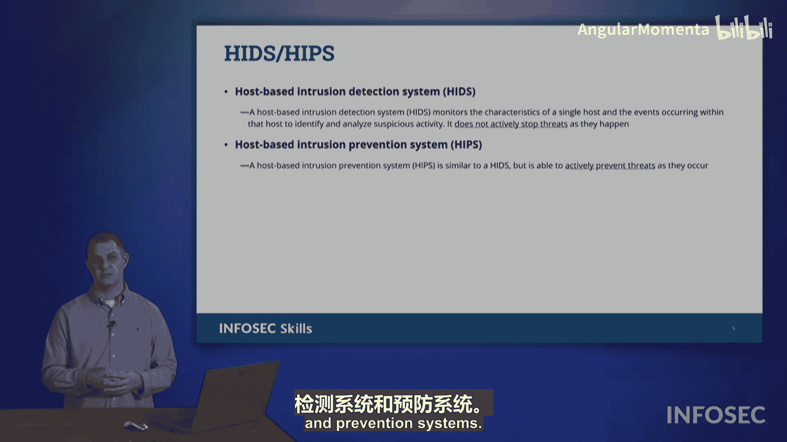

# 【Infosec】CompTIA安全 701认证 ｜ CompTIA Security+ 701 p38 07_01_04_ids-ips -BV1LRr5BTEow_p38-

Detecting any sort of suspicious or malicious activity on a corporate network is vitally important to organizations security。

And so in this section， we're going to be looking at intrusion detection systems and intrusion prevention systems。

 also known as an IDS and an IPS。First up， we're going to make the distinction between。

An in line and a passive form of detection inline detection is where。

A device sits in the data flow from one side of the network to the next as data flows through that device。

 as data transits that device， it's able to inspect every packet coming through that network。

Passive detection is where it sits outside of the network and is able to go through and see what is transpiring on the network。

 it is not engaging with the data， the data is not transiting the device itself。

 it is outside of that monitoring it from a distance。

As we go through and look at the intrusion detection system。An IS。

An IDS sits outside of the data stream， it passively monitors the network。

 it looks at the data transiting the network and makes decisions。

 is this suspicious or malicious activity on the network and if so an intrusion detection system will raise the alarm will be like" hey。

 I need an adult here， someone come check this out， I don't think this should be happening。

It's not going to do anything about it other than raise the concern。

It then allows the security team to then take corrective actions or say， yeah， that's a false alarm。

 that's nothing to worry about。This is the intrusion detection system。

The more active side of this is the intrusion prevention system。

 as we see that with the intrusion prevention system we're going to see how the prevention system is actually in line with the data。

 the data is actually flowing through the intrusion prevention system。

The defining thing about an intrusion prevention system is。Yes。

 it has under its hood an intrusion detection system。

 but it doesn't call for help it doesn't say I need someone to do something about it it instead engages。

That network activity it engages the threat and actually carries out corrective measures I often liken it to this is kind of a silly example。

 but I liken it to a security guard at night with an intrusion detection system you've got this kind of lazy security guard at night they're just looking down at the parking lot saying it looks like somebody's breaking into cars that's that's bad news。

Yep， someone's breaking into cars， I should definitely do something about this。Hey。

 I think somebody's breaking into cars， can you come check this out？And then if that's the case。

The security guard， they're just watching， that's all they're doing。The intrusion prevention system。

 though。It's a little bit more trigger happy。ItIt is seeing， you know。

 it's doing the security guard scanning， it's looking around and he goes。

 someone's breaking into cars。All right， someone's breaking into cars。

 let's go get them and then it goes down and it engages with the threat and so the problem with the attrusion prevention system is that。

It can be a little too trigger happy sometimes it can jump the gun a little bit so to speak。

It can engage with threats that are not actually there。You know。

 if that security guarder was to run down and you know。Put some kind of， you know。

 a shotgun in their face like free scumb bagag and it's like drop it and its like stop bringing to cars that people be like。

 what are you talking about， this is a grocery store， this is my car。

I'm putting groceries in my car what that's going be very disruptive to that business right and so you need to find a balance between how aggressive your intrusion prevention system is if you're going to be employing one and that's actually the main drawback of why you wouldn't just always use an intrusion prevention system。

Some organizations want to use an intrusion detection system because it is more passive。

 it is not going to jump out there and actually cause some false positives， some false alarms。

The intrusion detection system can raise the alarm and then a human can then come back and say yeah that's not really a problem like that can you can stand down about that with intrusion prevention system。

 it's going to say I sprung into action， I took care of the threat and you'd be like，Yeah。

 you actually caused a work stoppage issue for some of our users because you thought that was a threat。

But it's not really， and so an intrusion prevention system can be problematic in its eagerness to stop any potential threats that come up。

You may have noticed on the previous slide and on this slide we have mentioned of a network intrusion detection system or a network intrusion prevention system。

There's also a host based intrusion detection system and a host based intrusion prevention system。

We can utilize these technologies to help harden and raise the security level of activity on our endpoints on our machine。

 so this is something that is happening on your host。

The thing to know about these is they operate very， very similarly in concept。

 the intrusion detection system is more passive， the intrusion prevention system is more active。

 they have the same problems and drawbacks， the intrusion detection system， it sees something。

 it raises the alarm but nobody's there to see it or nobody responds to it quickly enough。

Or the intrusion prevention system sees something that may not actually be a threat and it stops that user's activity being disruptive。

 so even though the exam might mention an N IDS or NIPS or HI or HIPS。

 know that they're just talking about intrusion prevention system。

 a detection system and prevention systems。

