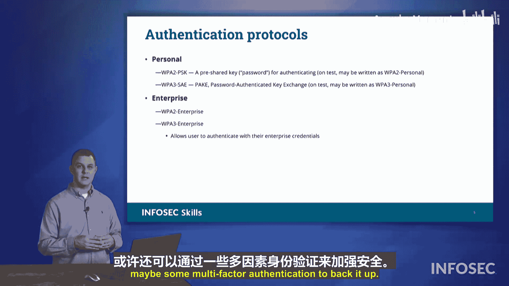

# 【Infosec】CompTIA安全 701认证 ｜ CompTIA Security+ 701 p39 07_01_05_wireless-security -BV1LRr5BTEow_p39-

When using wireless networks， security is very， very important。Wireless uses a shared medium。

 the radio waves， and so we need to be able to encrypt our communications so that nobody else is able to intercept and read our sensitive information being sent over the wireless networks in this section we're going to talk about ways that we can encrypt wireless networks and see the types of protocols that we'll see showing up on the security plus exam。

To begin， we'll start talking with Wired equivalent privacy。We。

Web is what we have used for a number of years， the problem with web is that it has been found to be cryptographically broken。

Webb， I think， has an excellent name。With wired networks。

 it is near impossible to sniff the network traffic that is found wireless on that wired network。

With web we have wired equivalent privacy， it gives the impression that hey if you're using web。

 it is as safe， even though you're using this shared medium it's as safe as if you're using a wired network and an adsary is not going to be able to snoop on your traffic Of course the problem is that they can web has some cryptographic flaws baked into it and so it is quite easy to break a web encrypted wireless network。

To replace it， we came out with WPA。Wifi protected access。WPA。

Stood in for web and was found to be useful for a while until there were cryptographic vulnerabilities discovered in it。

 we have since abandoned WPA in favor of WPA2。WPA2 is the form of encryption that we use quite often these days。

Up until the most recent version of the security+ exam。

 WPA2 was seen as the highest level of wireless encryption。WPA2 uses AES and CCMP。

Now you can see here on the slide it says that AES。

 the advanced encryption standard utilizes counter mode with cipher block chaining message authentication protocol。

 CCMP。You don't have to remember what AES and CCMP stand for， in fact。

 it is enough to just know that AES and CCMP are the two components that make up WPA2。

On the exam they're going to give you two of these three different pieces it's up to you to determine what is the missing third piece they might say which of the following is in use with WPA2 when using AES and then you would have to choose CCMP or they'll say which wireless。

Security standard uses AES and CCMP， and then you would answer WPA2。Now this one seems really。

 really corny and I will fully embrace this， it'll help you remember this whenever you see。

WPA2 how do you remember that AES and CCM go together I'm going to give this really really corny acronym mnemonic a way to remember what is this acronym and so it's really corny but you have an entertaining system。

Equals a computer。I know this is completely dumb and it's a corny goofy way to do this。

 but it'll help your member and be successful on the exam， AES and entertaining system。

That's a computer， a computer you have to put in the extra C because it's CCM AES and CCM。

 this goes with WPA2。Now I mentioned up until the most recent version of security+ WPA2 was seen as it。

 it was kind of the B's knees of wireless security， but we have a new standard that we can utilize。

 and this is WPA3。WPA3 operates slightly differently than WPA2。

 but we have baked into it a few different added features。

 such as the ability to use a QR code to automatically join， authenticate to a network。

If you ever find yourself joining a wireless network using just a QR code。

 chances are you're doing that through WPA3。What you need to know for the exam。WPA3。Is AES and GCMP。

And you guessed it I have another corny mnemonic for you to remember this by and it's only slightly better than the computer that I just spoke about in this case。

 this one's really corny as well， but this one is AES again it's an entertaining system this time it's a gaming computer。

So no weird pronunciations of computer in this case and entertaining system is a gaming computer if you see AES and GCMP。

 you know they're utilizing WPA3。If they're talking about WPA3 and AES。

 you'll know that the gaming computer is on use on here so you'll have GMP I know these littlenemonics are really really goofy if it helps you by all means I'm all about it。

 but an entertaining system in this case a gaming computer that's going to give you WPA3。Further。

 whenever we're looking at wireless networks， we have a couple different solutions that we will find mentioned on the exam。

 some nomenclature they'll use on the exam。They will talk about WPA2。Personal。On the exam。

WPA2 personal or WPA3 personal。Or WPA2 Enterprise。WPA3 enterpriseise。

 what are the differences between these？If you look at the personal on here。

 you'll see that with WPA2， we have this PSK。PSK stands for Pre shared Key。PSK pre shared key。

Officially the term that we use to describe whenever we talk to someone， hey。

 do you have the Wifi password， what's the Wiifi password。

 does anybody know what what's the Wifi password？It's not really a WiF password。

 it is a pre shared key PSK。If we're using that， that is going to be referred to on the exam as WPA2 personal。

Think about it on your home network， on your network at home， your wireless network at home。

You're probably not utilizing something， some big complex form of authentication。

 you're probably using a pre shared key， right I am as well。At most organizations， though。

 we don't want to have all of our users using the same password。

Reason being we don't want everyone lumping together。

 we want to be able to determine who is doing what。

 and we want to be able to revoke access for certain users and grant access to others。

In these situations， we use WPA2 enterprisese， WPA3 enterprisese。

And the reason we refer to these as enterprises because you're providing your username and password。

 something you already have at work。To authenticate into this network。

This is different than using a pre shared key where one and all use the same password if you' were to come to my house。

 I would have to give you the pre shared key for you to join my network。

I'm not going to issue usernames and passwords at home， I'm not that formal at home。

So with WPA2 Enterprise WPA3 Enterprise， you're providing authentication measures in the form of username。

 password， maybe some multifactor authentication to back it up。

 this is all done as part of the WPA2 enterprisese WPA3 Enterse。

Final thoughts on this section is when we're looking at wireless networks in professional settings。

 we might perform a site survey or a heat map。And so a site survey。

 this is essentially where you're going around and you're measuring the wireless activity in your office。

And so what you do is you put a laptop on a cart。And you push it up and down all the cubicles in and out of all the offices。

 and you're tracking your location along with signal strength。

That is all that a site survey is doing， you're surveying the site and you're measuring what is the signal strength of wireless at this particular position and as you move positions you're gaining information about that。

You can take all that information， feed it into some software， and it will generate。A heat map。

 the heat map will show you visually where coverage is provided in the office and then you can begin to go through and look at where are we missing information or where are we missing coverage on our wireless network and then we can situate our wireless access points to provide full coverage for all of our users at our organization these are some concepts to keep in mind when dealing with wireless networks on the security plus exam。

