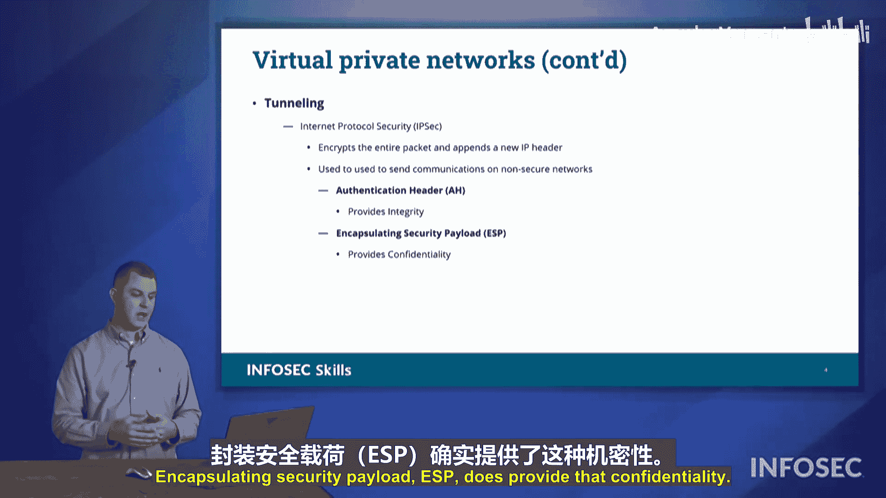

# 【Infosec】CompTIA安全 701认证 ｜ CompTIA Security+ 701 p40 07_01_06_virtual-private-networks-vpns -BV1LRr5BTEow_p40-

Virtual private networks we oftentimes will not always be at our organization's main office or we might need to connect to some remote satellite office elsewhere。

 and so we can utilize VPN's virtual private networks to safeguard the communications as that data is in transit from one location to the next。

We have two flavors of VPNs to discuss， there is the remote access。

 which is probably what you're thinking about whenever you discuss virtual private networks。

 and then we have site to site VPNs。The first one to look at is the remote access when you work remote。

When youre remotely connecting to a network， you will see folks connecting through a VPN。

 this is whenever you authenticate on your system with some remote system and then your system that connects over the public open internet。

It encrypts the data going back to the main office so that others can see that you are connecting to the。

To the network， they can see there， but they can't make sense of whatever the data is being encrypted along that channel。

 and then you can then get access to the corporate network within that VPN。

The other one that we have on here is the site to site VPN the site to site VPN is what we would use whenever we have users at two different offices and they're connecting in this case they're going to tunnel all of their traffic through the same network。

And so they're going to use all their connectivity。

 they're going to connect through the VPN to the other site and then pop out on the other side。

With a remote access， the first one we mentioned。You are having to authenticate as yourself on that network。

 you're setting up that VPN link。With a site to site， you're not having to do it。

 It is happening from the two ends。 They're going to be using。

Appreciate keys or certificates or some other authentication measure。

 and it's out of your hands it's not something you have to think about。Either one of these。

Relies on similar technologies， they can use tunneling technology to encrypt data as it flows from one site to the next。

And so we have tunneling。As the topic to discuss with VPNs。

 tunneling is what allows us to connect over an untrusted network and secure our information on there。

So with tunneling， what we're looking at is that we have two。Primary ways of handling this。

 we have transport layer security TlS TlS， as it says here， it's a cryptographic protocol。

 it encrypts our information ensures our privacy and is the successor to the previously broadly widely used secure sockets layer or SSL。

We no longer use SSL， it was found to be cryptographically broken， and so we don't use SSL。

 we now use TLS TLS is one way that we can secure data on our VPN。

The other way that we have is to utilize。IP S or internet protocol security extensions。

And so what we can do with IPS is we can encrypt all of our data so that all of our data that's flowing from you back to me is being encrypted in this sort of a tunnel。

Others can see that we are communicating， but they're not able to see what we are sending。

Part of this IP S structure is。You have a choice of how you want to encrypt the packets on there。

 we have the authentication header。And then we have the encapsulating security payload。

As you can see， the authentication header provides integrity。

 it ensures the security of the data that's in there， that it does not get changed。

 but it does not necessarily provide confidentiality。

Encapsulating security payload ESP does provide that confidentiality。

So one of the things I want to want you to think about whenever you are sending letters in the mail。

 for example， you've got two different ways you can send letters。

 you can have either an envelope or you can have a postcard。

With a postcard on the one face you've got like a picture of something and on the back it says you know to grandma or something and you might send grandma a picture like you know the weather's here。

 the weather is great， wish you were here and so your message might say wishish you were here and that goes out and grandma gets her card and she's all excited about it like oh this is wonderful but because anyone can see this someone might go well you know what？

I'm just going to pull out a pin here and write wish you were not here take that grandma and they put it through the mail someone else has altered the message that you sent to grandma you were trying to be nice。

 they wish you were here。But grandma receives the message，Wish you were not here。

And then she's all upset and she's going to call your mom and you're going to be all in trouble because what did you send to grandma and you're going to hear all about it like I sent her a postcard I said I wish you were here well she says wish you were not here and she's all upset。

What you could do is you could protect that information if you don't want anyone changing your message。

 you could take a piece of clear packing tape。Put that over the message。

 And now it doesn't provide any more confidentiality than you had before。

 but at least nobody's able to go through and actually alter that message。

 That's an example of how the authentication header provides integrity。

 Anyone can see that you're communicating back to your main office。

 There's no confidentiality with that， but that is your authentication header。 It doesn't provide。

Compfidentiality。But if you were to send a letter in the mail and you sealed up the envelope or something。

 you could send that along through the mail and anyone's going to be able to see that， okay。

 I've got a communication going from this person to this person， but I can't get into it。

 I can't open the letter。Others aren't able to see what the message is， what is being sent。

 this is encapsulating security payload， it encapsulates everything， it puts it all into an envelope。

If you will， and so it secures the message and you're able to send this over an untrusted network and nobody's able to see the message nor tamper with that because of the security found with that packaging so we use tunneling in a lot of ways to secure data from one site to another this is how we can utilize VPNs to protect our data going across untrusted networks。

