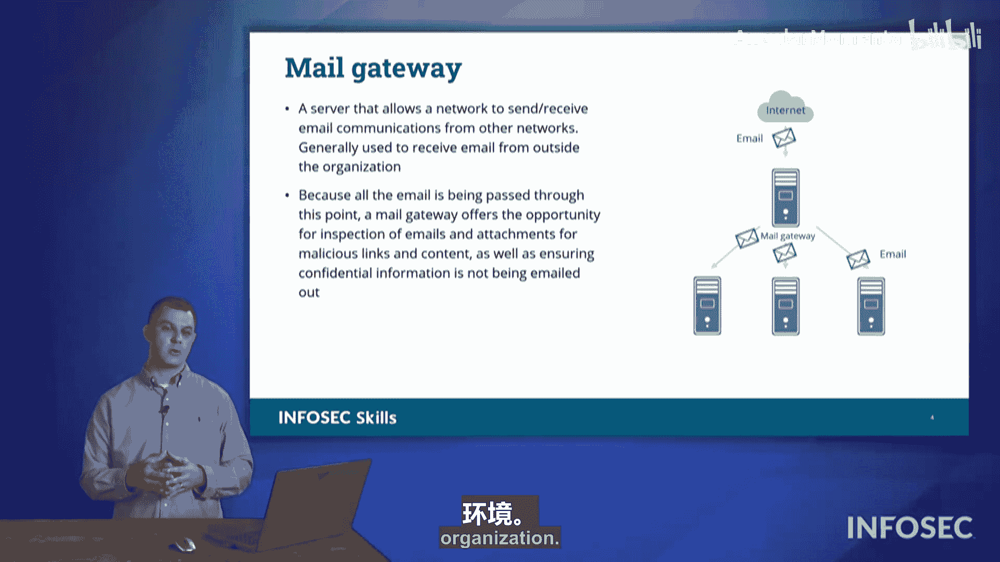

# 【Infosec】CompTIA安全 701认证 ｜ CompTIA Security+ 701 p41 07_01_07_email-security -BV1LRr5BTEow_p41-

In this section we're going to look at how we can protect the email security of our organization。

 we want to make sure that other entities are not impersonating our brand using our good name to deceive others。

So in this email on email security， we're going to look at the DMarRC framework that has been in use in the industry since early 2024。

In October 2023， Google and Yahoo got together and said。

If you're going to send any email to our users， you must use DmarC。What DmarRC is。

 the domain based message authentication reporting and conformance framework。

 it utilizes both DKM and SPF。DcaM is the domain keys identified mail。

And SPF is the Ser policy framework。You can see over on the right。

 we have the DNS entry for Comptia if you were to receive an email from Comptia。

Your email recipient server。Where the email comes in for your email is going to go back and check which host sent that email from Comptia to you。

And we can see here on the right side， we have the SPF record highlighted。With SPF。

 it says you must have an email that has gone through the hands of this server， spf。protection。

outlook。com。If it has not come from that particular server， then it is not in conformance。

This identifies that there has been a stop along the journey of that email coming from Comptia to you。

 and it is going to pass through this particular host。

What we do with an email that is not from that host is what this SPF is all about。

 we have three types of responses， we can accept it anyway， that's the plus all。We can toss it。

 we can reject it， the minus all， or we can flag it， and that's the till day character on here。

In this particular setup， we have minus all。This one says if it did not pass through the hands of this server。

 reject it。Let's take a look at a graphic that supports how this。

Happens so let's look at how does an email server know from which email did it originate and then also how do I know which email servers or which emails to allow through or which to reject。

In this next graphic。We pull up this diagram and it shows how this email structure occurs。

The whole thing begins by creating a DNS entry that reflects what it is that we want to do with this。

 that DNS query that we just saw on the previous screen gets created on the DNS record for an organization。

At the very top up here on number two， there's an adversarial email server out here。

 let's say it's from hacker。ruu。That's the domain name， but they're going to pretend to be。

Someone from Infoec。And so our email addresses at Infoec actually come from our parent company。

 Sageage。And so this system up here will pretend that this traffic is going to come from the Sage email server。

 they're going to send you some spam and you're going to have to differentiate if it's me sending you a legitimate email from Sengage or if it's the hacker sending an illegitimate message。

That's up here on number two。Way over here on number three。

We've got the legitimate S gauge email server。And so I'm going to send you an email and you're going to know that it's going to come from me because it's going to have my syn gauge emailed attached to it。

And so that email gets sent to you as well as that email from up here athacker。ruu again。

 they're mask ratingding as Sengage。com。So you have these two emails。

 how do you tell them apart what your mail server is going to do is it's going to request the public key。

From your mail server。Or actually， your mail server is going to request it from my mail server。

And is going to get the public key。And then it's going to use that to decrypt。

An email that has been signed。Using the private key from that other mail server。

Recall from public key cryptography， there's only one entity in the whole world that has。

 in this case， Sage's private key。And that is， Sengage。

 they're the only ones that have Sengage's private key。So the only way to encrypt a message。

In a way that the Sengage public key can decrypt it is if it originates from Sengage。

That's how your system knows the origin of this， if it passes that， it's passing decchem。

 the domainma key identified male。Next。It tries the same thing with this other email that is pretending to come from Sengage。

 but it's actually not coming from Sengage。This email was sent and it was not digitally signed。

 it did not have a domain key identified mail。And so whenever your mail server requests Sengage's public key because recall this email from the hacker is masquerading as Sage。

com so it's going to reach out to SengGage。com say。

 yeah let me get your public key there buddy and then it sends it back now your mail server is going to try to decrypt this message using that public key。

But it's not going to work why， because this email from the attacker was not signed using Sengage's private key。

 they don't have a copy of Sengage's private key。In doing so。

 it is able to get that non repudiation that we've talked about and it is utilizing。

Public key infrastructure in order to decrypt and these messages and know where it came from。

It allow is going to go through and it's going to say， yeah。

 this email actually came from Sage and I know that that's true and so it's going to allow that message to flow through to you you get the alert。

 you've got mail and now you're ready to go。But that email that does not pass that conformance check。

 it's going to be rejected。And it's going to be thrown out or that message might get flagged just saying。

 hey， this is little suss， I don't think that this is going to be something you want to allow into your network or you just need to be on alert for this and so in doing so we can reject that email but the SPF record。

That we have over on DNS will tell us what should be done with those non conformant emails。

This is how we utilize DMarRC and DKM to safeguard email and protect our organization's good name。

It's a very complex graphic that we have here， but the concept goes a long way into divventing spam。

And then lastly， we have mail gateways email gateways provide a point of inspection as email is coming into our organization from the outside。

 we can inspect that email traffic at our mail gateway to catch any would be malware suspicious length that are in there whatever sort of malware might be trying to get through our email system will catch it at our mail gateway before it goes on to our mail servers these different security technologies work together to provide a safe email environment for our organization。

Be on the lookout for these terms and concepts on the security+ exam。

