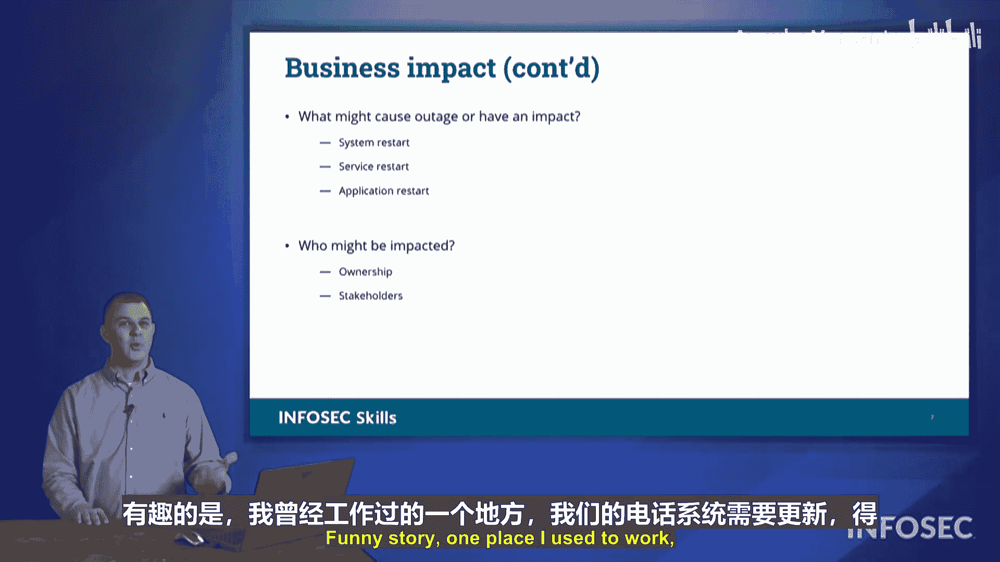

# 【Infosec】CompTIA安全 701认证 ｜ CompTIA Security+ 701 p42 08_01_01_change-management -BV1LRr5BTEow_p42-

Change management is one of these topics that we will see in the security plus exam with several topics related to it。

Such as version control。Version control allows us to track changes from one edition。

 one version of software to the next or one patch to the next by utilizing version control we can see what software we have installed。

 what software has changed and what our what our changes have been we can also roll back to previous version if we did not have issues with that but we're having issues with the latest version this allows us to track those changes also allowing us to track changes is documentation we want to track who made the change。

 what change was made， when was that change made， why would did they make that change and who authorized it you want to make sure that you're documenting your changes that you're doing。

 not only protect the organization as a whole so that we know who's making these changes on our network but also you want to do it yourself to make sure that you're not being left out like hey why did you make that change Oh I thought I was doing this。

Document it so that your activities can be tracked and you can provide proof。

 look I checked with these other people I checked and this was approved by this individual。

 I tested it here and it still went haywire so you want to make sure that you're documenting any activities that you're doing as a safeguard for yourself as well。

Also as。Technologies in our organizations changed， we want to make sure that we're updating our diagrams if we have any kind of network diagrams。

 process flow diagrams， you know anything in our organization make sure they our diagrams are up to date with the latest technology that we have installed。

 don't let them get out of date and then it just becomes a headache to try and maintain from that point to dig out。

The other thing that we'll see here is that if we have any policies or procedures that change with the addition or removal of certain technologies。

 you need to make sure your policies and procedures are staying up to date for example。

 we don't want to have a policy where to say you have to follow each of these steps。Oh well。

 well except for sort for rule number three and step number seven。

 we don't do that anymore you're right yeah， step number 13 we don't do that either yeah and then yeah 20 you don't have to worry about it either well if you have these holes in policy。

It's hard to tell someone you must follow it each and every step。

You can't come back later and say why didn't you follow each and every step well because you told me that some of these steps weren't important I don't know which ones to follow drones I don't keep your policies up to date。

 keep your procedures up to date so that you can say okay。

 we now can say followow each of these steps if we need to remove a step。

 update it and make that change known。You also want to make sure that you're considering the business impact of any sort of changes that you've made what sort of。

Impact is this going to have on our users we want to limit the amount of downtime that we cause for our users we want to prevent any sort of work stoppage we don't want any productivity lost whenever we are implementing some of these changes so consider the impact that it has and do a measured analysis before carrying out some sort of major changes。

Consider using maintenance windows。Mainance windows will let your users know when they need to wrap up their work because you're about to take the system offline and give them some reasonable expectation of when that service will be restored back to its normal availability Main windows allows support staff to carry out the needed necessary changes while limiting the amount of work stoppage that we've got。

Also， as we go through and look at our policies procedures。

 we want to come up with some sort of a workflow。You want to have a standard operating procedure in place。

 making sure that your folks are stepping through processes and we know the activities that each each and every individual within our organization what they're doing so that it all works together as a giant。

 well oiled machine。Also you want to make sure that you've got that approval process as I mentioned earlier。

 making sure that before we apply any changes someone has signed off on it before I signed off on this did you test it you sure can I see the results okay now I'll approve it I'll sign off on it you can carry out those necessary steps。

Test those results very， very important to do also you want to make sure you have a back plan if I have a an update that goes bad or it messes up with something on the network。

 I want to make sure that I have a restore point that I can roll back to。

You gamers that are out there， you've done this before when you're playing a game before you open that you know the hidden dungeons door with go in with the final boss。

 what do you do， you save the game and you save it and you save it again just to make absolutely sure because if I go in here and the boss just you know beats me to a mess then I'm going to be able to roll back to this restore point you want the same thing to happen with your corporate routers firewalls servers before I implement these changes I want to make sure I have a safe place to retreat to that's what the backup plan is all about think too about how important it is that certain sites don't have lost connectivity or any kind of loss of service anytime they go to implement a change they're going to have that rollout plan just in case they can roll back to that spot。

Whenever you're introducing some sort of new technology。

 make sure you're considering what those changes are going to have any kind of a knock on effect。

If you're changing any sort of allow lists or deny lists。

Which we will talk about the allow list and deny lists。

 those can have knock on effects on other processes within your organization。 So before you open。

Activity to a particular site， think about what sort of harmful activity might originate from that site or if we're going to block this。

 what other sort of software do we utilize that might be impacted by this。

 consider those technical implications of your activities that you're doing。

If you're changing any sort of restricted activities， if， for example。

 we don't want our employees browsing any sort of job search sites or whatever。

 if we block it for everybody，What do we do when human resources comes back and say， hey。

 we can't pull any prospective new hires from these sites because they're all blocked。

 so consider the knock on effects before changing making any kind of changes that are on here。

And then the third one that we have on here is managing。Legacy applications。

If nobody's told you to now。In technology， the term legacy is a euphemism for old。

 so there are some old software， some old solutions that we have to babysit and we just have to keep those running why well。

 it could be that。Our shipping department has this new Fangleal technology but。But two days a week。

 we have Joe that comes in and he volunteers just because he really likes shipping and he used to work here。

 but now he's retired， he just wants to stay busy。He doesn't really get this new software。

 but he continues to use the old software， we keep it around because we've already paid for the software and Joe likes it。

But。If we have some new security measure that's going to change the old legacy software that Joe is using。

 then maybe we're going to consider the changes that that's going to have and we might say， Joe。

 look， we really don't want you to you know we want you to keep working here。

 we don't want you to lose this software， but we have to implement these changes。

 it's going to cause an issue here。And so we're going to bring Joe over to the new system like Joe we're going to pay for a license for you。

 we're going to get you trained on this and we'll even customize it so it looks and feels a lot like the old one。

 but the legacy application can't live on because we have these requirements in place so before you make any sort of new technical changes consider the impact it would have on any sort of legacy applications you keep around for business operations or for other needs。

You also want to consider what is the overall impact？

To your business what sort of impact is this going to have whenever we restart this system or have this service restarted or an application restart who is it going to affect is it going to impact the the owners of that system。

 maybe I need to tell whoever our you know organization's webmaster as hey。

 before I take down our web server， I have to apply this patch just letting you know I need to do this。

Perhaps even better way would be when can I take this down， I need to take it down soon。

What do I need to do in head of time？And then you could also impact your stakeholders。

 this could be your users， your clients， your customers， your employees。

 it can be a lot of different folks with that， so consider what happens before you take a system down。

Funny story， one place I used to work and we had an update to our phone system and we needed to apply this patch and we were told time and again this is not going to impact anything and it was getting late in the afternoon。

 the patch came out we needed to install it。

And the。Conversation was like， do we do it now？Or do we wait until after five o'clock local so that we can then when most people are done with the workday。

 should we do it now and like well it says it's not going to take the system down， yeah。

 but what if it does？It says it's not going to。But what if it does？Can you imagine what we did？

We said well， it says it's not going to do it， and so the change was made。

 it restarted all of our voiceover IP system phone systems。

And it disrupted a number of calls as soon as it came back online。

Our phone board lit up with calls What happened I dropped my call I dropped my call I dropped my call and so it impacted a lot more than we thought and so from that point on we began to say okay before we make any changes we're going to you know if it's going to restart a system or potentially restart a system we're going to wait until after5 o'clock local so that we don't impact any sales because a lot of those phone calls they could not place the call back because the other person is like well it's the end of the day anyway I'll talk to them tomorrow and they went on about their day so consider the impact before making any changes to your organization this wraps up our section on change management。

