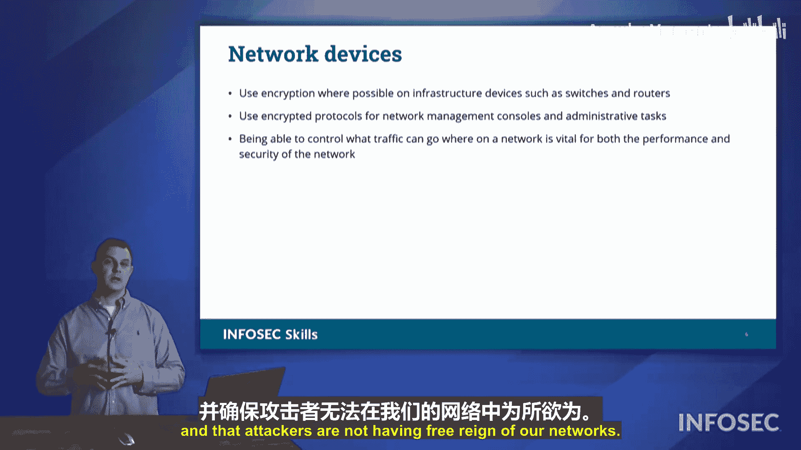

# 【Infosec】CompTIA安全 701认证 ｜ CompTIA Security+ 701 p43 08_01_02_system-hardening -BV1LRr5BTEow_p43-

When planning the security of our organization， especially that of our computing systems。

 we need to make sure that our systems are resilient and don't have many attack surfaces that might be exploited by an adversary。

In this section， we're going to talk about keeping those systems safe in the form of system hardening。

System harding is the process of going through and identifying weaknesses and shortcomings in the system and shoring up those weaknesses and vulnerabilities to make those systems more resilient。

We need to make sure that our endpoints are secure。

 and endpoint is anywhere where you interact with data。

Either on the server end of things or more likely on the desktop side of things on your local workstation you're going to interact with data that is stored back on the servers so these are your two endpoints we need to make sure that we're keeping both the servers and the workstations secure we're generally going to adhere to those baseline security configurations that we have set up or may have been suggested by suggested by industry insiders。

We want to make sure that we are following our best practices when it comes to patch management。

 that we're staying in tune and in touch with whatever patches are made available。

 what vulnerabilities exist， and we want to make sure that we're performing regular backups on the data found on those systems taken together these all help harden our endpoints。

Additionally， we can utilize software such as antivirus programs。

Antivirus helps us sniff sniff out and root out any sort of malware that might befall our system Antitivirus helps keep our system safe by looking for signatures of malware that are existing on the network or on our systems。

We might also make use of endpoint detection and response ER。Endpoint detection response。

Is something that as the name suggests is found on your endpoint。

 it helps detect any sort of malicious activity and carry out some sort of responsive actions to that we will also as part of our system hardening。

 we will also make use of data loss prevention software。

Data loss prevention software can be useful if there are certain projects we don't want our users leaking out to our competition or spreading the word about。

 for example， let's say that we have some project named Project hummingbird we don't want our users talking about Project hummingbird。

And so what we're going to do is have our DLP solution set up to monitor for uses of hummingbird。

Every time it sees mention of this word， it will flag that so that a security team can review that and see in which context is this key word being used。

 it could be。One coworker talking to another saying， hey。

 can you tell me how to make hummingbird nectar or have you seen those pretty hummingbirds that have come through and that's not in the use case that we don't want people talking about Project hummingbird。

Meanwhile， we might have a chat message going out saying like， hey。

 we've aed Project hummingbird and then our competition might be alerted to that so DLP will catch all of these and provide our security team the ability to review that。

Other ways that we can keep our endpoints safe is to utilize full disk encryption。

Full disk encryption is a software solution on a standard hard drive there's nothing special about this hard drive it's the same kind of hard drive you have on any other system What it does is it utilizes software such as bitlocker for Windows。

And it encrypts the data using a key， that key might be found on the trusted platform module on the device。

It encrypts the data coming from the operating system， it encrypts it inflow to that drive。

 using that key and then stores that information on the hard drive when the operating system goes to read that data。

 the data is pulled off the hard drive， it is decrypted by that software and then handed over to the operating system。

 it is a software solution。The problem with full disk encryption is that it does provide a performance hit to your operating system。

 it can slow you down somewhat。Because it is an additional task that the hard drive is having to have done or the operating system having to do before sending it to the hard drive。

Full disk encryption has a performance hit with it。You could also use a self encrypting drive。

Self encrypting drives are a hardware solution to this。

 They provide far less of a performance impact on the host operating system。In this case。

 a self encrypting drive does talk to a trusted platform module and unless that。

Self encrypting drive has contact with the trusted platform module。

 then those devices will not be able to decrypt the data coming off of it if someone was to physically break into that system。

 pull out that hard drive。If it's a self encrypting drive。

 that hard drive is of no use unless that trusted platform module is accompanying it。

So the self encrypting drive is a hardware solution， full desk encryption is a software solution。

Another type of solution that we have， another type of software that we've got is file integrity monitoring。

 as we discussed with hashing。The word integrity should come to mind whenever you talk about hashing and whenever you talk about integrity。

The phrase hashing should pop into your mind so here we've got file integrity monitoring what does this do well the name implies that we have hashing going on this tracks changes to data found in your system if one of your users。

Changes data on your system through unauthorized means。

The file integrity monitoring system will detect that change and alert because what it's doing is it's going to have an authorized process for how to do this and it's going to generate a hash。

The hash digest will be stored if somehow an attacker or a user comes along and messes with the file。

And the digest on that file is not going to match what was on there， it can raise an alarm。

 it can say someone has messed with this， someone's tampered with this data， we don't know why。

 and it may not even directly tell you who。But it is going to alert you that there has been a file change。

 this is file integrity monitoring， it's a way to safeguard changes wanted or unwanted on our systems。

And then lastly， if we're going to go through and harden our different devices。

 we want to make sure that we're keeping our network devices safe and secure again we're utilizing encryption and we're using encrypted protocols for sending data back and forth between our endpoints we want to be able to control data how it goes from here to there and so we're going to make use of routers。

 firewalls and access control lists to make sure that our network is operating as efficiently as possible and that attackers are not having free reign of our networks all taken together this is how we can safeguard and harden our systems。

