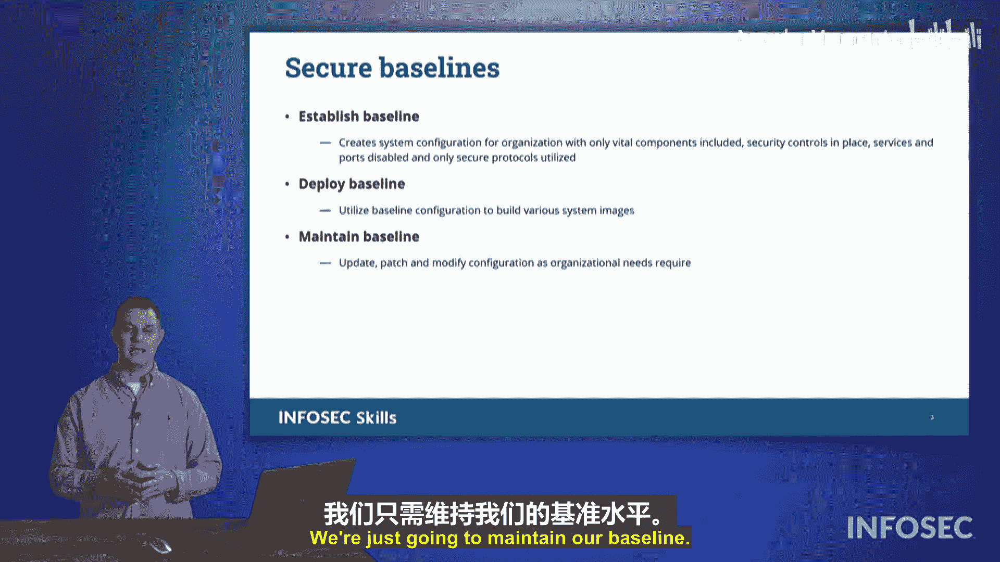

# 【Infosec】CompTIA安全 701认证 ｜ CompTIA Security+ 701 p44 08_01_03_secure-baselines -BV1LRr5BTEow_p44-

When keeping our computers and endpoints safe and secure on our corporate networks。

 we make use of secure baselines。With secure baselines。

 what we're going to do is we're going to have safe operating environments on our systems。

In this section， we're going to talk about what makes up a baseline。

A baseline is going to have a common secure operating position for all the computers on our network。

In in the baseline， you're often going to go through and take care of hardening a system's security。

 you're going to disable any unnecessary network services or ports that you're not using。

 for example， if you have an end point，Computer at a desk。

 you don't need a web server on there uninstall that close those port you don't need port 80 and port 443 open if this is just a traditional workstation。

You also want to make sure you remove any software if you're not running a web server。

 there's no need to have that software installed any sort of software on your system is a potential vector for attack and so you want to unload any software that is not absolutely necessary for the job this device will be working with。

You also want to make sure that you're utilizing secure protocols。

 no more will you be using any of the plain text protocols， use encryption wherever possible。

And then lastly， if you need to implement an application allow list or block list。

 you want to make sure that you are safeguarding that system from having any applications that are introduced to that computer that are not on the allow list。

The allow list says these are the systems that we're allowed to run and any ones that are not on this list are not allowed to run。

Or you could have the block list that says specifically these are the applications we do not want executing on this computer if you're going to implement this。

 it's good to put it into your baseline so that whenever you get new computers in for your users。

 you're installing this baseline a common system image that is secure across all of your devices in this manner you're able to assure yourselves that you have operating an operating environment that is secure right from the get go。

Whenever you're using a secure baseline， you want to make sure that you're going through these three steps。

 we're going to establish a baseline we're going to first go through and define what does it mean to be secure in our environment what software is common to all of our users what software is needed what software is not needed this is part of establishing the baseline then you create that baseline and roll it out you deploy it to any sort of new systems that you get coming in。

At a university used to work at， we would get palette loads of computers coming in every summer we would get new computers for different departments。

 different colleges and we would deploy baseline on the baseline on all of those systems。

 they would come in and we would keep up with all of those systems。Occasionally。

 we would have to dig up the image that we would use for those systems。

 maybe in the middle of the academic year。And we would then maintain that baseline any sort of updates or patches that had come out since we created that baseline。

 we would want to implement those changes on that image so that when we go to roll out that baseline again for the next crop of computers that comes in or maybe we have to replace a computer for one of our faculty or support staff。

 we're going to go through and use that same image but it's going to get them up to date and we're not having to install the baseline and then wait for those patches and updates to apply we're just going to maintain our baseline。

Baselines are helpful in establishing a common， secure operating environment in our corporate networks。

