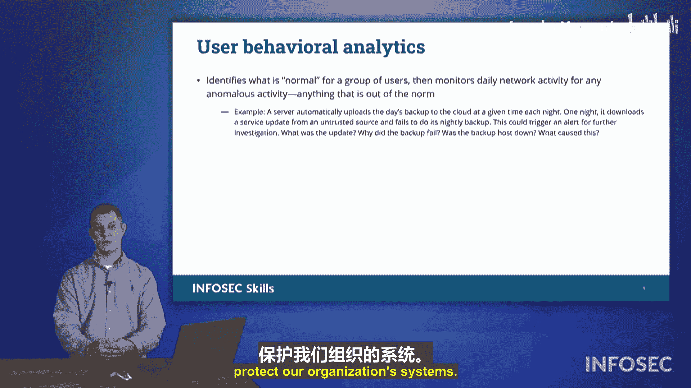

# 【Infosec】CompTIA安全 701认证 ｜ CompTIA Security+ 701 p45 08_01_04_secure-technologies -BV1LRr5BTEow_p45-

In this section， we're going to talk about security technologies。

 some of those technologies that we can use to provide some level of security for our organization and those that connect to our organization's network。

First of all， we can protect our network through filtering。

 we want to make sure that we are preventing our users from connecting to any server or services or websites that could be harmful and so we can accomplish this a few different ways。

 we can have an agent installed on the computer， we can utilize a central proxy。

That will provide filtering so that it will not go out and get those web pages if they are on a block list。

 we can use URL scanning， going through and looking for specific keywords embedded in the URL。

 the domain that we go to might be okay， but particular keywords found within that domain may not be。

 and so we'll block that。We can also have content categorization。

 this is where an organization some third party goes out and categorizes websites based on the type of information that they are or the type of website operation that they are。

 gaming websites， explicit content， social media， job search。

 we can block all of these types based on the category that they're in。

We can also use reputation tools like abuse IPDb， this is a organization that。

Their clients will submit IEP addresses too， if that IP address is found to be harmful or malicious。

 then it gets flagged as that as others pile on and say， yeah。

 I've got some suspicious or malicious activity coming from this IP address will put it on the block list and then our sites will then be prevented from going to it or our users will be prevented from going to that site。

We can also filter based on DNS and with DNS filtering。

 this means that we can go through and whenever a user goes to request a website。

 we can block that particular site from even getting a response back so if we for example。

 want to block social media。On DNS filtering， we can say if anyone tries to connect to Facebook。com。

 we're going to block that here on the site and that's a form of DNS filtering there's a free。

P of software you can use called Phole Phole is free you can run it on a small raspberry Pi mini computer or you can also run it as a virtual machine What Phole does is it has this list of domains that it associates with ads and advertising so you go to a normal web page and on that web page there might be ads that are getting pulled in。

If that web page goes to request images from a domain that is known to generate ads。

It'll block that and so you end up not seeing that ad whenever you go to view that instead you see just the content you want to go see and none of those ads。

 it doesn't actually pull in those because the DNS refuses the DNS server refuses to actually even provide that connection so DNS filtering is a helpful way to filter the type of content that we can get to。

Next， we can look at ways to protect on the operating system itself。

 we can have the operating system and services built into it to actually help protect the users。

On Windows we've got group policy and so we can specify what is and is not allowed on a system through。

Group policy on this operating system。 we also have things with like Linux we've got security enhanced Linux S Linux What this does this embodies a lot of the security controls。

 and so various processes cannot。Run their normal operation without approval to access data across the system。

Or users cannot log in unless certain criteria are met this kind of embodies that mandatory access control SE Linux is a good example of a hardened system。

 it's not really something I would use as a daily driver。

 but it is something you might want to run on a server。

Another technology we can use to help safeguard our network。Is 802。1 x。802。

1 x this is a little bit silly to do this with me， put your hands in the form of an x。

 you shall not pass you shall not pass whenever you see 802。1 x。

 I want you to think you shall not pass and it's helpful I know this is silly it's helpful if you actually do your hands in the form of1 x。

While you're sitting there， just do it alone if you need to， you can make a small x， but 802。

1 x when you see that x think。You shall not pass。The reason I'm saying this is because 802。

1 x it' an iEE specification。Put forth by the IEEE technology group。

 and what IEEE is is a group of technologists that come together to create best practices。What802。

1 x does for us is。It is this idea that， hey， you know。

 it would be a great idea if we had a way that we could block people from joining our network unless they authenticate。

 you must authenticate to join the network。You shall not pass。

Unless you authenticate and then at which point you can come in， it's a little corny， I know。

 but with 802。1 x， it's this technical specification。This specification， though。

 doesn't really get at。How do you actually accomplish that？Well。

 to answer that question of how do you actually accomplish it， we have this idea called EP。

 the extensible authentication protocol， and what EP does is it actually creates the framework and it says this is how we're going to do this it takes that kind of lofty idea of8itude。

 1 x。And it says， okay， this is how we're going to accomplish what was a good idea。

 we're going to now accomplish it in E。Now with an eve。

EP doesn't say here's the actual code that does it。

It leaves that kind of last mile up to different solutions and so you have a few examples here there are four examples listed here on this bolted list。

 I've also put three examples over in the graphic。And what it does is it says that with EPTlS。

 it answers the question， how do I have a user connect to the network？

And send their credentials over the network。Without joining the network， that's a little weird。

I can't join the network yet I'm supposed to talk to the network to provide them with my credentials。

How's that going to work EP TlS is one of the answers to that what they do is they create a transport layer security tunnel。

Or link to。The Ep server。 And then what it's going to do is it's going to。

Communicate with your device it can basically sets up a little two point network between the EP client and you the user and then using EP it's going to transfer your credentials at which point those credentials are then handed off and checked to see if it is really you or someone else。

So we have EPTlS listed on our bulleted list， we also have EP TTLS that's EP tunneluned TlS。

Peeep is another one。I think that one's protected EP and then we have EP fast。

 these are four different different implementations of this concept of EP。

You do not need to know for the exam these four examples I put them out here to show you that there are different implementations of it。

 the ones over on the graphic you don't need to know those either。

 but I've kind of nested them in this Venn diagram so you can see the relationship between 802。1 x。

Eep。And how e fits within 802。1x， and then within E is you have these different flavors of how eP gets implemented。

So for the exam， we need to know8 to2。1 x， we need to know E。

And then somewhat related to those is this concept of radius。

Radius stands for the Re authenticuthation dial in Use Service。Hold the phone。Tommy。

 did you say dial in user service？Yeah， that's。Dial in is in part of the name。

 That's how long this technology has been around It originally started with。

Systems having users that were remote and they would dial in over a dial up modem。

And they would connect in and just because you're calling into my dialin modem line。

 I don't know who you are， I need to authenticate you。

And so this whole concept of radius was created it's this its this platform that we use to authenticate users over a remote link somehow now granted these days we don't really use dialup user service anymore。

 I honestly can't tell you the last time I've ever used a dial in modem or a dialup modem service before but。

With radius。What you're going to see on the exam is they're going to talk about how radius is that server。

That EP communicates with when you go to authenticate using Ep。Your credentials get sent back。

How did they get sent back， they get sent back to the radius server， in fact， the client。

That you connect to earlier， I said E client。On the exam。

 you're going to refer to it as the radius client radius is what receives your credentials and then hands it off to the radius server or what what you're actually going to see on the exam。

The AA server。The AAA server， remember talking about AAA。Authentation， authorization and accounting。

The AAA server is that thing that we have that keeps track of all of our credentials。

 it is what approves a user if you've entered the right credentials you're then authenticated。

 then I will then say you're authorized to access this that and any the other。

The AAA server is what is being queried by radius。To allow you to authenticate into the network。

So on the exam， I need you to know that radius and AAA， these terms get used。

Almost interchangeably in Comptia land on the exam。

 they're going to use radius and AAA they're going to say you connect to the radius server。

 you connect to the AAA server and they're almost interchangeable so be on the lookout for using radius and AAA。

Also， associated with these terms is we have network access control with network access control。

 we can control who has access to the network as the name implies。And so with network access control。

 you'll see it referred to on the exam as Mac again， Mac is network access control。8 to 2。

1 x that we just spoke about is an embodiment of NAC。A22。1x can protect wireless networks。

 it can also protect wired networks， it is really immaterial the technology。

 the medium that we're using to connect with， it's the idea that you shall not pass whenever you see A22。

1x that is providing network access control。We can also have network access control beyond just authenticating users。

 we can also have a host health check that comes in with host health checks。

 we can check on the health of the system that we have got it installed on it's going to look at what is the latest version of the operating system being run what is the level of patching that we've got are we running the latest patches do we have these vulnerabilities addressed are we running anti malware are we running our endpoint detection and response is that taking care of all of the network security controls that we should have in place are those in place If so the client the agent will vouch forth to say yes。

 this user is able to connect to the network because the host health check has been passed？

You could also use the agent that is on here， that will be the client that will actually do that host health check。

There can be an agent that is installed， this can be a small executable on your system。

Or you can rely on agent less scanning and this is going to be some system on your network that is scanning your systems from a distance it's not something that you have running on your individual computers instead it's going to be a server checking devices that are on the network if it passes host health check then it will be allowed on the network and then network access control will provide access to it。

When talking about joining the network， you've got two options that you can have permanent network access control or disvable network access control with Dissolvable。

 you download the agent。It checks the host health of the system。

 are you running anti anti malware are you running the latest patches。

 is everything all set up and good， if so， allow the user to connect to the network is the good。

 and then it kind of bows out and it does its thing， disappears。

The dissolvable network access control that agent lives temporarily on the system until its job is done。

 it vouches for you， deletes itself。Permanent networked access control is where that agent resides on your system。

Doing an ongoing host health check， making sure that everything you're doing is up to snuff and you're working as you should。

 all systems are present and every 30 seconds or minute， five minutes， 30 minutes。

 it's all going through and checking in with the system saying yep。

 the user is all set and ready to go。Permanent network access control resides on the system for as long as the link is necessary。

Once you drop from the network， it will then dissolve itself that permanent network access control agents must be present and running on the system in order to vouch for your access。

Finally， we can also check out user behavior analytics， what is normal for our users。

Humans are creatures of habit， we do the same thing generally day in， day out。

 we have these routines that we're into。By monitoring behavior of our users。

 we get to an idea of what is normal， we get to determine what normal looks like for that user。

If something falls outside of the norm， we can report it and be like， something's going on over here。

 this isn't normal， this isn't what Tommy usually does， this is an issue。

User behavioral analytics watches for that and is able to grab those situations in which users fall out of their normal behavior activities and we can take response for that these are some of the different security technologies we can have in use on our network to protect our organization's systems。

Be on the lookout for some of these terms and others on the security+ exam。

