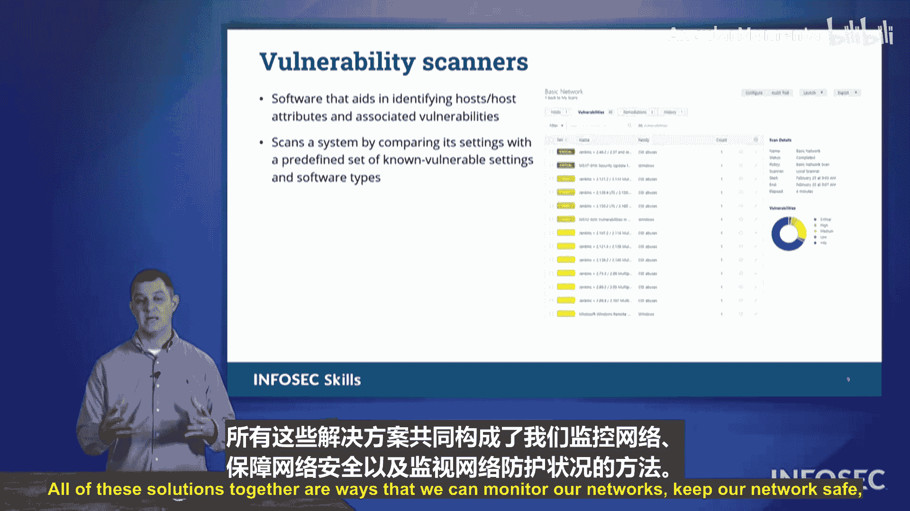

# 【Infosec】CompTIA安全 701认证 ｜ CompTIA Security+ 701 p46 08_01_05_security-monitoring -BV1LRr5BTEow_p46-

Being on the lookout for security situations on your network is paramount to making sure that we have a secure operation as we go forward in this section we're going to be talking about security monitoring。

With security monitoring， we need to make sure that we're keeping an eye out for。Each of our systems。

 the various applications that we have and the infrastructure that connects our systems。

 and each of these we need to watch for threats and vulnerabilities that may surface。With this。

 we also want to be able to watch for information coming out of our log files we have a number of different log files to be on the lookout for firewalls。

 endpoints， operating systems， our intrusion detection and intrusion prevention system logs as well as any sort of network devices that we have and also even metadata。

Coming from our data， different log files will have metadata about some of our different files that are in use。

 all of these logs come together and can be sources of information for investigation for watching and monitoring the health of our network。

We also can utilize vulnerability scans， we can have automated reports that give us information about the health of our overall system。

 we can also rely on the use of dashboards such as a seaM and then we can also make use of packet capture。

When we look at how to glean data from those systems。

 we can look at grabbing those log files from all the different systems， again from our systems。

 applications and infrastructure。Pulling all of those log files together and aggregating those log files。

 bringing them all under one roof is important to， first of all。

 condense all of that information so we can put them into a single unified。

Set up we've got the each column is going to be identified is this the name of the system。

 is this the activity that occurred the time and date。Those。

Different columns might appear in different orders on different log files as you aggregate them。

 you're going to want to put them into a single unified setup so that you're able to compare apples to apples in this case。

Once you have all the logs aggregated to a single platform。

 then you can go through and scan those log files looking for anything that is suspicious or malicious。

If you see something， you can raise the alarm， you can create a trouble ticket about the issue。

 you can disconnect the other system， you can call in for assistance with that。

 this is all part of the alerting。You also want to document what your findings have been so you've got access so you can go back historically and look at what has transpired。

 a detective control in the form of reporting。Once you have those reports。

You also want to archive them for longevity so that we can go back over time and look and see what has transpired all of these different activities are part of monitoring solutions that we have for our organization。

When we find something in our network logs， when we have some sort of actionable intelligence that we can share with others。

 we might package that and send it to other operations so that they can ingest that data。

 provide it to their security infrastructure and be on the lookout for that similar sort of activity。

This format is called SAP。The security content automation protocol， SAP。Down here at the bottom。

 I've listed two Xml based formats。 We have oval and X CCDF。

 You do not need to memorize these for the security plus exam SAP， however。

 is important to know about it is the。Protocol that we use it is the formatting that we use to send information from one organization to another so that they can be on the lookout for similar threats or they might send it to us to be on the lookout for threats so when we start looking at what is our security monitoring network using to identify what threats are out there。

 SAP is the answer。We can also utilize SNmp traps。S andmp， the simple network management protocol。

 is a protocol we use to query the health of devices on our network。

A trap is the response that comes back from an S andmp enabled device so you can have a wireless。

Access point， a switch or even a router， and you can go out and query the health of that and then it responds back to a management information base。

That management information base will then respond back or sorry the SNmp will respond back。

To the MIB and say what the health of that device is， I've had this many user connected。

 I've sent this much data out， I've received this much information that sort of data is what's normally found in there。

However， if that device has an issue， if it has an emergency。

Let's say the temperature of that device is getting too hot or it has lost internet connectivity。

Something is an emergency and it needs to raise the alarm it's not going to wait until you go out and query that device instead it's going to speak up it's going to send out an alert and that's going to come in the form of a trap and so it's just an alert saying hey。

 I need an adult over here I've got problems and so an SNMP trap is one way we can monitor the health of our network。

Further， we can use a solution called Neflow。This is a product that was created by Cisco and what it does is it captures the essence of communication。

 it's almost the metadata of communication between two different hosts。So with netflow。

 what we're going to see is we're going to see information about the exchange， this host。

 talk to this host for this length of time， they exchanged information in this protocol。

 or it was about this information。NetF records that activity at the conclusion of that communication。

And so netflow is an after the fact sort of messaging system or logging system。

Netflow captures the essence of the communication， logging it after the fact。This is in。

Opposition to doing live packet capture with packet capture you're grabbing all the information coming off of a network device or all the data transiting a network。

 you're capturing every single packet。And storing that。

 and they can eat up large amounts of data storage。

You could easily overwhelm your data center by capturing every packet on every device across your entire organization。

Regardless of how large your organization is and how much storage capacity you have。

 the bigger your organization is， the more data you're going to generate。

 and so it's just a waiting game of how long until you fill up all of your storage capacity。

With all of the network traffic you normally generate。Netflow is a more efficient way of doing that。

Net flow captures just the essence。 We don't need the exact back to back from this。

 We just need to know that this kind of communication is transpired。

 How is this useful for logging and monitoring if it records after the fact。

Hasn't the communication already happened？Yes， but as a more efficient way of grabbing this information。

 we can use netflow to look at how that data has been transacted between these hosts we're able to go back and see every Tuesday at 203 pm this host talks to this outside host at this time they send this much data its uniform in length。

What is that information， I'm not able to see what that is。

But what we're going to do is next Tuesday， we're going to be ready for that。Next Tuesday。

 we'll be able to do full packet capture on that host。As it talks to the outbound networks。

So net flow allows us to start the investigation， and then we can really dig down deep when we start using packet capture。

Finally， when we're keeping tabs on our network， we can use vulnerability scanners。

Vulnerability scanners are a way that we can keep our network safe by watching for vulnerabilities that pop up。

 it's going to list them out in order of severity and we're able to address them as needed all of these solutions together are ways that we can monitor our networks keep our network safe and watch the security of our network all terms we might see coming up on the security plus exam。

