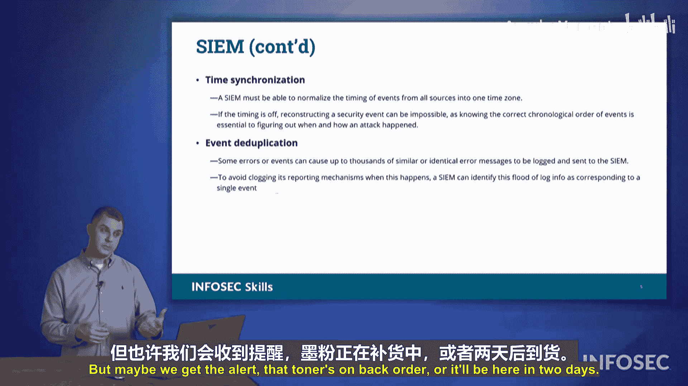

# 【Infosec】CompTIA安全 701认证 ｜ CompTIA Security+ 701 p47 08_01_06_security-information-and-event-management-siem -BV1LRr5BTEow_p47-

Monitoring what occurs on our networks is vitally important for organizations。

In this section we're going to be talking about the security information and event management。

 this is often seen as the go to dashboard， the all seeing eye of your security operations。

This is also known as a seam。Seeme as the security information and event management。Again。

 it is the all seeing eye。You and I as humans， we're simple creatures， we're going to get tired。

 we're going to get hungry， we're going to need to take a break。

 we're going to need go to the bathroom， there's any number of things that happens when we're talking about monitoring a network。

As we begin to look through different log files we're going to miss things when it comes to a seam it is not going to get tired。

 it's not going to need a break， it is always going to be vigilant。

 it's going to be watching what's going on here and so it's going to be able to grab all of the data coming from all the different network devices on our network bring them all under one roof and be able to digest those and provide us with information about the operation of that。

In the following slides， we're going to talk about the different features that a seam has and the different operations that a seam does for us。

The first thing that it does is it does log aggregation。

 it talks those different devices on our network， it brings them all under one roof。

And it grabs these log files and as it ingests those log files from routers and switches and servers endpoint systems。

As the different files and those logs come in， it is able to identify the various columns of information。

If you've looked at different log files， you may have noticed that certain files start with。

The hour minute second。Month day year。Whatever happened with the event log and then what computer was affected。

Others might start with what happened， what computer did it affect。

 and then it has year month day hour minute second others might have year month day。

 what system was affected， what was the time。The order gets mixed up right so as your seam ingests all this it can start to say。

 okay this is the year column， this is the month column。

 this is the day column it doesn't matter what order they're in in the log file as it ingests that information it's able to align them all together and keep those logs and reports。

Situated so they're all uniform in their structure。

 this allows it to then go through and provide some correlation between activities as we see with log files once we've ingested it。

 the scene is then able to go through and correlate the activities of what's going on when you go to sign in to the system。

You're signing in and then those different activities are going to be seen as， okay。

 that's one user logging in， checking their email， downloading this file， printing it out。

 and they're done for the day。that's the kind of activity that we would see。

They might have touched a dozen different systems when they were doing that that those log files are going to be there's going to be 12 different log files and they're going to be referencing the same sort of activity the same we'll be able to see all of that and say yep all of that is one user doing this thing。

And so we're able to then get a big picture of what's going on and instead of rather。

 instead of just looking at one individual network device。

 we're seeing the big picture with our seam。The other thing the seam can do is once it has correlatedlate these activities and one of those activities is suspicious or malicious。

 we're then able to fire off an automated alert。Or trigger some sort of response activity。

 it can automatically send you a slacklack message or a teams message。

 automatically create a trouble ticket or send out a page or a text message。

 it can alert your security theme a number of different ways。

You can also have triggered alerts and so it can automatically trigger some script that is going to be in response to some sort of activity。

Almost like what we have with an intrusion prevention system。

 alert might be raised with an intrusion and detection system， seeing something。

 the sea sees that says， yes， I agree that's a problem and it fires off a trigger to respond with some sort of a script。

Your team is also able to receive those warnings and those alerts and you can tune that and you can tune。

Fine tune if that alert is worth working with or not， you can say that's not a problem or yeah。

 that is a problem， that's definitely something I want you to catch each and every time。

And then the final point on this slide here is that we have quarantine if we see some sort of suspicious or malicious activity。

 we can quarantine the system， we can knock that system offline， we can pull the plug so to speak。

 removing access from that host so that they cannot spread malware or its malicious activity on the rest of the network。

The same is able to do all of these。The other thing a sceneM can do is if your organization spans multiple time zones。

 reaches around the world， your team is able to ingest those log files and adjust the time found in those log files to correlate with a single time zone。

 maybe you put all of your security activity lined up with coordinated universal time UTC。

And so what we can do with this is that way we're able to compare did all of these events occur at the same time or did they occur at different times it also helps because certain time zones around the world。

 not every one of them is a single hour apart here in the US it's quite easy are they an hour ahead。

 two hours ahead， three hours behind， two hours behind。And so it's simple round numbers。

 but around the world there are some time zones that are half an hour off and I think there's even some that are like 15 minutes off of another time zone。

 things can get really， really wacky when you start talking about time zones with the seam。

 not a problem it's just going to adjust all of those taking in the local time that it's at and then aligning it with UTC。

The other thing that your team is able to do is eventvent deduplication。

If the printer up on the fifth floor is out of toner， it can fire off a trouble take and see like。

 hey， I'm out of toner and then someone can place an order for that。

 but maybe we get the alert that toner's on back order or it'll be here in two days。 Meanwhile。

 the printer keeps on， hey， I'm out of toner。 Hey， I'm out of toner and it does that every five minutes。

Shut up， we don't need to hear that every five minutes your sea is able to just kind of squelch that down and just get like okay yeah you keep sending me alerts in case something is not right。

 but if it's about the toner I'm just going pack it away here and then we can just increment how many of those alerts we've received and maybe we see a thousand of them or something it's something we know about we're addressing it。

 we're dealing with it but we don't need to keep getting those alerts over and over and over that's what we mean when we talk about event deduupplication on the sea。

These different topics that we have regarding a sea are some of the things that you might see reflected on the exam when talking about a seam。

