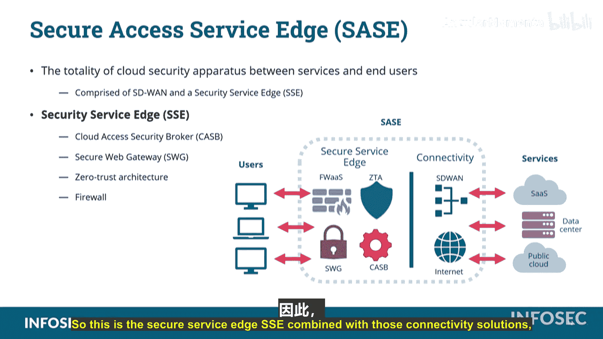

# 【Infosec】CompTIA安全 701认证 ｜ CompTIA Security+ 701 p48 09_01_01_virtualization -BV1LRr5BTEow_p48-

In this section we're going to talk about virtualization virtualualization has been a game changer across the IT industry。

 there are more and more organizations using virtualization。

 so much so that many organizations no longer even run their own data centers。

 instead they rely on virtualization and ultimately cloud in order to provide their data services。

In this section， we're going to talk about what is virtualization。

Virtualization is using a physical computer to simulate。

Another computer being able to run a virtual machine inside of a physical discrete computer， yes。

 there is hardware at some point， you do have a hardware computer running。

 but it might be running multiple different virtual environments where you have the operating systems running on that virtual machine。

This is the idea it goes back at his track back to the 1960s where the idea was first hatched。

 but it really didn't come into fruition until the mid to late 1990s。

 and then into the early 200s it has grown to become a major dominant force in the IT industry。

The best way that I have to describe virtual environments is if you think about how you can run a game emulator on some computers。

 what it does is it takes the hardware of the game console。

 it recreates that in software and then that circuitry is virtualized inside the software。

 that is the software， making the same logical circuits。

 interact with the software that has been written for it。

This virtual environment becomes a simulation， the operating system running in that virtual environment is not aware that it's not on a real computer。

 it thinks it's a real computer and we don't tell it otherwise。

The virtualization platform is often like if you remember seeing the movie。

 the Matrix with Kiiannorees and Lawrence Fishman。Inside this movie， there is this in the storyline。

 there are a bunch of these virtual。Characters in here。

 you have humans thinking they are living in reality。

 but in fact it is a virtual reality in the scifi movie， this virtual reality。

 this simulation is known as the matrixtrix。And it is when the matrix is realized as being make believe that it's not actually reality that。

Kre's character Neo becomes to discover that he has powers beyond what he thought was possible inside this reality。

 The storyline blurs what is real and what is not， but the whole process or the whole。

Storyline is based on these humans living in this virtual environment。

 every human is being run inside these little pods and they think they're living in reality。

 but it is not。When we're talking about virtual environments。

 there are some problems associated with that， one of them is known as VM Sprawl。

VM Sprawl is where you have the software that runs your virtual machine。Called a hypervisor。Now。

 at first， when an organization gets a new virtual machine。

 they begin to go in and launch a few different virtual machines， and it's not really a problem。

The departments that need a virtual machine or need a new server。

 they get one because it costs essentially nothing up front to launch a virtual machine if you are running that hypervisor。

However， as other department heads to get word that we can start up virtual machines and when we can have our own dedicated server。

 they start asking for some and because it costs nothing。

Many IT departments initially are okay to just give this away and let it run for free。

 but then more and more and more start asking it for it and soon you start overwhelming your hypervisor with too mini virtual machines and this just grows and grows and grows and suddenly you're overwhelmed with the number of virtual machines you're having to keep track of and the software that you're having to keep track of and keep patched and you're having to monitor all those systems and maybe provide compliance scans for all of these and the documentation and it becomes too much。

This is known as VM Sprawl because organizations don't recognize upfront the cost of managing each one of these virtual machines on a hypervisor。

And so with V and sprawl， the problem becomes in managing all that。

Because at some point those users no longer use those virtual machines。

 they may not tell you and you leave them running， and soon you're left with dozens or even hundreds of virtual machines。

That you have to patch and maintain because you don't know which ones are in use and which ones aren't。

And I almost guarantee the moment you take one of those machines offline。

 your phone's going to ring and someone's going to say， hey。

 what happened to our machine so VM sprawl can definitely be a problem for organizations。Next。

 we have the issue of VM escape。Once again， in the movie， The Matrix。

 you might remember that Neo woke up from his dream or what he thought was a simulation。

 he looked around and realized that this simulation is actually going on and this is a virtual reality that he was living in。

 what he thought was reality was actually made up。This virtual reality that he was living in。

Showed him that what he thought were the laws of physics， what he thought was real。

 was actually all in his head， it was all being imagined and it was controlled by the matrix。

The problem of the matrix was that。He was limited by what he could do in the movie。

 Lawrence Fishburn's character Morpheus teaches him how he can bend the laws of that reality。

 and we see this played out with VM escape。With virtual machines。

 if an attacker is on a machine and they realize， wait a minute， this is a virtual environment。

 this isn't an actual real computer。The the laws that say。

 I have to use a network to go from one system to the next。Those don't apply to me。

 I can do whatever I want， this is all running in a virtual environment in RA。On a hypervisor。

So I can bend the rules， I don't have to use a network to connect to another device。

 I can just pop over in memory and I can pop over there and I can pop over there。

Recall too that in the movie the matrixtri there was also the adversary Agent Smith。

 and if you remember on the movie Agent Smith is able to hop from one person to another at will。

 he's able to move anywhere because he's actually written like a small program and so he's able to hop from person to person to person because。

That reality that exists， it's all made up anyway， so he can bend those rules as he wants。

 Neil and Moreus also bend their laws of physics， and they got some great special effects in that movie。

😊，But VM escapescape is one of those things that keeps our。Virtual machine developers awake at night。

 they're always having to go back and patch that software。Because we have virtual environments。

 because we can virtualize the hardware that makes up a computer。

We can virtualize other types of hardware too， and we get software defined networking this is where someone are along the way someone said。

 hey， if we can virtualize a game console， if we can virtualize a small computer。

My router my router is a small computer Can we virtualize that My load balancer is a small computer。

 can we virtualize that My switch and so on， And so we ended up with all of our hardware being virtualized and run as software definedfined networking The benefit of software defined networking is that we get very responsive networks where we can change things with a click of a mouse and there's no actual physical rewiring needed Sure there's actual physical cabling for that last mile。

 but behind the scenes， we don't have a lot of hardware infrastructure instead it's all running in a virtual environment so we can implement a firewall we can implement a router and we can update those routers and we can change those routers and we can change as the firewall before or after the router we can click and move that piece of software around and the software will in kind。

This is known as software defined networking。Another virtualization concept to talk about is containerization。

 being able to run an application inside of a virtual environment so that that application can only access those pieces of data that we want it to access。

 it cannot escape out of that container。Indeed， if there is a piece of malware inside that container。

 if it was to spring its trap and go boom。It's only going to shut down that particular container and what do we do。

 no problem we click close and we bring it back up and it's as if it never happened。

 so containerization can help protect the overall integrity of the operating system that it is running on and it also protects data on that system if that malware was to run and try and gobble up all of the RAM available on a system。

Not a problem， the system might have 32 or 64 gigs of Ram。

But we only are using eight gigs for this one container。

 it's not going to shut down the whole system， it might hang up when we just go no worries。

 shut it down， bring it back up containerization helps protect the integrity of the overall system and also helps so we can run multiple copies of the same application on a single server。

All of this is made possible and referred to sometimes as infrastructure as code IAC。

Infrastructure is code， all of our back end， all of our infrastructure is being generated and operated as if it was all code this is what we mean we talk about infrastructure as code。

We also have this concept called serverless personally I sometimes cringe a little bit whenever I see serverless being used。

Because at some point you do have a server。Serverless architecture is defined as not having a single server that you rely on。

 if we need a server， we'll bring it up and bring it online and if we don't need it。

 we can shut it down as needed。Oftentimes we're running these things in the cloud。

 and so if we don't need those computing resources， we'll shut them down。

 I don't want to keep paying for a server I don't need。

And so you might have startups that say we're a serverless startup and so if we look at how the serverless architecture is structured。

 we can start to look at we don't have a single server where somebody goes， yep。

 our entire industrylies on or our entire business relies on this server no instead we have a serverless architecture if we need a server we'll start it up and we're paying for it only when we need it and we shut it down when we don't。

The ways that we can start these virtual machines and shut them down on a WiIim or enable software defined networking。

 interacting with different hardware devices on a whM like that。

We can utilize microservices and APIs。Microservices are these small services that we will query oftentimes。

 that we pay for a certain number of queries per month， and it provides small bits of information。

Abuse IPDB is one of these you give it an IP address and it's going to come back and say if it's good or no good。

 do all want to allow my users to it or do I not want to allow my users to connect to it and you're billed by the number of queries that your organization sends to them every month this is known as a microservice。

The ways that we interact with various pieces of software is through an automatic programming interface。

 an API。An API is this sort of program that we interact with through the predefined channels that has been set up for us。

 a programmer can write code to interact with an API depending on how the authors of that API have dictated。

Oftentimes， I relate to folks that an ATM， an automatic teller machine is very much like an API。

The bank has tellers in the lobby， you go in and you can talk to the teller and say like。

 I'd like to find my checking account， please I'd like to find out what is the balance on my savings account and they'll let you know what that is。

You can make a withdrawal， you can make a deposit， you can transfer money。But at some point。

 someone said， you know， we can make a machine that'll do this。

And you don't have to actually come into the bank during bankers hours。

You can check it at 11 o'clock at night。And so we have ATMs that are available 24 hours a day。

 you go and access those and the bank has defined these are the processes that an automatic teller machine will do for you。

 you interact with the bank through that and you can do all of those same processes as if you were interacting with the bank directly these processes have been defined and you're going to interact with the bank through those defined processes。

Now there might be certain things that you can't do at an ATM that the bank still does。

 for example you can't apply for a loan at an ATM， but you can still do those same basic activities through the ATM this is like interacting with the bank through an API that's whether the analogy of an ATM tracks back to an API。

As we spoke about earlier with software defined networking， we also have software defined。

Wide area networking， a software defined wide area network or SD WN。

Is utilizing the same concepts that we have with software defined networking。

 but instead we're doing it on a grander scale， we're interacting with various wAN links。

Software defineded wide area networks will interact with various wN links to determine what is the best and more capable route for data to take we might have a selection of different routes forake and they're going to come with different speeds。

 different latencies， different costs， and so the software defined wide area network will manage all of that for us so we don't really have to think about it it's going to make those decisions in the moment。

Finally， when talking about virtualization， we also have this new term called Sassy。

Secure access service edge and essentially what we're doing is it's our users interacting with the services that we have available to our users where we store our data。

 it might be in a software as a service solution， it might be in our data center somewhere。

 or it might be in the cloud somewhere。And then we have our users on this side where the users are connecting from various remote locations。

We will utilize different secure service edge security technologies。

To safeguard our users from our network， safeguard our network from our users。

And then also utilizing those sort of connectivity solutions such as S D WN and wide open internet to provide access to those services。

 So this is the secure service edge SSE combined with those connectivity solutions and we end up calling this the Sassy。

 the secure access service edge all of these solutions that we just spoke about are different ways that we can approach。

Virtualization and virtualization is a very hot topic and one we can expect to see on our security+ exam。

