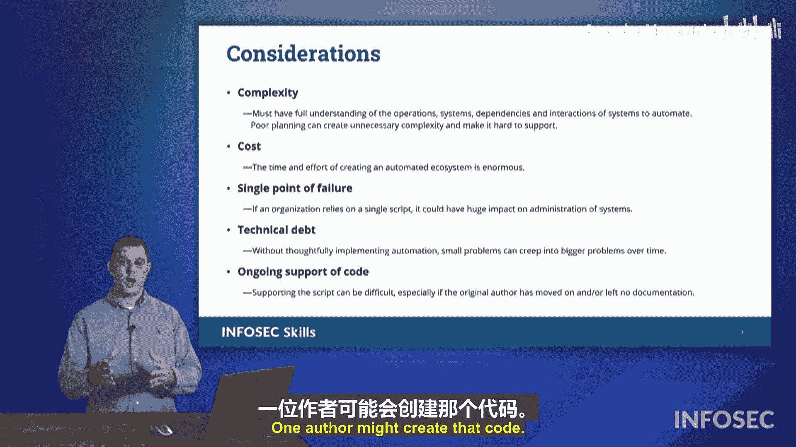

# 【Infosec】CompTIA安全 701认证 ｜ CompTIA Security+ 701 p49 09_01_02_orchestration -BV1LRr5BTEow_p49-

When working with large complex systems at an organization。

 it is important that we be able to manage all of those systems。

 one way we can do that is through orchestration and automation。In this section。

 we're going to look at ways that orchestration and automation can help。

Grow our workforce and we can utilize some workforce multiplication through the use of automation。

And when we're talking about orchestration and automation， we mean scripting and automated programs。

So you might have thousands of different systems that you can manage。

 but through scripting you can manage those with just a few people。

 that's what we mean when we talk about it as a workforce multiplier。

We also can make sure that we have consistent actions carried out each one of our systems。

For consistency's sake， use of automation ensures that we have the same exact changes made on each one of our systems。

 the same patches installed， the same reporting on each of them。Further。

 we can also receive a shorter reaction time for any sort of suspicious malicious activity as soon as your security apparatus notices something amiss on your network。

 an automated script can spring into action， carry out corrective activities before you even are aware。

This is a help that we have coming from automation。When considering the use of automation， though。

 we need to first be aware of the complexity that can involve our organization through these automated programs。

These scripts can become very， very complex， merely creating them requires you to understand all of the systems at your disposal and how they are all interrelated。

Affecting one system might have downstream effects on others， so be aware of that。

There's also a large investment， an upfront cost of both time and work hours when we're looking at creating all of the scripts to maintain operations at a large。

 sufficiently complex organization。You can also have a single point of failure if all of your scripts are reliant on one particular scripting language or one particular script working。

 if that goes down， the rest of your whole operation can be held to a standstill。

And then you also have this concept of technical debt technical debt is a term or phrase that we have coming out of computer programming and what it means is if we have one small problem。

 it can snowball into much larger issues， technical debt can grow through the use of scripts。

 especially whenever we compound the number of our scripts running across hundreds or thousands of different systems。

Further， there's also this issue of ongoing supportive code。One author might create that code。

 they may no longer work there years later whenever we need to go and address the shortcomings of that code and so you need to be making sure that all of your code authors are documenting what's going on and making sure that your personal are all trained so they can update and create new scripts to replace older ones all of these are considerations to be made whenever you're considering the use of automation and orchestration at your organization。

