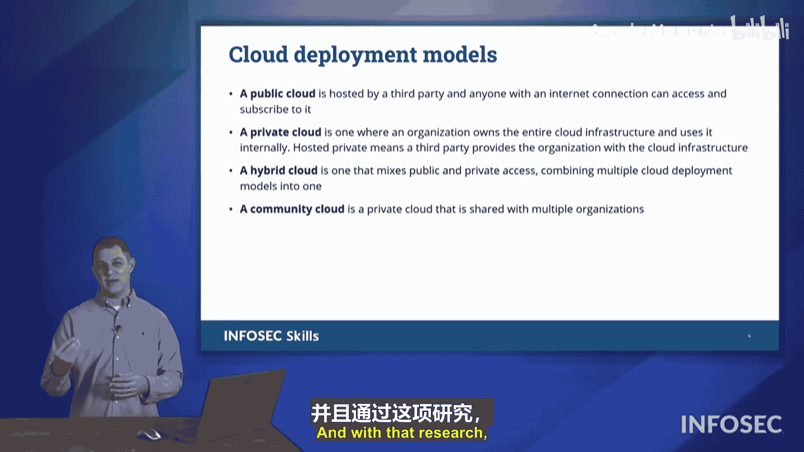

# 【Infosec】CompTIA安全 701认证 ｜ CompTIA Security+ 701 p50 09_01_03_cloud-service-models -BV1LRr5BTEow_p50-

In modern computing， we rely more and more on different cloud services。

Whenever we're purchasing a service from a cloud operator。

 whenever we want to activate a cloud account and we want to choose which type of service we want to run with。

 we will choose of these three different types that CompTA has put out for us on the security plus exam the three models that we need to be aware of are software as a service。

Platform as a service and infrastructure as a service。

With each of these we have a shift of responsibility between the cloud operator and the client。

 you and I， this is what is known as the cloud responsibility matrix。

 this shifting of responsibility from one model to the next and what our requirements are for our systems。

 what do we need to do in order to maintain the system and then what does the cloud operator do to maintain the system。

In all of these cases， the cloud operator is going to maintain the physical structure of the data center。

 redundant internet links， redundant power and power backup solutions。

 heating ventilation air conditioning， physical security。

 and the actual physical computer hardware itself。These are the responsibilities of the cloud operator beyond that is where we start getting into this cloud responsibility matrix that we see with our three service models again software as a service platform as a service and infrastructure as a service let's dive into what each of these look like the first one to talk about is software as a service。

With software as a service， this is probably the easiest one to wrap our heads around because we have already experienced using various types of software as a service。

My go to example with this is something like Google Docs。

Google Docs is not something that you install on a system， it's just software that you use。

 but it's not something that you install， it's just something you use as a service。And so。

Google Docs is software as a service option solution from Google。

The next one that we're going to look at is platform as a service。

Platform is a service if you're going to be building a web application。

The platform as a service that you might get will be a web server or a database server。

 they're providing you the platform upon which you can build whatever your solution is。

 you will then go back and fill in whatever the content of that web server is or whatever the content in that database is。

 you provide the content， they provide the platform。

And then the third option we have here is the infrastructure as a service。

 infrastructure as a service。Sometimes folks get a little confused about platform and infrastructure as a service。

 so here's what I want you to think about when you see IAAS。I want you to think about H。

AAS remember the letter H and letter I are right next to each other in the alphabet。

 so letter H hardware as a service when you see infrastructure think hardware。

Infrastructure as a service is where the cloud operator provides you with a computer。

They provide an operating system。And that's about it， everything else is up to you。

 they're giving you the hardware that you can use。But the operating system and all of the internal workings of that system are on you。

 you will install the web server， you will secure and patch that web server。

 you will install the database server， you will secure and patch that whatever applications you're going to install whatever security solutions you want to use that's on you you're just using their hardware。

As a service。On the exam， we'll see it listed as an IAAS。

 but you will think of it as HAAS hardware as a service。Taking this another approach。

 we can see how cloud operators。Provide different types of clouds。

 The first one to look at with this is。Public cloud， private cloud。

 and then that's some sort of a hybrid cloud。With a public cloud。

 this is what you think of whenever I'm talking about cloud operators。

 most of the time people think about AWS or Google Azure， Google app Microsoft Azure， Google cloud。

 this is。These are the different cloud deployment models。These different cloud operators。

Provide us with a public cloud。You plop down a credit card， you say one cloud。

 please and they provide the services。This is a public cloud。

There's also organizations that run private clouds。

 these are clouds operated and maintained by their team。

 by their employees for their internal corporate use。

Research institutions might have this large computing， powerhouses might do this， in fact。

 even Amazon， AWS。Has their own private cloud。AWS grew out of Amazon's need to have these computing resources。

 but along the way， someone said。You know， it'd be a great idea if we abstract all of this。

And we make this available to others as well， surely if we have the need for it， they do too。

 and so AWS was born out of their own internal private cloud needs。

They have then turned it into a public cloud， but they also maintain their own。Private cloud。

You can't go in plop down a credit， say， one cloud， please， they'll be like。Here's your card back。

We don't do that， we don't have a way to bill you， that's not what we do here。

And so a private cloud is one that you cannot access that is run and maintained by that organization for that organization。

We next have hybrid cloud， a hybrid cloud is where a private organization says we want to run a private cloud。

 but we don't really have the tools， hardware expertise。

Personnel to run this private cloud on our own。Let's instead have a public cloud operator。

Run this private cloud for us。You see whenever you have a cloud account。If you have a public cloud。

 your data is commmingling with a bunch of other systems on those virtual machines running in the cloud。

If you want your data to not commingle with others。You need a private cloud。

But if it's not part of your skill set to run a cloud， you might tell the public cloud operator， hey。

 will you run a hybrid cloud for me， will you run this private cloud for me even though you're a public operator。

And so for a fee， they will do that。The best case example that has come up in the news in the past few years is the Department of Defense has set up various cloud accounts。

 they have contracted with cloud operators， public cloud operators whose forte is running these different systems。

They will run this sequestered set of computing resources for DOD cloud that's considered a hybrid cloud。

 it's private。But it is being run by a public cloud provider。

And then the final one that we see on here is a community cloud this doesn't mean that your city or town comes together and says hey let's put together a cloud no instead what this is this might be a community of like-minded individuals my example for this is whenever you have faculty researchers at different academic institutions。

 they might be doing some grant funded research and with that research they might need some cloud computing powers that they will contract out with different public cloud providers。

One researcher sets up their services， they get it running。

 but maybe they need to hire an assistant can you help me run my my own computing needs here and they'll do that along comes one of their colleagues at another institution and says hey。

 I really like what you're doing can I。Pggyback on what you're doing。

 can I work with the same cloud computing resources that you've got and I'll chip in to help foot the bill for that。

And then another researcher comes in from another institution and another and another another。

 and soon there's a community of these researchers all researching the same kind of work and they're all paying into a pot to fund the cloud operation help pay for the assistant or assistants that run that。

 but they don't belong to any one's institution， nor will their funding sources come from the same funding source like the National Science Foundation。

Instead， they're going to pool all their money， pull their resources to run this cloud so that they can share data and research whatever it is that they have their own specific research interests into this would be an example of a community cloud。

So once again， be aware of software as a service。Platform as a service， infrastructure as a service。

 which you and I are going to think about as hardware。As a service and then public。

 private and hybrid cloud deployment models， these are the things to be aware of when we're talking about cloud deployment models on the security plus exam。

