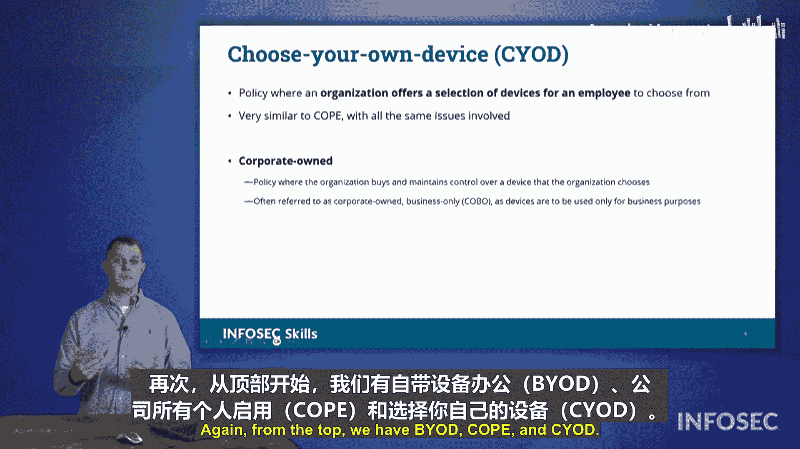

# 【Infosec】CompTIA安全 701认证 ｜ CompTIA Security+ 701 p51 10_01_01_mobile-device-deployment -BV1LRr5BTEow_p51-

With so many mobile devices in use at today's organizations。

 we need to consider ownership of the data and ownership of the device when looking at different mobile device。

In this section， we're going to be looking at mobile device deployment models。In this section。

 we're going to first look at who owns the device when you're looking at the handset。

That is independent of the data on the device。 It is also separate from the service provided for that。

 And so there are certain ownership concerns that a lot of organizations will have with this following that there are legal considerations to be made。

 You have to think about， well。Who owns this device， therefore who owns the data？

If you use your phone for work and you separate from your employer。Who owns that data？

If that data is on your device。The employer can't really compel you to do anything if you're not at that organization anymore。

So these are the back and forth legal concerns that a lot of organizations have when it comes to mobile device usage。

One of the things mentioned on the certification objectives is this idea of connectivity。

 I don't want to blow any minds here。But when you look at the list of different types of connectivity when it comes to cellular phones。

Check out this list it says that you can connect。A cell phone。Via a cell network。Whoa。

 I know that's really groundbreaking stuff but。The reason that it gets mentioned here is because a lot of organizations。

 you can put all the thought and effort and investment into securing your wireless network to protect against any sort of wireless network attacks that might befall your mobile devices。

 but recall that mobile devices can still just turn off Wifi and turn on cellular。

 and they can use their cell connection to circumvent all manner of security that you've got on your organization's network。

So mobile devices connect over cellular and Wifi you also have Bluetooth connectivity remember that Bluetooth is beening out。

Its unique identification， looking to make connection with other devices。

 And so Bluetooth can be a vector of attack for different forms of attacks against mobile devices。

 These sorts of connectivity are embedded with our mobile devices。In this section， though。

 we're going to be diving into the ways that we。Think about the ownership structure of these mobile devices。

In this section， we've got three different mobile device model to consider。

So mobile deployment models， we've got bring your own device， also known as BYOD。

We've got corporate owned， but personally enabled Cope COPE。

And then we've got choose your own device， CYOD， also known as corporate owned and business only。

So these three models are what Comptia wants us to know for the security plus exam。

 let's dive into BYOD。Bring your own device。The majority of organizations utilize BY OD。

 a lot of lot of organizations just say， no， we don't have any formal。

Agreement with our employees on how they use these cell phones if you have a phone。

 you can connect to your work email， you can connect to our professional networking apps such as teams or Slack you can message your colleagues from these mobile devices。

That's on you if you wanted to use that where there's no formal expectation from us。

The problem with BYOD for some organizations is。If you have data stored on your mobile device。

If you separate from that organization。You keep that data and so they may say well。

 we don't want you using your mobile device for anything。

 don't use your phone for work related activity because that information can leak out there's privacy concerns with it。

 data ownership concerns。If there is some data on your phone。

No one can force you to delete that data。Unless it's illegal content。

 but nobody can force you to delete that data unless the extreme the most extreme thing they could do is have you separated from the organization。

 they could terminate you， but they might draw a lawsuit against you but that's about it and so organizations are aware of this and they think。

 well if we have our employees using their own phones。

We really don't have any way of controlling what they're doing with that data that's one of the problems with BYOD is the employee owns the phone。

 therefore the employee owns the data， whether we want them accessing that or not and the most that we as an organization could do is terminate that employee but that still doesn't do anything to get our data back so BYOD for very security sensitive organizations is just simply not enough。

So what they do is they go and look at the next option that we have available to us we've got this whole concept of。

Corporate owned， personally enabled。This is where the data that is on the device， well that device。

 if you separate from our organization， that device is ours。

 we expect you to give that device back to it， No you can't take that device with you。

 It has all of this information on there and that's our device。Some organizers or some organizations。

Look at how different employees have access to the information。

 so they've got this personally enabled。The personally enabled side of this is we don't know where exactly our employees might live across the country。

 we have this kind of remote work trend across the country right now。

And with this personally enabled， we're going to give you a stipend。 You must have a phone for work。

 We own this phone。But we don't know what carrier works best at your home location。

 and so we're going to give you a monthly stipend to help offset the cost of enabling that phone you can choose whichever carrier you want。

 whichever has best service where you live or where you travel etc。And so。Corporate owned。

 personally labeled。The problem with the personally enabled side of this。

The legal side of this is yes， the phone， the device itself belongs to the organization。

 the data on it belongs to the organization， you must give that back to them。But。

The position of that device， any of the phone calls， the text messages。

 all of that is in the phone records。And if you are the one that has set up the phone service agreement。

That goes back to you。And so that's your information， look， even though we。

 the organization paid you a monthly stipend。We want to get that information。

 that information belongs to the person who enabled that contract。

 so even though there might have been a stipend involved to help offset that cost。

 it is still in that person's name legally， that's their data。So to sidestep all of this。

We have a third option on here and this is what a lot of the most secure security sensitive organizations use and that is choose your own device。

 CYOD， not bring your own device。Choose your own device。

Choose your own device is where an organization says， here。

We know that you iPhone users are loyal to that platform and that's the interface they want to use。

 Android users are loyal to that。Choose whichever one you want these are the two old crusty beat down phones that we're going to give you if you've ever had to choose from them。

 you know that these phones are not the latest and greatest phones they've been passed around a while and run over a few times。

 but you choose which phone you want to use。And this is a corporate owned device。

 the company owns it， the organization owns this device， and they turn on the service for that。They。

They talk to major carriers and they come up with and they negotiate for the best service contract they can to provide services for all of their users in this way the organization controls both the device。

Itself and the service and all data associated with those。 This is choose your own device。

 sometimes also referred to as corporate only。Or corporate owned business only COBO。

These are the three different types of mobile deployment models to be aware of on the exam again from the top we have BYOD。

COPE and CYOD be on the lookout for these on the security plus exam and be able to distinguish between them。

