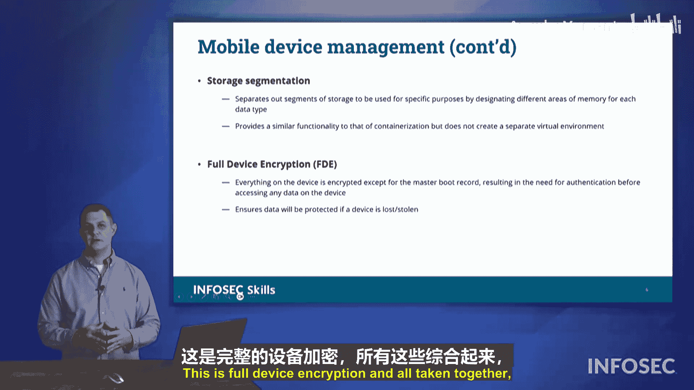

# 【Infosec】CompTIA安全 701认证 ｜ CompTIA Security+ 701 p52 10_01_02_mobile-device-management -BV1LRr5BTEow_p52-

Many organizations these days have mobile devices in the workplace。

Oftentimes an employer might issue to their employees a mobile device for professional purposes。

In this section， we're going to be talking about mobile device management。

And as we get into mobile device management， we're going to look at ways in which we can keep the data stored on these mobile devices safe and secure。

We utilize this。Software technology called mobile device management MDM and what we can do with this is we can help protect the information stored on mobile devices through a number of different security postures on the device itself and so what we can do is we can separate。

Personal activity and professional or business related activities。

 we can segment the data in the mobile device that way。

 we can also ensure that applications on the device itself are being kept safe。

 that those applications are from trustworthy sources and they are not going to undermine the security of the device itself。

Further， we can also keep the data safe by protecting it， either encrypting the data。

 forcing the use of encryption， or even destroying that data if we need to。

So as we look at ways that we can implement mobile device management。

 some of the terms that we see in this section are geofencing with mobile device management。

 we can enforce policies through the use of geofencing where you're located。

Might affect what permissions you have， for example。If your mobile device has a camera on it。

 maybe we don't want a camera coming into our research and development facility。

That could be a potential data loss issue。And so we disable cameras on people's mobile devices when they enter one of our facilities。

 what are our facilities willll set that up in the mobile device management software with geofeing will'll set waypoints around the property peri and then if you cross into that。

 the camera disables。Or you might say the camera is not enabled anywhere， but at work。

 we don't want you using your professional camera to take pictures。

Family photo events or whatever the case may be。So geo fencing is one of the things that we can have flowing out of mobile device management。

We can also require the use of push notifications， maybe we utilize push notifications you're going to get a message pushed out to your mobile device with a pen a one time pin that we'll use to log in as a form of multifactor authentication we're going to send that out we will also。

Safeguard those notifications by default， most mobile devices these days unless the device is unlocked will not show the content of a notification or a message。

 you might see what app it's from， you might see that you have some sort of notification。

 but until you unlock that device， you cannot see the contents of this。

The reason that exists is because we don't want an adversary grabbing our phone and having access to whatever that pop up is。

 because if they were to steal a user's password and they stole their mobile device。

 they could then type in the password and then when issued a pin。

The notification pops up and it shows them what that pin is they've now been able to break your multifactor authentication so by requiring you to unlock your device to see the contents of the message。

 you can help keep your device safe。This is the use of push notification。

We can also have remote wipe if a mobile device that it contains company data is stolen or lost。

You report that to support personnel and we can then issue a remote wipe command this wipes out all data on the mobile device and keeps the data safe。

That way it doesn't fall into the wrong hands， potential competitor or some adversary。

We can also enforce the use of screen locks if you walk away from your mobile device for a certain length of time。

 we can have the phone automatically locked。Typically。

 this is something that you can be in control of on your personal device and you can turn it off if you want。

 but if this is a professional use mobile device， we're going to require the use of a screen lock after 10 seconds。

 30 seconds you name it， I don't want you setting your phone down and walking away somewhere else。

We can also require the use of passwords or pens or even the use of biometrics to unlock the device using either a fingerprint reader。

 increasingly facial recognition， these are some of the device security controls that we can enforce through the use of mobile device management。

We also have this idea coming up called context Aware authentication。

Context aware authentication is this concept where when you go to request access for something it considers the context。

 it thinks about， well let's see what is the user's access level。

 what is the data they're trying to access what time of day is it where are they located do they have the proper security controls in place is this device operating in a secure manner。

 all of these things are part of the context in which the request is made to authenticate into a device or to have authorized access to some file。

Pay careful attention that this is something different than multifactor authentication。

 This is context aware authentication， it's considering the context。

 it's more than just asking about something you have， something you know。

In this case is looking at the whole context of the request being made and so this is going to include software like I said。

 security controls， like I said， it's bringing those in as well as geolocation information。

 so all this together forms the context of the request for authentication。Going on。

 we have in mobile device management， we have this concept of containerization。

Containerization allows us to create a container， a virtual execution environment where we can implement certain security controls on data。

So if we have different apps running on our phone in the container。

 it is not going to allow access to data on the mobile device。

If we were to somehow get a malicious app， it's not going to be able to grab data from elsewhere on our device。

 it is contained within that container。We also have the idea of storage segmentation。

 your mobile device， maybe you have it with you at all times when you're at work and when you're at home。

In order to safeguard your professional data and keep it separate from your personal data。

 we're going to keep these separated， we're going to segment the storage。

 we're going to allow you to keep a little bit of personal information on your mobile device just know that it's perhaps our mobile device and so that information is residing on our。

Product。But you have a small segment of data that is set up for your own personal use。

 whereas the rest of the data is going to be set aside for professional use。

 this is the idea of storage segmentation， you get a little bit here。

 we get a little bit here and that way we know how much data we're using on each side。

The final term that we have with mobile device management is the use of full device encryption。

Full device encryption encrypts all of the data on the mobile device。

 it is inaccessible if someone was to hack into your device or physically try to unlock that device。

 the data in the device itself is all encrypted。As the mobile device's operating system takes that data。

And writes it to memory， it is being encrypted as it goes into the memory。

It is talking to the device's trusted platform module as the key to encrypting that。

 then as the data flows back out of it， it decryptps so that the mobile device can make use of that。

This is a way that we can keep data on the device safe and secure when is stored and that data is at rest。

 this is full device encryption and all taken together。

 all of this helps make up what we are refer to as MDM or mobile device management。

