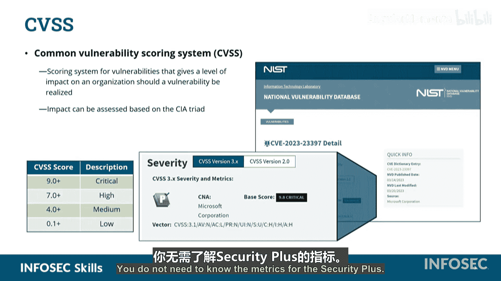

# 【Infosec】CompTIA安全 701认证 ｜ CompTIA Security+ 701 p53 11_01_01_vulnerability-identification -BV1LRr5BTEow_p53-

After performing a vulnerability scan， youll receive feedback from your vulnerability scanners and it will identify different vulnerabilities using an identification system。

The common way that we identify。Vulnerabilities is utilizing the common vulnerabilities and exposures identifier。

 This is an identification tool or scheme put forth by the MIre corporation。

The Mire corporation and outgrowth of MIT has created this naming convention with CVveEs common vulnerabilities and exposures。

 the CVE identifier follows the format CVE dash a four digit year dash and then some what the slide says is arbitrary what we mean by this is it is arbitrary in the sense that the number itself does not convey any meaning it is not say like oh this particular one is a 23000。

 so that must be it this type of vulnerability it's not like that the number is just a unique identifier the four digit year that's the year that vulnerability was disclosed or discovered。

And so think about how with COVID 19， you saw COVID 19， well， it was disclosed or discovered。

It was the coronavirus infectious disease from the year 2019。

 It wasn't really until 2020 that it hit the United States and so with Covid-19 we utilized that 19 moniker。

 that doesn't mean that it's not a problem in other years so when you see a CVveE with a year identifier don't let that fully in thinking。

 oh， that's an old vulnerability， that's not going to affect me today。

 you need to make sure that there has been a patch issued for that vulnerability。

The image you see here on the screen is the National vulnerability database。

 this is a clearinghouse or a warehouse of disclosed vulnerabilities， discovered vulnerabilities。

That the National Institute for Standards and Technology operates。

 The National vulnerability database is this giant catalog warehouse of different vulnerabilities。

 Each vulnerability gets an identifier in the form of CVE dash and in this case，2023 dash2，3。3，9，7。

That identifier specifies this particular vulnerability。

 and then there's going to be a description field below it along with some other information。

Key to the security plus exam is this CVSS that you see at the bottom if we kind of zoom in on that little section there。

 you'll see that the CVSS score is computed based on a number of different vectors。

That vector listing that you see at the bottom of that little zoom in box shows you the number of different metrics that you've got。

 you do not need to know the metrics for the security plus。

That it will be coming up on other cybersecurity certification exams。

 but not on security plus instead what we need to know is the CVSS is the common vulnerability scoring system。

And it tells us how。Impactful or how harmful this particular vulnerability is。

 A number of different organizations are CNs。 They are numbering authorities。

 They scan and compute how impactful this is。They come up with a base score based on those metrics that we just saw at the bottom。

And then that score that they generate is what you see here on the side。

 which shows that if you have a score from。Point1 up to four。That's going to be low。

If you go from four， I'm sorry from yeah， from four to seven， you've got medium from 7 to9。

 you've got high and then9 up to 10， that's critical that is。Drop what you're doing。

 you need to fix this now， this is a huge， huge problem。And there are potentially。

Level 10 vulnerabilities out there， these are the ones that will absolutely break your system if it was found to be exploited。

So the CVSS is how we identify how dangerous a vulnerability is and the CVE is how we name different vulnerabilities these are some ways that we can refer to vulnerabilities across systems and have a single common naming convention。

Be on the lookout for CVE and CVSS on the security+ exam。

