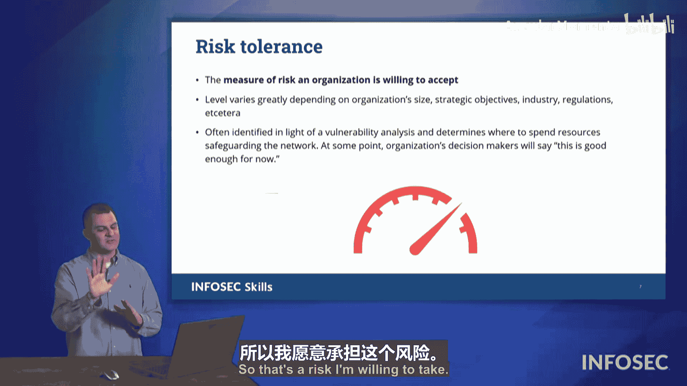

# 【Infosec】CompTIA安全 701认证 ｜ CompTIA Security+ 701 p54 11_01_02_vulnerability-analysis -BV1LRr5BTEow_p54-

After performing a vulnerability scan， it's important to go through the findings and analyze the different vulnerabilities presented from it and analyzing the results from that vulnerability scan。

In this video， we're going to talk about vulnerability analysis。In vulnerability analysis。

 the next step for us to look at is to determine are the findings correct or not？

So the first topic we're going to look at with this is true positive， true negative， false positive。

 and false negative。Let's first address what makes it true or false true means that the findings are correct。

False means the findings are incorrect。Positive， if we're doing a vulnerability scan。

 tells us that we have found vulnerabilities。 Negative means that we have not found vulnerabilities。

 So a true positive is going to say， I did find vulnerabilities and that。

Measurement or that detection is correct。If it says it's a true negative， it says。

 I did not find any vulnerabilities and that assessment is correct。A false positive。

Is going to tell you。I did find vulnerabilities when in fact it's incorrect。

 it should not have found vulnerabilities。A false negative is going to say。

 I did not find any vulnerabilities， but that finding is therefore incorrect。

 And so we're going to label that a false negative。

 The problem with false positives and false negatives is not only are they misreporting what's going on。

 but they can have knock on effects following after。For example， with a false positive， you say。

I found vulnerabilities well it might send you off on a wild goose chase trying to find how do I fix this problem。

 it says it has this vulnerability and I keep fixing it and I keep applying these patches and it's just not fixing the problem or I keep applying this security control and it's not fixing the problem。

The problem is is that it's a false positive， that vulnerability doesn't exist anyway。

 and so you want to make sure that you're not getting any false positives before you start spending these sort of money trying to fix some of these problems。

A false negative can also be extremely problematic。

 a false negative says no nothing to worry about here， don't worry boss。

 we didn't find any vulnerabilities， everything's all safe。When in fact， that finding is incorrect。

 there are vulnerabilities and it's still。Not detecting them。

 and so this is going to be an incorrect negative assessment， a false negative。

Be able to on the exam， determine if the example they're providing is a true positive。

 a true negative， a false positive， or a false negative。These terms will be used。

 you can expect to find at least one or two questions dealing with true positive， true negative。

 false positive， false negative， think about what is being assessed and if true or false what would be the impact with that。

The ways in which we prioritize different vulnerabilities is determined by how that technology is used at our organization what sort of mitigations are being called for to address the particular vulnerability that we're and looking at and so we might tackle these differently。

 some of them might be more involved and they're going to require more personnel or they're going to require us talking with different vendors or some of them might just be really cheap and easy to do and so we might be like hey。

 if you have a minute everybody on the team go and do this for us real quick and we're gonna be able to knock out a bunch of these vulnerabilities and so you might triage these and address them differently。

 you might have one or two people dealing with outside vendors looking for a solution or as you have the rest of the team going through and tackling whatever the particular vulnerability is and so the prioritization is going to vary from organization to organization based on how you're using the technology in question。

We can also go through and we can classify the vulnerabilities that we're dealing with。

 we can look at how big or small is this particular vulnerability。

 how many machines does this affect， how many users is this going to affect what type of system is it affecting or what version of software is it using so we're going to be able to go through and classify the vulnerability based on different metrics。

We also have environmental variables， the ways in which you use technology。

Might be unique to your organization and so what one person at a different organization might completely freak out about。

 your organization is kind of like meh， not a big deal for us， we hardly even use that In fact。

 we never even start up that virtual machine anymore。

We might as well just uninstall it or we were thinking about getting off of this solution anyway。

 we're going to， this is just going to hasten our shift over to the new solution and so how your organization uniquely uses different software is going to determine how impactful a particular vulnerability is for you。

The next term to talk about is impact being able to look at what is the impact on our organization when we're looking at this vulnerability。

 how would it impact us， we can have vulnerabilities that have different impacts。

 some might cause financial loss or cause reputational harm。

There's operational disruption we're not able to get orders shipped until this thing gets solved or we're not able to。

 you know our phones are down until this solution gets implemented there's a number of different things that can happen with that。

We can also face regulatory penalties， fines that can also be filed under that financial loss category。

You might also have partners that walk away， they don't want to do business with you anymore。

We're paying a lot of money for this service and it's not really helping us and it has actually cost us business and cost us some trust in the eyes of our clients and so we're just it's not worth it to us anymore to do business with you as an organization anymore they just walk away and so with this reputational harm that comes about you can have a lot of follow- on effects that can really impact your organization it's going to be different for each organization based on the amount of impact that a particular vulnerability has so you need to be able to consider the overall organizational impact and also the industrywide impact。

In recent history， we've had a number of incidents with airplanes， with aircraft manufacturers。

And so with this， the entire industry has now come under scrutiny and lawmakers are starting to look at。

 sit up and take notice and like， how are we regulating this industry and should we implement more regulation or not？

One company's issues have now spilled over and is now affecting other manufacturers who may not have had any issues。

 never have had any issues， and yet it's having an impact across the industry so just because it is something that you calculate and say yeah。

 this is something we're going to address or we don't think this is gonna to be a problem it can still spill over and affect others in the industry。

Finally， when we looking at different vulnerabilities。

 you need to consider risk tolerance risk tolerance is looking at how much risk are we as an organization willing to accept。

The level of risk that your organization is willing to tolerate is largely dependent on the type of industry that you're operating in。

 the the mindset of your leadership， the amount of budgeting you have for cybersecurity。

 there's often this。Kind of ongoing cybersecurity joke that risk tolerance is directly tied to the budget。

 If we have allocated a certain amount of money， we've spent all that money。

 anything above and beyond that that we need to fix。 That's a risk I'm willing to take。

 I'm not going to spend any more money on that。 so that's risk we're willing to tolerate。

 It could be catastrophic， but we've already allocated money， so。

That's a risk I'm willing to take it's the joke is that risk tolerance is always equal to。

The amount of cybersecurity budget you have to work with。

 all of these together taken together looking at different vulnerabilities with your organization。

 ways that you can analyze vulnerabilities be on the lookout for some of these terms on the security plus exam。

