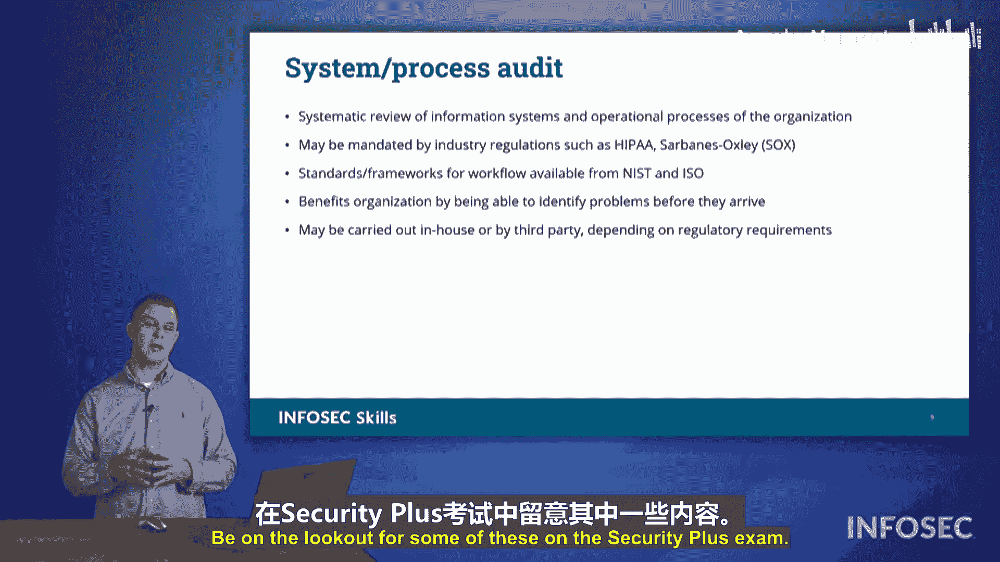

# 【Infosec】CompTIA安全 701认证 ｜ CompTIA Security+ 701 p55 11_01_03_vulnerability-management -BV1LRr5BTEow_p55-

With any organization it's important for us to be able to spot any vulnerabilities before they become problems we want to be aware of what our potential problems could be so that we can deal with them in this section we're going to be talking about vulnerability management。

And ways that we can spot various vulnerabilities or learn about vulnerabilities。

Other sources of information you can use to glean information about vulnerabilities is open source intelligence。

Open source intelligence is where you use any publicly available information to learn more about attacks that are happening。

 vulnerabilities that have been spotted or other organizations sharing what they are seeing on their networks this sort of information is useful and can be gleaned from the open internet。

 social media， etc lots of information is shared in open source intelligence circles。

The problem with open source intelligence is that you might have to wade through a lot of information to glean actionable information。

To help condense what this is， we might rely on proprietary intelligence proprietary intelligence is where you turn to an organization that has collected and curated information they've sifted through all of the information to cut out any redundancy that is on there you're not reading the same articles over and over and over only to pick up a minute small detail about it they've done all that reading they've collected all those minute small details so that you have a report that has less less filling and it is more focused on。

The vulnerability at hand。You have a higher signal to noise ratio with this because it is proprietary。

 it is not for public consumption it's not to be shared widely among organizations proprietary intelligence serves their purpose because you're not having to go through and weed out all of the fluff that might be included in the narrative of other articles。

We can also rely on the deep web， on sometimes even the dark web。

 the deep web is that information that is available on the open internet。But it is not。

Readily found on search engines， it's not being indexed by the major search engines。

You have to know where to look whenever it comes to the deep web。

Deep web information is information that's not really being hidden per se， it's out there。

 it's just the search engines are not there to pick it up。

The Deep web can be a very useful tool and a great resource。

Another resource is the dark web or tourR。TOR stands for the Onion Ror Network。

And what ToOR does is it receives data from users， you have either an entry node。Or a relay node。

And on these nodes on the ToR network。Every link gets encrypted。

 every hop in the Tor network gets a new layer of encryption added onto it。

So your communication from point to point to point is randomized and it is also providing some confidentiality on top of all of that it makes it incredibly difficult to determine who sent the original information。

 where did that packet originally come from because you have layer upon layer upon layer of encryption。

 hence the name， the onion router because it's like layers of an onion。

 the different layers of encryption that is available on there。

The problem with the dark web is because it provides that confidentiality and it makes it hard to track who is on there。

 a lot of hacker types are utilizing the dark web for illegal activities。

And so you want to be careful about using ToOR， it's not illegal to use。

 but there's a lot of illegal content on it。You certainly would not want to use ToOR from your corporate network without lots of approval。

 lots of clearances， and people signing off on that sort of activity。

Organizations such as those proprietary reports that we talked about will search and glean the dark web for information on the dark web are。

Hacker type forums where they can share information。

 one one actor might say look I hacked this major corporation。

 here's proof of it and they're going to show that proof to others or they might say I collected all of these credit cards and identities of these customers at this organization。

 I'll sell them for a dollar apiece and they have thousands of them。

The dark web is a place it's a lot of CD characters that are there， be careful about it。

 but it is a wealth of information about what are the hackers doing and what is their interest。

 what are they up to and what's coming next。We can also rely on other organizations in the form of intelligence sharing。

Intelligent sharing groups such as ISAACX and Sixes。

IsSAC stands for an Information Sha and Analysis Center。six is a security information exchange。

These communities， these bodies， exist to share information between organizations who might be in the same industry。

 the same organization size， or the same geographic location。

These organizations will share their information so that they can be on the lookout for one another。

 it's a form of circling the wagons， if you will。It's a common unified defense against our adversaries who might seek to undermine one organization or another。

It's not unheard of for organizations who might be competing in the marketplace to be sharing cybersecurity intelligence and information between each other sure Coke and Pepsi might be duking out in the marketplace Ford and Chey might be going after one another in terms of customer sales but on the back end their security teams could be sharing information with one another how to keep each other safe so just because we see them as competition in the marketplace doesn't mean that we have an adversarial approach to our competition takes a common unified defense for us to all remain cyber secureure。

We can also have teams that will come in and perform a penetration test on our network。

 they will launch a simulated attack on our network， we will partner with them。

 we will sign plenty of agreements， we'll talk about this more later。

And then these penetration tests will then exploit any sort of detected vulnerabilities。

 and they will be able to tell us， should an attacker try to exploit these vulnerabilities on our networks？

What might they have access to a penetration testing team is made up of good guy hackers and they're going to share their findings with us documenting what they've done。

 how they did it， and what they had access to。I'm more。

Automated approach is going to be using vulnerability scanning software as we spoke about earlier。

Vulnerability， scanning is software that is doing this and it's an automated process。

 penetration testing is the human element and it is not going to be an automated process。

We can also rely on other humans to help with bug bounties， a responsible disclosure program。

If a vendor creates a new product and they want to make sure that that product is safe and free of as many vulnerabilities as possible。

 they might partner with someone like Hacker One， Hacker One is a marketplace where bug bounty hunters。

Folks like you and me that go in and try to find vulnerabilities with these products before the adversaries do。

We find these bugs in the programs， we turn around and tell the vendor about it， hey。

 this new product you're about to launch， it's got this problem and this problem and this problem。

 these need to be addressed。And the organization， thankful for your work。

 will pay you according to the severity level of the risk provided by that vulnerability。

So these bug bounty programs are a great way for organizations to partner with。Creative。

 good guy hacker types who want to。Have a challenge in front of them。

 but they want to make sure their product is safe and cyber secure before they go to market with it。

And then finally， we can also go through and determine what sort of issues。Are present。

 what sort of vulnerabilities are present in our individual processes within our organization。

 the ways that we carry out our processes， and so this might be required by law。

 by industry regulation or through some sort of compliance response that we've got these different processes we're going to walk through and step through and see what are the vulnerable steps in here that we need in order for our organization to continue to operate as usual。

In this section， we've talked about ways that we can learn about different vulnerabilities。

 be on the lookout for some of these on the security plus exam。

