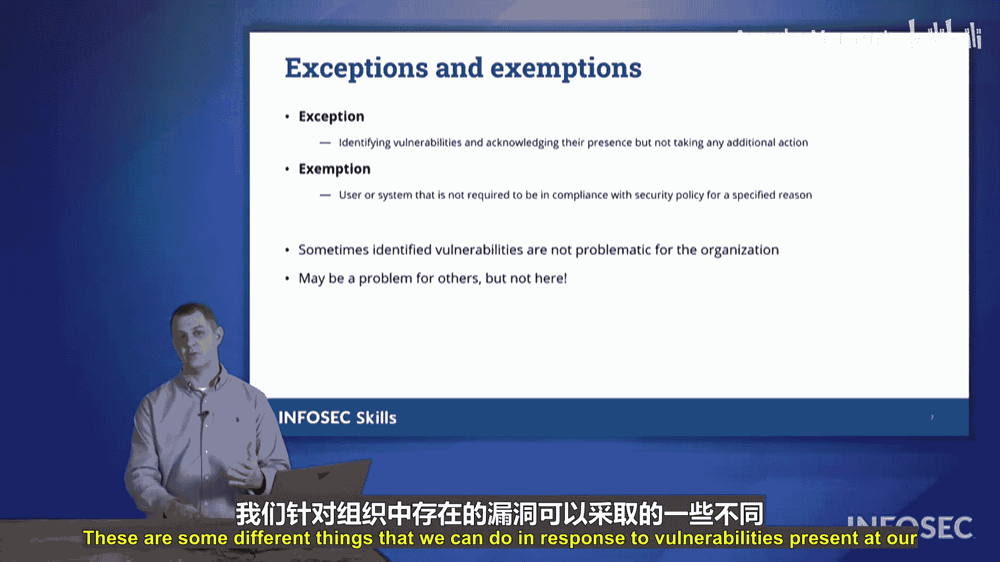

# 【Infosec】CompTIA安全 701认证 ｜ CompTIA Security+ 701 p56 11_01_04_vulnerability-response -BV1LRr5BTEow_p56-

Once we've detected vulnerabilities present on our systems and network at our organization。

We need to take some form of action and response to it in this section， vulnerability response。

 we're going to dive into things we do in response to these vulnerabilities we're now made aware of。

The first thing we're wanting to do is patch those systems。

 we're going to seek software updates and patches from software vendors and product manufacturers to ensure that we can continue to use their products in a safe and secure manner。

If we cannot patch that software， if we cannot patch that system。

 then we must segment it from the rest of our network， we're going to keep that system operational。

 but we may isolate the system， we may segment it off so that no other devices on the network can communicate with it or maybe so that cannot communicate with the internet and so forth segmentation is a way that we can subdivide the network into smaller bitesized pieces so that should malware take root on a system it is not spread throughout the whole organization We're going to be able to limit the impact or the scope of the impact on our corporate network through the use of segmentation。

Next， we can also utilize cyber insurance cybersecurity insurance does not in itself prevent cybersecurity attacks。

 instead it limits the financial impact to our organizations。With cybersecurity insurance。

 should a cyber incident come to pass and you're doing everything you should be doing？

The cybersecurity policy will pay out to your organization to limit the financial harms done by that cyber event。

Cybersecurity insurance is going to require of your organization in order to maintain your policy。

 regular security testing and proven documented security policies that you have in place。

 they're also going to want to make sure that you're operating within industry regulations that you're not leading yourself exposed in some way and further they want to make sure that the employees at your organization are receiving proper cybersecurity training and they want to see proof of that。

Indeed， some of you are seeking your security Plus certification so that your employer or future employer can check that box on a cybersecurity policy。

 they want to know that you are cyber aware and you know how all of these different security controls and measures inter work。

Next we have compensating controls， we might implement a number of different mitigations in response to various threats and vulnerabilities。

Sometimes those mitigations have with them weaknesses and so we want to。

Address those weaknesses by offering up even more。Security controls。

 some sort of compensating control。We talked before about how we want to protect our systems so that we don't have unauthorized users logging in。

 and so there's a certain risk involved with that。How do we keep unauthorized users from accessing our systems？

We're going to use。Passwords。But we still have that little weakness found in there because some users are going to use some super weak passwords。

Adversaries are going to be able to guess those and so what do we do we compensate for the weakness found with just passwords alone and we utilize some other forms of authentication we utilize multifactor authentication to overcome that weakness to compensate for that weakness of that security control this is yet another thing that we can do in response to some known vulnerabilities。

Further， if we've scanned for vulnerabilities and we have found certain vulnerabilities。

 once we've taken corrective measures， the next thing we can do is to validate those findings。

 We want to make sure that we're not falling for some false positive。

Recall that a false positive is where a vulnerability scanner says。Hey chief。

 it looks like I found something on the network， this is a problem。

And you go out and you search for what is that vulnerability going to look like， have I corrected it。

 does this fix the problem， did that fix the problem？

And you're going to validate those findings because it may not be a vulnerability at all。

 and you might be spinning your wheels or going in a wild goose chase。

 looking for a vulnerability that does not actually exist， that's a false positive。

So one way that we can do this is to validate those findings。

 we're going to rescan those vulnerabilities or we're going to audit and we're going to go through and look for and say。

Does this mitigation line up with that vulnerability that it's finding there。

 Does that correct for that， We want to verify those results by running it again。

 we're going to validate its findings。 And then we're also going to document。

What we've done and how it fits into the grander scheme of things。

But one of the things you're going to do in your validation is you're going to scan the systems again。

If you get a false negative。Remember， a false negative with your vulnerability scan is whenever your vulnerability scanner does not detect any vulnerabilities。

So what do you do Well， I bring out a little virtual machine that I keep just in case and it has some known vulnerabilities if my vulnerability scanner is saying there are no vulnerabilities I can bring in my vul machine put it out there and my vulnerability scanner better see those vulnerabilities if it doesn't then I know I've got a problem with my vulnerabability scanner because it's not picking up these vulnerabilities that I know are present on my vulner machine。

And so in that case， I'll turn that virtual machine off that vulnerable system。

 put it away until next time， and then I can address the problems with my vulnerability scanner。

And then lastly， once we have gone through and we've identified some different vulnerabilities。

 we've taken corrective actions for them， we're going to document our findings and some of those findings are going to fall under exceptions and exemptions。

An exception is where we acknowledge the presence of it， but you know what。

 I'm not going to take any actions on here because I know that's an issue。

And there's nothing I can do with it。 and so I'm going to sit on this。Issue for now。

 maybe I'm aware that a patch is forthcoming I've contacted that vendor and said I've got this issue。

 When is a patch going to be ready。It'll be ready in about 45 days or it'll be ready in about 35 days。

Well， we might have a policy internally that says we must address all vulnerabilities within 30 days。

 have them corrected within 30 days， so what do we do we make an exception in this case because a patch is going to be coming out shortly after that 30 day mark we're going to document that we acknowledge that there's a problem here and we're waiting on that patch it'll be here soon。

Or you might also have an exemption， an exemption is where you have a system that says。

This system is exempt from following those rules， such as my little virtual machine that I bring out from time to time to check on my vulnerability scanner。

 I know it has vulnerabilities。Our policy says we can't have any known vulnerabilities on our network of these types。

 but this one's an exemption， this one's exempt from the rules because I keep it offline and I never use it except for whenever I need to test our vulnerability scanner。

 we'll document these findings and that will be an exemption that we have for this。

These are some different things that we can do in response to vulnerabilities present at our organization。

 be on the lookout for some of these on your security plus exam。

