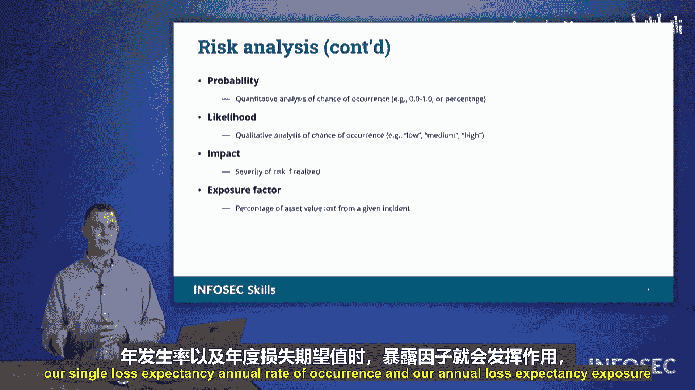

# 【Infosec】CompTIA安全 701认证 ｜ CompTIA Security+ 701 p57 11_01_05_risk-analysis -BV1LRr5BTEow_p57-

So we've identified our vulnerabilities。We've listed out threats and now we begin to perform risk analysis。

With risk analysis， we have two terms to talk about， we have two approaches to this。

 we have qualitative and quantitative。Quallitative is subjective it's based on experience and it's all about your perception of something going on have you talked to a former experienced colleague before and then like they' were like oh this is going to be bad。

How do you know？Well， trust me， I know I've been here before， I've seen this before。

They are speaking from experience， they have seen this kind of set before they know how it's going to go that is a qualitative assessment of what's going on。

There's also the quantitative side of things and whenever you do quantitative you're starting to look at numbers。

 the root word here is quantity， it's a measurable。

Analysis of what's going on you're starting looking at what what are the impacts that we've got or how much is this going to cost us what is the probability that this is going to occur and so this is going to be a quantitative assessment based on the quantity of something and so look at the root where they quantitative know that that's the numbers and qualitative is more about the experience we have two different approaches here they are both being informative about how a particular risk might come to pass。

Looking at some of the factors of our risk analysis， we have the probability and likelihood。

Consider for a moment how rain showers come up the National We Service puts forth a probability of precipitation with a forecast and that probability is going to tell you a certain percentage for a forecasted regional area and so if this says there's a 50% chance of rain。

They're not saying well it it might not， instead they're saying for 50% of the forecasted area it's going to receive precipitation。

 this is the probability of rain in this particular forecast。

The qualitative side of this is likelihood and this is whenever you ask， you know。

 you ask an all time and they're like， well， yeah， it looks like it's going to rain。Oh。

 how do you know well， there's a chance to rain because。You can smell that， you feel the wind。

 it's informed by experience， they know what the clouds look like in this area。

 they know what it's going to be like， and so they know the likelihood of this。

They're not going to affix a number to it， they're just going to tell you， yeah。

 rain's likely or no it's probably not going to happen， this is likelihood。Probability is the number。

 likelihood is more informed by experience， and it's going to be generally high middle and low。

And then impact is whenever you start to look at how does our organization get impacted by this particular event。

 should this event occur？What is it going to look like， how is it going to harm us。

 how is it going to disrupt our business operations， this is the measured impact that we've got。

And then the final term that we see here is the exposure factor exposure factor is how you begin to calculate the financial impact。

For an organization。Take for example， if you have a window。If it cost you $1，00 for that window。

And one pane of glass in that window gets broken。How much does it cost。

 what is the exposure factor you have on that window if one pain gets broken。

 if you're going to replace that one pain for $500。Your exposure factor is 50%。

If you have some sort of insurance taken out on those windows and you only have to pay a small deductible on that。

 say $100 to get the whole window replaced。If it cost you $1，000 for the asset， the window。

 and it only costs you $100 to replace it。Your exposure effect on that is 10%。$100 is 10% of 1，000。

On the exam the numbers they're going to be using with this are going to be very very round numbers we're talking $100 or $250 or $500 out of 100 so you're looking at 10% 25% or 50% something along those lines this is exposure factor and where exposure factor fits into the grand scheme of things we start to work into the single loss expectancy that's going to be coming up on a future slide that we've got when we're getting into calculating our single loss expectancy annual rate of occurrence and our annual loss expectancy exposure factor comes into play with that。

These all come together。Probability， likelihood， and our impact all work together as part of our risk analysis process。

